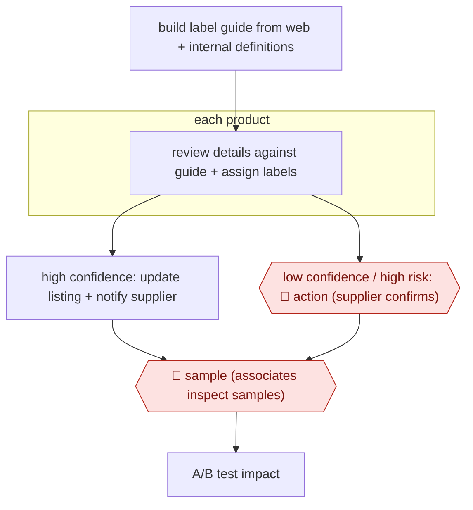

# Supplier-confirmed catalog fixes

`COM › RET › CATALOG` · sampled · evidence B · **draft: needs a reference example** ([how to add one](../../../../../CONTRIBUTING.md#1-add-an-example-run))

**Shape:** `build label guide from web + internal definitions → each product: review details against guide + assign labels → high confidence: update listing + notify supplier | low confidence / high risk: 🛑 action (supplier confirms) → 🛑 sample (associates inspect samples) → A/B test impact`
**Variants:** `openai`

<!-- shape diagram: generated by scripts/build_diagrams.py from `shape`; don't edit -->

<!-- end shape diagram -->

## Background

A marketplace holds listings that suppliers wrote, and suppliers describe their own products loosely: a "wood" side table may be veneer, a "leather" bag may be bonded leather. Customers filter on those words, so a wrong one is not a typo — it sends people to products that do not match what they wanted, and it is a consumer-protection problem when the word carries a legal meaning. Fixing it at the scale of a million listings by hand is not possible, and letting a model rewrite supplier content unasked is worse, because the supplier is answerable for what its listing says. This workflow has a model review each listing against a guide that defines what each label means, assign the labels, and split the outcome: where it is confident, the listing is corrected and the supplier is told; where it is not, or where the change is risky, the supplier is asked to confirm first. A sample of products is then inspected physically by staff, and the effect of the corrections is measured by A/B test rather than asserted. The split is the design: the agent decides when to ask, not what the answer is.

**Terms:**
- **listing**: the product page a supplier provides, with its title, description and attributes.
- **label**: one controlled attribute value — colour, material, size — that customers filter on.
- **label guide**: the written definition of what each label means, and what evidence justifies using it.
- **high risk**: a change where being wrong has legal or safety weight, such as a material or a flammability claim.
- **supplier confirmation**: the supplier's agreement to a change on its own listing.
- **associate sample audit**: staff ordering or retrieving products and checking the label against the physical item.
- **A/B test**: comparing the corrected listings against the old ones on impressions and clicks.

## Build it with an agent

**Form:** `service`. A million listings are reviewed in batches with nobody starting each one; people appear at the supplier confirmation, the physical sample and the test design.

**You need:** the label guide as a versioned document, one entry per label with its definition and the evidence that justifies it; the listings themselves, with supplier contact details; a way to write to listings that carries the change's provenance, so a supplier can see what changed and why; a channel for supplier confirmation that leaves a record; a sample-purchase process for the associate audit; the analytics for the A/B test. The agent must not be able to change a listing that a supplier has disputed, and must not send supplier communications outside the approved template.

| Step | Built as |
|---|---|
| build label guide from web + internal definitions | The Skill drafts the guide from public standards and the company's own definitions, and the category team approves it; the guide's version goes into every change record. |
| each product: review details against guide + assign labels | A script batches the listings through the review; the Skill assigns a label only with the evidence it used quoted, and marks the listing "no change" when the guide does not cover the case. |
| high confidence: update listing + notify supplier | Writes go through the listing tool, which stamps the change with the guide version and the model version; the supplier notice is generated from a fixed template and logged. |
| low confidence / high risk: 🛑 action (supplier confirms) | The change waits in a confirmation queue addressed to the supplier, and the listing keeps its old value until a reply arrives; a material or safety label always takes this path whatever the score. |
| 🛑 sample (associates inspect samples) | A scheduled sample of changed listings is bought or pulled and checked physically, and the result is reported per label so a bad label class can be paused. |
| A/B test impact | The Skill proposes the test design — which listings, which metric, how long — but the test is read by the team, and no listing change is called an improvement before it. |

**Checkpoints:** `action`: the confirmation queue is the only route for a disputed or risky change, and the listing tool refuses a write whose change record lacks either a confidence above threshold or a supplier reply, so the agent cannot talk its way past it. `sample`: the sample is a physical check by staff and it is the check the model cannot substitute — it is what catches a label that is confidently and consistently wrong, which is exactly the failure the A/B metrics would not show. High-risk labels are routed to `action` in the policy, not in the prompt.

**Since the sources:** Sources date from 2026-09: one vendor case study, which is also the public run, opened this month. It reports the scale and the test result; it does not publish the routing thresholds or the sample rate. What has changed since: the routing rule has been written up as a general policy for catalogue work. A 2026 practitioner account sets out [an explicit promotion policy — confidence plus no conflict with an existing asserted value; a conflict always human; a legal or safety attribute human regardless of confidence — and warns that editing supplier-asserted content in place loses the difference between what the supplier said and what a model inferred](https://paragraph.com/@techcirkle/building-a-product-catalogue-enrichment-pipeline-that-doesnt-corrupt-your-data). That is the part this build takes up: the change record carries both the asserted value and the proposed one, which is also what makes a supplier dispute answerable.

*A design based on this entry's steps and the tool documentation as of 2026-11, not a reported run.*

## Steps

*As reported by the sources.*

1. Generate a guide explaining what each label means, using web information and Wayfair's internal definitions [[1]](#sources).
2. Models review product information against the guide and assign labels (color, material, size) [[1]](#sources).
3. High confidence: update content directly and notify the supplier. 🛑 **Action**: low-confidence or high-risk changes need supplier confirmation first [[1]](#sources).
4. 🛑 **Sample**: associates inspect product samples in a structured audit [[1]](#sources).

**Output:** Corrected live listings; impact measured by A/B test.
**Failure modes → guards:** Wrong edits to supplier content → confidence and risk routing to supplier confirmation.
**How it differs:** Instacart/Walmart (above) route doubts to internal auditors. Here the external supplier is the approver for risky changes and live listings are edited in place, so the checkpoint owner and the deliverable differ.

## Public runs

Coverage as of 2026-11-06: **Weak**: only anonymous, vendor-linked or journalist-told accounts. Collected and re-checked in [Second collection pass](../../../../../research/2026-11-second-pass.md).

- [OpenAI, Wayfair](https://openai.com/index/wayfair/) (2026-09-25). Over a million products processed; A/B test showed more impressions and clicks. "has processed more than 1 million products". *First-hand: vendor; confidence: med.*

## Sources

1. OpenAI, Wayfair boosts catalog accuracy and support speed with OpenAI, 2026-09-25. https://openai.com/index/wayfair/
