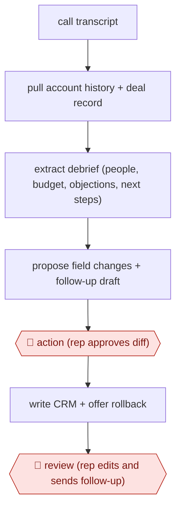

# Call-to-CRM diff approval

`COM › SAL › DEAL` · assist · evidence B · **draft: needs a reference example** ([how to add one](../../../../../CONTRIBUTING.md#1-add-an-example-run))

**Shape:** `call transcript → pull account history + deal record → extract debrief (people, budget, objections, next steps) → propose field changes + follow-up draft → 🛑 action (rep approves diff) → write CRM + offer rollback → 🛑 review (rep edits and sends follow-up)`
**Variants:** `claude-salesforce-mcp` · `claude-code-fathom-gmail`

<!-- shape diagram: generated by scripts/build_diagrams.py from `shape`; don't edit -->

<!-- end shape diagram -->

## Background

After a sales call, the salesperson (the rep) has to record what was learned in the CRM, the shared database of customers and deals, and send the customer a follow-up. Every call with a prospect or customer triggers this. By hand it is slow and easily skipped, so records fall out of date, and when it is rushed the notes can claim a budget or a commitment that nobody actually stated. The agent reads the call transcript and the deal's history, proposes exact changes to the CRM fields and drafts the follow-up. The rep approves every change before it is written and sends the follow-up personally, because the CRM figures feed the company's revenue forecast and the email is a commitment made to a customer in the rep's name.

**Terms:**
- **CRM**: customer relationship management system, where accounts, contacts and deals are recorded.
- **Opportunity (deal record)**: the CRM entry for one potential sale, with its value, stage and expected close date.
- **Stage**: how far a deal has progressed, for example discovery, proposal or negotiation.
- **ARR**: annual recurring revenue, the yearly value of a subscription deal.
- **Debrief**: a structured summary of the call: who took part, budget, who signs, pain points, objections and next steps.
- **Diff**: the list of fields that would change, each with its current and proposed value.
- **Rollback**: putting back the values a record held before a write.

## Build it with an agent

**Form:** `skill`. One rep handles one call at a time and stays in the conversation to approve the changes and the draft, so a single skill is enough.

**You need:** the call transcript, from the meeting recorder's export or its connector; a CRM MCP server that can read accounts, opportunities and activity history and update fields; a mail or document tool that can only create drafts; a few of the rep's past emails beside the skill as examples of their voice. Call transcripts and CRM records hold personal and commercial data, so use a setup your organisation has approved for them. Do not give the agent a tool that sends mail.

| Step | Built as |
|---|---|
| call transcript → pull account history + deal record | The skill's first instruction: read the transcript, then fetch the account, the open opportunity and recent activity through the CRM MCP server. |
| extract debrief (people, budget, objections, next steps) | The main conversation fills a debrief template kept beside the skill. Every field quotes the transcript line it comes from, or stays blank. |
| propose field changes + follow-up draft | The skill prints a table (field, current value, proposed value, transcript quote) and writes the follow-up as a draft in the rep's voice. |
| 🛑 action (rep approves diff) → write CRM + offer rollback | A permission rule set to ask before the CRM update tool. Before writing, the skill saves the current values to a file so it can restore them if the rep asks. |
| 🛑 review (rep edits and sends follow-up) | See Checkpoints. |

**Checkpoints:** `action`: the skill stops after printing the diff, and the CRM update tool is under an ask rule, so each write shows the rep the exact fields before it runs. `review`: the follow-up exists only as a draft and the agent has no send tool, so the rep edits it, attaches the files and sends it from their own mailbox.

**Since the sources:** Sources date from 2026-06 to 2026-09. Source 2 is one seller's account of a single Claude skill run on call transcripts, which is the form chosen here. Source 1 is a CRM vendor's customer story about sellers using Claude with their CRM data, with approval and rollback on write-backs; it reports the practice, not each step. The build leaves out the pre-meeting briefing in step 1, which is a separate run before the call. It does not assume that a CRM's MCP server offers rollback; the skill keeps its own record of the old values instead.

*A design based on this entry's steps and the tool documentation as of 2026-11, not a reported run.*

## Steps

*As reported by the sources.*

1. Before the meeting, the agent pulls account history, past emails, calls, campaign activity and open opportunities into a briefing [[1]](#sources).
2. After the call, the agent reads the transcript and builds a debrief: who they are, budget, who signs, pain points in their own words, objections and whether they were resolved, and next steps with owners and dates. Everything must be verifiable from the transcript [[2]](#sources).
3. The agent proposes the CRM changes (call notes, ARR, stage) and drafts the follow-up email and proposal in the rep's voice [[1]](#sources)[[2]](#sources).
4. 🛑 **Action**: the rep sees the proposed changes before anything is written. Approved values go to the CRM, with an immediate rollback offered afterwards [[1]](#sources).
5. 🛑 **Review**: the rep reads the proposal and follow-up, attaches the files and presses send. The agent never sends [[2]](#sources).

**Output:** An updated opportunity record and logged call in the CRM, plus a follow-up email and proposal sent by the rep.
**Failure modes → guards:** Invented numbers or commitments → require every field to trace to the transcript [[2]](#sources). Unwanted writes → confirmation skill plus rollback [[1]](#sources). The rep stops reviewing → keep the send manual [[2]](#sources).
**How it differs:** AWF-0020 Research-then-personalize outbound researches prospects and drafts first-touch emails before any conversation. This workflow runs after a live call and writes field-level changes to the CRM, gated by the rep.

## Public runs

Coverage as of 2026-11-06: **Partial**: first-hand runs that cover part of the shape or put checkpoints elsewhere. Collected and re-checked in [New workflows for empty categories](../../../../../research/2026-11-new-workflows.md).

- [Salesforce, Legora customer story](https://www.salesforce.com/customer-stories/legora/connecting-crm-to-claude/) (2026-09-11). Legora sellers brief, log notes and update opportunities via Claude with approval and rollback. "Those write-back actions now account for almost 20% of our headless tool-call volume.". *First-hand: interview; confidence: med.*
- [Lennard Cowans, post-sales call skill](https://www.linkedin.com/posts/lennycowans_i-automated-80-of-my-post-sales-call-work-activity-7476092744172638208-XHlB) (2026-06-26). Fathom transcript to debrief, follow-up draft and quote; human reviews and sends. "This skill cuts my post-sales call work from a couple hours down to 15 minutes.". *First-hand: yes; confidence: med.*

## Sources

1. Salesforce, Legora makes Salesforce data actionable in Claude, 2026-09-11. https://www.salesforce.com/customer-stories/legora/connecting-crm-to-claude/
2. Lennard Cowans, I automated 80% of my post-sales call work with one Claude skill (LinkedIn), 2026-06-26. https://www.linkedin.com/posts/lennycowans_i-automated-80-of-my-post-sales-call-work-activity-7476092744172638208-XHlB
