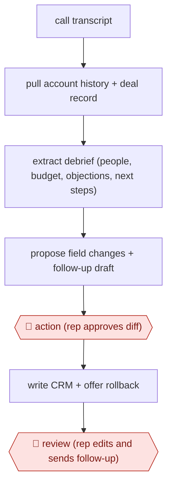

# Call-to-CRM diff approval

`COM › SAL › DEAL` · assist · evidence B · **draft: needs a reference example** ([how to add one](../../../../../CONTRIBUTING.md#1-add-an-example-run))

**Shape:** `call transcript → pull account history + deal record → extract debrief (people, budget, objections, next steps) → propose field changes + follow-up draft → 🛑 action (rep approves diff) → write CRM + offer rollback → 🛑 review (rep edits and sends follow-up)`
**How it differs:** AWF-0020 Research-then-personalize outbound researches prospects and drafts first-touch emails before any conversation. This workflow runs after a live call and writes field-level changes to the CRM, gated by the rep.
**Variants:** `claude-salesforce-mcp` · `claude-code-fathom-gmail`

<!-- shape diagram: generated by scripts/build_diagrams.py from `shape`; don't edit -->

<!-- end shape diagram -->

## Steps
1. Before the meeting, the agent pulls account history, past emails, calls, campaign activity and open opportunities into a briefing [[1]](#sources).
2. After the call, read the transcript and build a debrief: who they are, budget, who signs, pain points in their own words, objections and whether they were resolved, and next steps with owners and dates. Everything must be verifiable from the transcript [[2]](#sources).
3. Propose the CRM changes (call notes, ARR, stage) and draft the follow-up email and proposal in the rep's voice [[1]](#sources)[[2]](#sources).
4. 🛑 **Action**: the rep sees the proposed changes before anything is written. Approved values go to the CRM, with an immediate rollback offered afterwards [[1]](#sources).
5. 🛑 **Review**: the rep reads the proposal and follow-up, attaches the files and presses send. The agent never sends [[2]](#sources).

**Output:** An updated opportunity record and logged call in the CRM, plus a follow-up email and proposal sent by the rep.
**Failure modes → guards:** Invented numbers or commitments → require every field to trace to the transcript [[2]](#sources). Unwanted writes → confirmation skill plus rollback [[1]](#sources). The rep stops reviewing → keep the send manual [[2]](#sources).

## Public runs

Coverage as of 2026-11-06: **Partial**: first-hand runs that cover part of the shape or put checkpoints elsewhere. Collected and re-checked in [New workflows for empty categories](../../../../../research/2026-11-new-workflows.md).

- [Salesforce, Legora customer story](https://www.salesforce.com/customer-stories/legora/connecting-crm-to-claude/) (2026-09-11). Legora sellers brief, log notes and update opportunities via Claude with approval and rollback. "Those write-back actions now account for almost 20% of our headless tool-call volume.". *First-hand: interview; confidence: med.*
- [Lennard Cowans, post-sales call skill](https://www.linkedin.com/posts/lennycowans_i-automated-80-of-my-post-sales-call-work-activity-7476092744172638208-XHlB) (2026-06-26). Fathom transcript to debrief, follow-up draft and quote; human reviews and sends. "This skill cuts my post-sales call work from a couple hours down to 15 minutes.". *First-hand: yes; confidence: med.*

## Sources

1. Salesforce, Legora makes Salesforce data actionable in Claude, 2026-09-11. https://www.salesforce.com/customer-stories/legora/connecting-crm-to-claude/
2. Lennard Cowans, I automated 80% of my post-sales call work with one Claude skill (LinkedIn), 2026-06-26. https://www.linkedin.com/posts/lennycowans_i-automated-80-of-my-post-sales-call-work-activity-7476092744172638208-XHlB
