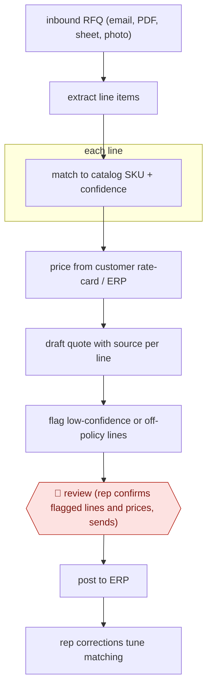

# RFQ-to-quote drafting

`COM › SAL › DEAL` · checkpointed · evidence B · **draft: needs a reference example** ([how to add one](../../../../../CONTRIBUTING.md#1-add-an-example-run))

**Shape:** `inbound RFQ (email, PDF, sheet, photo) → extract line items → each line: match to catalog SKU + confidence → price from customer rate-card / ERP → draft quote with source per line → flag low-confidence or off-policy lines → 🛑 review (rep confirms flagged lines and prices, sends) → post to ERP → rep corrections tune matching`
**How it differs:** Nearest is AWF-0050 Call-to-CRM diff approval: that turns a sales call into CRM field changes and a follow-up email. This turns a customer RFQ into a priced quote from catalog and rate-card. Different deliverable and input; the review is on flagged quote lines, not a CRM diff.
**Variants:** `canals` · `quotery` · `proton-ai` · `azure-openai`

<!-- shape diagram: generated by scripts/build_diagrams.py from `shape`; don't edit -->

<!-- end shape diagram -->

## Steps
1. Watch the shared sales inbox; read requests in the form they arrive (email body, PDF, Excel, photos of handwritten lists) [[1]](#sources)[[3]](#sources).
2. Extract each requested line; match it to a catalog SKU by exact code first, then AI match, with a confidence score per line and alternatives for vague descriptions [[2]](#sources)[[3]](#sources).
3. Price each line from the customer's own rate-card tier, contract rates and volume breaks in the ERP; the model never sets a price [[3]](#sources)[[4]](#sources).
4. Draft the quote in the firm's template with source description, matched part and price source per line; flag low-confidence matches and unpriced items [[2]](#sources)[[3]](#sources).
5. 🛑 **Review**: the rep or estimator confirms flagged lines, adds substitutions or stock notes, and sends; every quote is reviewed at first [[2]](#sources)[[3]](#sources). Some teams later release categories (e.g. stock answers) to go without review as accuracy is proven, while pricing stays human [[4]](#sources).
6. Post accepted quote/order to the ERP; rep corrections feed back into matching [[1]](#sources)[[4]](#sources).

**Output:** A priced quote in the customer's inbox and the ERP, with traceable line sources.
**Failure modes → guards:** Wrong SKU or price reaches the customer → deterministic code match first, confidence threshold, review on flagged lines [2][3]. Messy ERP catalog → learn from reps' past quotes [1].

## Public runs

Coverage as of 2026-11-13: **Weak**: only anonymous, vendor-linked or journalist-told accounts. Collected and re-checked in [Third collection pass](../../../../../research/2026-11-third-pass.md).

- [Quotery, Brazos Valve case study](https://quotery.io/blog/case-study-brazos-valve-distributors/) (2026-05-12). 15-person team; deterministic + AI line matching; rep reviews before send; five months tracked. "Quote time: 8 minutes average. Down from 3 hours.". *First-hand: vendor; confidence: med.*
- [Canals, Puget Sound Pipe & Supply](https://www.canals.ai/case-studies/puget-sound-pipe-and-supply-slashes-quote-times) (undated). Distributor reps review and confirm AI item matches; customer quoted on time savings. "with an advanced user, the time savings is probably three or four to one". *First-hand: vendor; confidence: med.*
- [EasiraAI, wholesale quote pilot](https://easiraai.com/work/wholesale-quote-from-enquiry) (undated). Six-week pilot at a ~30-staff distributor; estimators reviewed every draft. "~10 minutes (incl. estimator review)". *First-hand: vendor; confidence: med.*

## Sources

1. Canals, Puget Sound Pipe & Supply Slashes Quote Times (case study), undated. https://www.canals.ai/case-studies/puget-sound-pipe-and-supply-slashes-quote-times
2. Diogo Hudson / Quotery, Case study: Brazos Valve quotes in 8 minutes, not 3 hours, 2026-05-12. https://quotery.io/blog/case-study-brazos-valve-distributors/
3. Ibram Ghali / EasiraAI, Wholesale quote automation (pilot write-up), undated. https://easiraai.com/work/wholesale-quote-from-enquiry
4. CIG, An industrial distributor turns quotes around in under an hour instead of a day, 2026-09-28. https://www.thecig.ai/case-industrial-distribution
5. Concurrency, AI Auto-Quoting Saves Man Hours, Reduces Missed Opportunities, 2024-06-11. https://concurrency.com/case-study/ai-auto-quoting-saves-man-hours-reduces-missed-opportunities/
