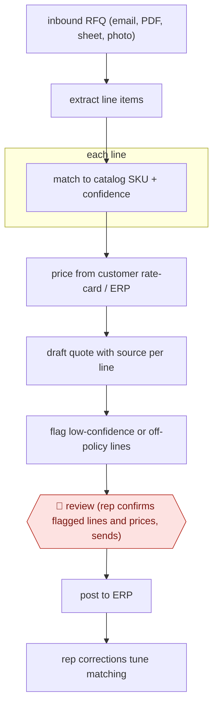

# RFQ-to-quote drafting

`COM › SAL › DEAL` · checkpointed · evidence B · **draft: needs a reference example** ([how to add one](../../../../../CONTRIBUTING.md#1-add-an-example-run))

**Shape:** `inbound RFQ (email, PDF, sheet, photo) → extract line items → each line: match to catalog SKU + confidence → price from customer rate-card / ERP → draft quote with source per line → flag low-confidence or off-policy lines → 🛑 review (rep confirms flagged lines and prices, sends) → post to ERP → rep corrections tune matching`
**Variants:** `canals` · `quotery` · `proton-ai` · `azure-openai`

<!-- shape diagram: generated by scripts/build_diagrams.py from `shape`; don't edit -->

<!-- end shape diagram -->

## Background

Distributors of industrial parts, such as valves, pipe and fittings, receive requests for quotation (RFQs) from their customers: a list of items and quantities, sent as an email, a PDF, a spreadsheet or a photo of a handwritten list. A salesperson or estimator has to work out which catalog product each line means, look up the price that particular customer pays, and send back a quote. By hand this means decoding vague descriptions, searching a catalog of many thousands of parts and checking each customer's own price terms, and a wrong part or price reaches the customer as an offer the company may have to honour. The agent reads the request, matches each line to a catalog item with a confidence score, takes the price from the company's pricing system and drafts the quote with a source for every line. A rep checks the lines the agent flagged and sends the quote, because a quote is a price commitment to a customer and the agent never sets a price.

**Terms:**
- **RFQ (request for quotation)**: a customer's request for prices on a list of items and quantities.
- **SKU**: the company's code for one catalog product.
- **Estimator**: the person who prices requests, often for project or bulk orders.
- **Rate card, contract rate, volume break**: the price tier a customer is on, prices fixed in that customer's contract, and lower unit prices for larger quantities.
- **ERP**: the company's main operations and accounting system, which holds the catalog, prices and orders.
- **Confidence score**: the matcher's estimate of how likely a match is right; lines below a set threshold are flagged.
- **Off-policy line**: a line the quoting rules do not allow through unchecked, such as an item with no price on record.

## Build it with an agent

**Form:** `service`. Requests arrive in a shared inbox with nobody at the keyboard, and reps see only finished drafts with their flagged lines.

**You need:** read access to the shared sales inbox, through a mail MCP server or a script that fetches new messages and attachments; read-only access to the catalog and to each customer's prices in the ERP, through one script per lookup or an MCP server; the company's quote template; a review queue where drafts land, such as the inbox's drafts folder or a ticket queue; a file of past corrections (customer wording → SKU). Give the agent no tool that sends mail and no tool that writes to the ERP.

| Step | Built as |
|---|---|
| inbound RFQ (email, PDF, sheet, photo) | Your own mail trigger starts `claude -p` or an Agent SDK program for each new request; or a cloud scheduled task checks the inbox on a schedule. The agent reads the body and the attachments, including images. |
| extract line items | The skill's first instruction: write every requested line, with quantity and the customer's wording, to a table. |
| each line: match to catalog SKU + confidence | A script beside the skill tries an exact part-code match and the corrections file first. The agent matches the remaining lines against catalog search results and records a confidence and alternatives for each. |
| price from customer rate-card / ERP | A pricing script returns the price for that customer, item and quantity. The agent copies the result and never writes a price of its own. |
| draft quote with source per line → flag low-confidence or off-policy lines | The skill fills the quote template with the customer's wording, the matched SKU and the price source on each line, and marks lines below the threshold or without a price. |
| 🛑 review (rep confirms flagged lines and prices, sends) → post to ERP | See Checkpoints. |
| rep corrections tune matching | A later run compares the sent quote with the draft and adds each changed match to the corrections file, which the matching script reads next time. |

**Checkpoints:** `review`: the run ends by putting the draft, with flagged lines marked, in the review queue. The agent has no send tool and no ERP write tool, so a quote reaches a customer only when a rep sends it, and the rep posts the accepted quote in the ERP. Before the draft is saved, a check in the calling program compares every price in it with the pricing script's output and rejects the draft if one differs.

**Since the sources:** Sources date from 2024-06 to 2026-09; sources 1 and 3 are undated. All five are vendor case studies or a vendor's pilot write-up about their own quoting products, so they report the steps but not how each is built, and none describes a general agent running them. The build above is a proposal for the same steps. Source 4 reports releasing some categories (such as stock answers) to go without review once accuracy is proven; the build sends every draft to the queue. Source 5 is not cited by any step.

*A design based on this entry's steps and the tool documentation as of 2026-11, not a reported run.*

## Steps

*As reported by the sources.*

1. The agent watches the shared sales inbox and reads requests in the form they arrive (email body, PDF, Excel, photos of handwritten lists) [[1]](#sources)[[3]](#sources).
2. The agent extracts each requested line and matches it to a catalog SKU by exact code first, then AI match, with a confidence score per line and alternatives for vague descriptions [[2]](#sources)[[3]](#sources).
3. The ERP prices each line from the customer's own rate-card tier, contract rates and volume breaks; the model never sets a price [[3]](#sources)[[4]](#sources).
4. The agent drafts the quote in the firm's template with source description, matched part and price source per line, and flags low-confidence matches and unpriced items [[2]](#sources)[[3]](#sources).
5. 🛑 **Review**: the rep or estimator confirms flagged lines, adds substitutions or stock notes, and sends; every quote is reviewed at first [[2]](#sources)[[3]](#sources). Some teams later release categories (e.g. stock answers) to go without review as accuracy is proven, while pricing stays human [[4]](#sources).
6. The system posts the accepted quote/order to the ERP, and rep corrections feed back into matching [[1]](#sources)[[4]](#sources).

**Output:** A priced quote in the customer's inbox and the ERP, with traceable line sources.
**Failure modes → guards:** Wrong SKU or price reaches the customer → deterministic code match first, confidence threshold, review on flagged lines [2][3]. Messy ERP catalog → learn from reps' past quotes [1].
**How it differs:** Nearest is AWF-0050 Call-to-CRM diff approval: that turns a sales call into CRM field changes and a follow-up email. This turns a customer RFQ into a priced quote from catalog and rate-card. Different deliverable and input; the review is on flagged quote lines, not a CRM diff.

## Public runs

Coverage as of 2026-11-13: **Weak**: only anonymous, vendor-linked or journalist-told accounts. Collected and re-checked in [Third collection pass](../../../../../research/2026-11-third-pass.md).

- [Quotery, Brazos Valve case study](https://quotery.io/blog/case-study-brazos-valve-distributors/) (2026-05-12). 15-person team; deterministic + AI line matching; rep reviews before send; five months tracked. "Quote time: 8 minutes average. Down from 3 hours.". *First-hand: vendor; confidence: med.*
- [Canals, Puget Sound Pipe & Supply](https://www.canals.ai/case-studies/puget-sound-pipe-and-supply-slashes-quote-times) (undated). Distributor reps review and confirm AI item matches; customer quoted on time savings. "with an advanced user, the time savings is probably three or four to one". *First-hand: vendor; confidence: med.*
- [EasiraAI, wholesale quote pilot](https://easiraai.com/work/wholesale-quote-from-enquiry) (undated). Six-week pilot at a ~30-staff distributor; estimators reviewed every draft. "~10 minutes (incl. estimator review)". *First-hand: vendor; confidence: med.*

## Sources

1. Canals, Puget Sound Pipe & Supply Slashes Quote Times (case study), undated. https://www.canals.ai/case-studies/puget-sound-pipe-and-supply-slashes-quote-times
2. Diogo Hudson / Quotery, Case study: Brazos Valve quotes in 8 minutes, not 3 hours, 2026-05-12. https://quotery.io/blog/case-study-brazos-valve-distributors/
3. Ibram Ghali / EasiraAI, Wholesale quote automation (pilot write-up), undated. https://easiraai.com/work/wholesale-quote-from-enquiry
4. CIG, An industrial distributor turns quotes around in under an hour instead of a day, 2026-09-28. https://www.thecig.ai/case-industrial-distribution
5. Concurrency, AI Auto-Quoting Saves Man Hours, Reduces Missed Opportunities, 2024-06-11. https://concurrency.com/case-study/ai-auto-quoting-saves-man-hours-reduces-missed-opportunities/
