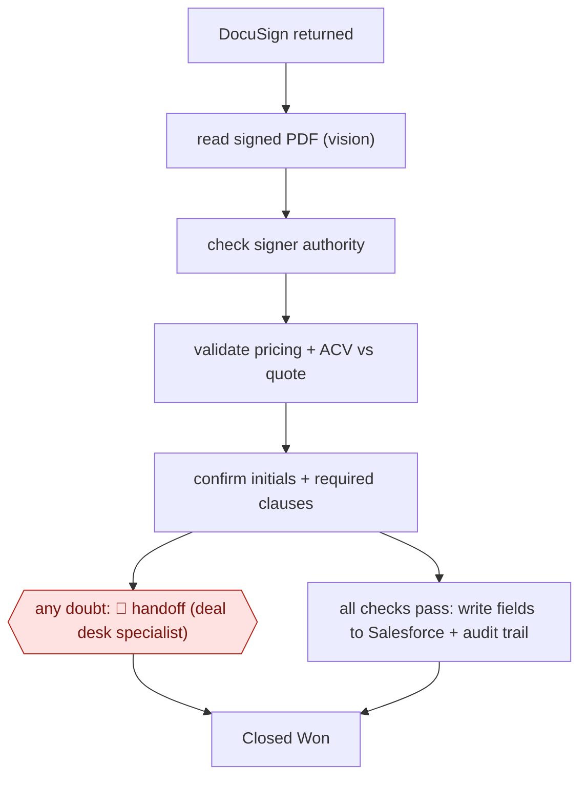

# Signed-contract validation

`COM › SAL › DEAL` · sampled · evidence A · **draft: needs a reference example** ([how to add one](../../../../../CONTRIBUTING.md#1-add-an-example-run))

**Shape:** `DocuSign returned → read signed PDF (vision) → check signer authority → validate pricing + ACV vs quote → confirm initials + required clauses → any doubt: 🛑 handoff (deal desk specialist) | all checks pass: write fields to Salesforce + audit trail → Closed Won`
**How it differs:** Closest is AWF-0176 RFQ-to-quote drafting (and AWF-0050 Call-to-CRM diff approval). Those draft a quote or CRM diff that a rep reviews item by item (checkpointed/assist); this one validates contracts after signature and writes to the system of record with no per-item approval, routing only exceptions to a specialist (sampled). The deliverable (validated closed-won record) and checkpoint (exception handoff) both differ.
**Variants:** `salesforce` · `docusign` · `gemini` · `claude`

<!-- shape diagram: generated by scripts/build_diagrams.py from `shape`; don't edit -->

<!-- end shape diagram -->

## Steps
1. Trigger when a signed contract comes back from e-signature; the workflow sits between 'DocuSign returned' and 'Closed Won' [[1]](#sources).
2. Before building, document the specialist's manual checks by sitting next to a contract validation specialist and noting every check and every reason they escalate; set the bar 'accuracy > speed' [[1]](#sources).
3. A vision model reads the signed PDF for signatures and initials [[1]](#sources).
4. A reasoning model cross-checks the contract against the Salesforce record: signer authority, pricing and ACV against the quote, required initials and clauses [[1]](#sources).
5. 🛑 **Handoff**: if the agent has any doubt at all, the deal goes to a deal desk specialist; specialists only touch deals where something is potentially wrong [[1]](#sources).
6. Clean contracts flow through: a separate middleware layer writes the fields back to Salesforce for finance and legal and keeps the audit trail, under the same Okta-based permissions and approval paths as a human [[1]](#sources).

**Output:** A validated, Closed Won Salesforce record with audit trail; exceptions sit in the specialist queue.
**Failure modes → guards:** An invalid contract (wrong signer, price mismatch, missing initials) slips through as Closed Won → any doubt escalates to a human, and orchestration/audit is kept in deterministic middleware apart from the model's validation logic.

## Public runs

Coverage as of 2026-11-13: **Strong**: a first-hand, detailed run that matches most of the shape. Collected and re-checked in [Fourth collection pass](../../../../../research/2026-11-fourth-pass.md).

- [Henry Schuck / ZoomInfo, In Q4, we built an AI agent to replace our Deal Desk](https://www.linkedin.com/posts/hschuck_in-q4-we-built-an-ai-agent-to-replace-our-activity-7419740825846194176-3GNa) (2026-01-21). ZoomInfo's deal desk agent validates signed contracts at ~100,000 deals/year; specialists handle exceptions only. "~85% of signed contract validations are now fully automated". *First-hand: yes; confidence: high.*

## Sources

1. Henry Schuck (ZoomInfo CEO), 'In Q4, we built an AI agent to replace our Deal Desk...', LinkedIn, 2026-01-21. https://www.linkedin.com/posts/hschuck_in-q4-we-built-an-ai-agent-to-replace-our-activity-7419740825846194176-3GNa
