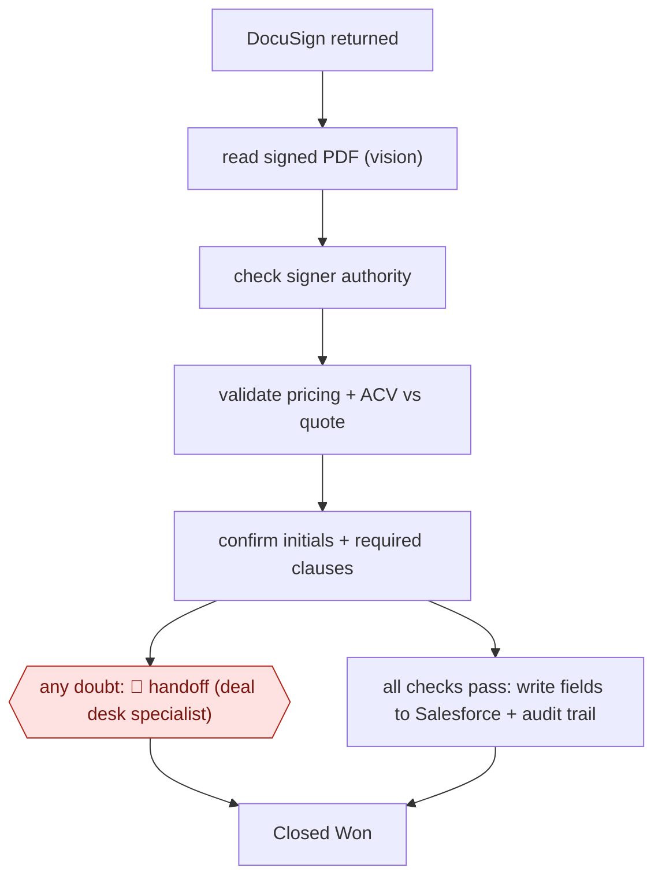

# Signed-contract validation

`COM › SAL › DEAL` · sampled · evidence A · **draft: needs a reference example** ([how to add one](../../../../../CONTRIBUTING.md#1-add-an-example-run))

**Shape:** `DocuSign returned → read signed PDF (vision) → check signer authority → validate pricing + ACV vs quote → confirm initials + required clauses → any doubt: 🛑 handoff (deal desk specialist) | all checks pass: write fields to Salesforce + audit trail → Closed Won`
**Variants:** `salesforce` · `docusign` · `gemini` · `claude`

<!-- shape diagram: generated by scripts/build_diagrams.py from `shape`; don't edit -->

<!-- end shape diagram -->

## Background

When a customer signs a sales contract electronically, someone has to check it before the deal is recorded as won: that the person who signed may sign for the customer, that prices and the contract's annual value match the approved quote, and that every required initial and clause is there. In many companies a small team called the deal desk does this by hand, contract by contract. At the end of a quarter, when most contracts arrive at once, the checks become a queue, and an error that slips through goes straight into the records finance and legal rely on. Here an agent runs the checks on every returned contract and records the clean ones itself; any contract it has the least doubt about goes to a deal desk specialist. A person keeps the doubtful cases because a wrong contract recorded as won misstates revenue and can bind the company to terms nobody approved.

**Terms:**
- **E-signature**: signing a document online through a service such as DocuSign, which returns the signed PDF when everyone has signed.
- **Deal desk**: the team that checks and approves the commercial terms of deals.
- **Signer authority**: whether the person who signed is entitled to commit the customer's company.
- **ACV**: annual contract value, what the contract is worth per year.
- **Quote**: the approved offer, with products and prices, that the contract should match.
- **Initials**: the signer's initials on particular pages or clauses, showing they were seen and accepted.
- **Closed Won**: the CRM stage for a deal that has been signed; finance and legal work from it.
- **Middleware**: a separate program that sits between the agent and the CRM and does the writing.
- **Audit trail**: a record of what was checked, what was written and by whom.

## Build it with an agent

**Form:** `service`. Each check starts when a signed contract comes back, with nobody present, and specialists see only the contracts the agent doubts.

**You need:** a notice from the e-signature service when a contract is completed that starts your own program; read access to the signed PDF and to the matching CRM opportunity and quote, through an MCP server or scripts; a checklist file written from the specialist's manual checks and reasons for escalating; a deal desk queue; a separate program or script that writes the CRM fields and the audit record. Give the agent itself no tool that writes to the CRM.

| Step | Built as |
|---|---|
| DocuSign returned | The e-signature service's notice starts an Agent SDK program, or `claude -p`, with the contract's identifier. |
| read signed PDF (vision) | The agent reads the PDF, including the signature and initial pages as images. |
| check signer authority → validate pricing + ACV vs quote → confirm initials + required clauses | A skill holding the checklist, one line per check the specialist does, run against the CRM record fetched read-only. The agent returns a structured result: each check marked pass, fail or unsure, with the page it relied on. |
| any doubt: 🛑 handoff (deal desk specialist) | Any result that is not pass on every check goes to the deal desk queue with the PDF and the result. |
| all checks pass: write fields to Salesforce + audit trail → Closed Won | The calling program, not the agent, writes the fields and the audit record and moves the deal to Closed Won, only for an all-pass result. |

**Checkpoints:** `handoff`: the calling program sends every result that is not all-pass to the deal desk queue. The agent has no CRM write tool, so it cannot mark a deal won; the program does that only for an all-pass result, under the same access rights a specialist would have.

**Since the sources:** The one source dates from 2026-01. It is a company chief executive's post about an in-house build at ZoomInfo: a vision model reads the PDF, a reasoning model runs the checks, and middleware does the writing and keeps the audit trail. The build keeps that split between the model's judgement and a deterministic writer. The source used two models; a current general agent can read the PDF pages and run the checks in one run, but nothing here shows it does so as reliably. AWF-0110 Exception-only contract validation describes the same source and the same steps; a maintainer should consider merging the two entries.

*A design based on this entry's steps and the tool documentation as of 2026-11, not a reported run.*

## Steps

*As reported by the sources.*

1. The workflow triggers when a signed contract comes back from e-signature; it sits between 'DocuSign returned' and 'Closed Won' [[1]](#sources).
2. Before building, the team documents the specialist's manual checks by sitting next to a contract validation specialist and noting every check and every reason they escalate; it sets the bar 'accuracy > speed' [[1]](#sources).
3. A vision model reads the signed PDF for signatures and initials [[1]](#sources).
4. A reasoning model cross-checks the contract against the Salesforce record: signer authority, pricing and ACV against the quote, required initials and clauses [[1]](#sources).
5. 🛑 **Handoff**: if the agent has any doubt at all, the deal goes to a deal desk specialist; specialists only touch deals where something is potentially wrong [[1]](#sources).
6. Clean contracts flow through: a separate middleware layer writes the fields back to Salesforce for finance and legal and keeps the audit trail, under the same Okta-based permissions and approval paths as a human [[1]](#sources).

**Output:** A validated, Closed Won Salesforce record with audit trail; exceptions sit in the specialist queue.
**Failure modes → guards:** An invalid contract (wrong signer, price mismatch, missing initials) slips through as Closed Won → any doubt escalates to a human, and orchestration/audit is kept in deterministic middleware apart from the model's validation logic.
**How it differs:** Closest is AWF-0176 RFQ-to-quote drafting (and AWF-0050 Call-to-CRM diff approval). Those draft a quote or CRM diff that a rep reviews item by item (checkpointed/assist); this one validates contracts after signature and writes to the system of record with no per-item approval, routing only exceptions to a specialist (sampled). The deliverable (validated closed-won record) and checkpoint (exception handoff) both differ.

## Public runs

Coverage as of 2026-11-13: **Strong**: a first-hand, detailed run that matches most of the shape. Collected and re-checked in [Fourth collection pass](../../../../../research/2026-11-fourth-pass.md).

- [Henry Schuck / ZoomInfo, In Q4, we built an AI agent to replace our Deal Desk](https://www.linkedin.com/posts/hschuck_in-q4-we-built-an-ai-agent-to-replace-our-activity-7419740825846194176-3GNa) (2026-01-21). ZoomInfo's deal desk agent validates signed contracts at ~100,000 deals/year; specialists handle exceptions only. "~85% of signed contract validations are now fully automated". *First-hand: yes; confidence: high.*

## Sources

1. Henry Schuck (ZoomInfo CEO), 'In Q4, we built an AI agent to replace our Deal Desk...', LinkedIn, 2026-01-21. https://www.linkedin.com/posts/hschuck_in-q4-we-built-an-ai-agent-to-replace-our-activity-7419740825846194176-3GNa
