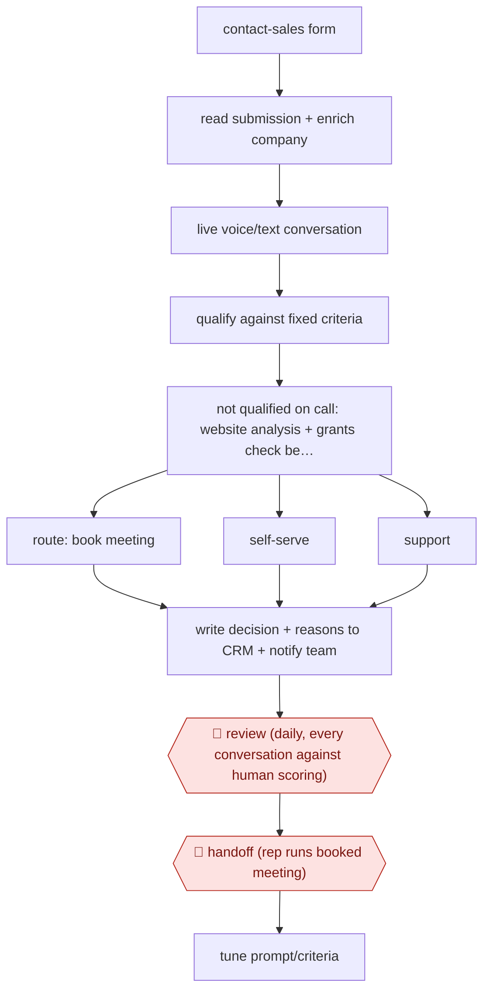

# Inbound qualify-and-book agent

`COM › SAL › PROSPECT` · sampled · evidence A · **draft: needs a reference example** ([how to add one](../../../../../CONTRIBUTING.md#1-add-an-example-run))

**Shape:** `contact-sales form → read submission + enrich company → live voice/text conversation → qualify against fixed criteria → not qualified on call: website analysis + grants check before disqualifying → route: book meeting | self-serve | support → write decision + reasons to CRM + notify team → 🛑 review (daily, every conversation against human scoring) → 🛑 handoff (rep runs booked meeting) → tune prompt/criteria`
**Variants:** `elevenlabs-agents` · `salesforce` · `qualified-piper`

<!-- shape diagram: generated by scripts/build_diagrams.py from `shape`; don't edit -->

<!-- end shape diagram -->

## Background

When a potential customer fills in a "contact sales" form on a company's website, someone has to talk to them quickly, find out whether they fit what the sales team handles (what they want to use the product for, how much, by when), and then book a meeting with a salesperson, point them to sign up on their own, or pass them to support. This first conversation is the job of a sales development rep (SDR). By hand, leads wait hours or days for a reply, and the decision about who deserves a salesperson's time varies from rep to rep. Here a voice or text agent holds the conversation as soon as the form arrives, qualifies the lead, books the meeting itself and records its decision and reasons in the CRM. People read every conversation daily to check those decisions, and a salesperson runs each booked meeting, because the agent speaks to prospects in the company's name and a lead turned away by mistake is a lost customer.

**Terms:**
- **Lead**: a person or company that may become a customer; **inbound** means they contacted the company first.
- **SDR (sales development rep)**: the salesperson who answers and qualifies leads and books meetings for the sellers who close deals.
- **Qualify**: decide, against fixed criteria, whether a lead is worth a meeting with a salesperson.
- **False positive / false negative**: here, booking a meeting with a lead who does not fit / turning away one who does.
- **Enrich**: add public data about the lead's company, such as size and industry, to the record.
- **Waterfall**: a sequence of further checks run one after another before a final decision.
- **Grants check**: checking whether the lead's company qualifies for the vendor's programme for startups.
- **Self-serve**: signing up and buying online without a salesperson.
- **CRM**: the customer relationship management system where leads and deals are recorded.
- **CSAT**: customer satisfaction score, a rating the caller gives the conversation.

## Build it with an agent

**Form:** `platform`. The core step is a live voice conversation with a prospect, which needs a voice-agent platform with speech recognition, speech synthesis and calling. A general agent can run the steps around it as a `service`: the website and grants checks after an inconclusive call, the daily review pack and the proposals for tuning.

**You need:** an account on a voice or chat agent platform that holds the live conversation and can call tools (calendar, CRM, email); the qualification criteria and the FAQ knowledge base as files; read access to conversation transcripts and the CRM records the platform writes; a channel where the daily review pack lands. Transcripts are personal data: keep them in a setup your organisation has approved, and give the scheduled runs no tool that changes the live agent.

| Step | Built as |
|---|---|
| contact-sales form → read submission + enrich company | The platform's agent, with a tool that fetches the form and the company data. |
| live voice/text conversation → qualify against fixed criteria | The voice or chat platform, with the criteria and FAQ loaded into it. |
| not qualified on call: website analysis + grants check before disqualifying | A `service` run started by the platform after an inconclusive call: two subagents analyse the company website and check grant eligibility in parallel, and the result is added to the CRM record. |
| route: book meeting \| self-serve \| support → write decision + reasons to CRM + notify team | The platform's calendar, CRM and notification tools. |
| 🛑 review (daily, every conversation against human scoring) | A cloud scheduled task each morning gathers the previous day's transcripts and decisions into a review pack, low- and high-CSAT calls first. People score each decision. |
| 🛑 handoff (rep runs booked meeting) | The rep, starting from the CRM record the agent wrote. |
| tune prompt/criteria | The scheduled task proposes changes to the criteria or prompt from the reviewers' scores; a person makes them on the platform. |

**Checkpoints:** `review`: the daily pack goes to the team, and the scheduled task has read-only access to transcripts and the CRM, so a change to how leads are qualified is made only by a person on the platform. `handoff`: the rep runs every booked meeting; nothing in the build contacts the lead after the booking.

**Since the sources:** Sources date from 2025-10 to 2026-09. Sources 1 and 2 are a voice-agent vendor describing the agent it runs on its own product; source 3 is a media company's account of an inbound agent run by three people. None of them describes a general agent holding the conversation, so the build proposes one only for the steps before and after the call. Source 1 reports switching models when tool calls failed; that is a setting on the voice platform and is not part of this build.

*A design based on this entry's steps and the tool documentation as of 2026-11, not a reported run.*

## Steps

*As reported by the sources.*

1. At the start of each call, the agent reviews the lead's contact-form submission. It answers product questions from a knowledge base of 100+ FAQs and docs [[1]](#sources).
2. The agent qualifies the lead in the conversation against defined criteria (use case, expected volume, timeline). The team tunes the agent to favour false positives over false negatives [[1]](#sources).
3. If the call is inconclusive, the system runs a backend waterfall before disqualifying: AI analysis of the lead's company website plus a parallel startup-grants eligibility check [[2]](#sources).
4. The agent routes the lead: it books a meeting live by checking calendars across time zones, sends them to self-serve, or hands them to support. It sends a follow-up email with whatever the lead asked for [[1]](#sources)[[2]](#sources).
5. The system writes the use case, qualification decision and enrichment data to the CRM and notifies the team, so both what was decided and why are visible [[2]](#sources).
6. 🛑 **Review**: the team reviews every conversation daily, qualified or not, for decision accuracy and helpfulness. Low- and high-CSAT calls are read first [[1]](#sources)[[2]](#sources).
7. 🛑 **Handoff**: a human seller runs the booked meeting, opening with what the agent captured [[3]](#sources).
8. The team feeds review findings back as prompt rules or workflow nodes, and switches models when tool-calling fails [[1]](#sources).

**Output:** Meetings booked on reps' calendars with CRM qualification records; unqualified leads routed to self-serve or support.
**Failure modes → guards:** Prompt bloats as edge-case rules pile up → split into workflow nodes [[1]](#sources). Leads try to bypass qualification by asking for a human → explicit guardrails [[1]](#sources). Silence during tool calls confuses callers → spoken status message [[1]](#sources). Cut-short calls get wrongly disqualified → website-analysis waterfall [[2]](#sources).
**How it differs:** AWF-0020 Research-then-personalize outbound: that builds outbound lists and launches sequences after plan and sample gates. This one answers inbound leads in real time and books meetings on its own (sampled autonomy), with review after the fact. The deliverable is a booked meeting, not a launched sequence.

## Public runs

Coverage as of 2026-11-06: **Strong**: a first-hand, detailed run that matches most of the shape. Collected and re-checked in [Second collection pass](../../../../../research/2026-11-second-pass.md).

- [ElevenLabs, How our AI SDR qualifies leads in minutes](https://elevenlabs.io/blog/how-our-ai-sdr-qualifies-leads-in-minutes) (2026-09-15). Accuracy raised from 78% to 92% via waterfall; daily review of every call. "4 min median speed to qualification". *First-hand: yes; confidence: high.*
- [SaaStr, inbound AI agent guide](https://www.saastr.com/the-saastr-ai-guide-to-building-a-top-tier-inbound-ai-agent-17000-conversations-600-meetings-booked-and-60-more-new-business/) (2026-09-23). Inbound agent qualifies and books sponsorship meetings; three humans run it. "17,000 conversations with prospects in the last 12 months and booked about 600 meetings". *First-hand: yes; confidence: med.*

## Sources

1. ElevenLabs, How we scaled inbound sales with an AI SDR, 2025-10-10. https://elevenlabs.io/blog/how-we-scaled-inbound-sales
2. Eduard Toth, Jake Tennant (ElevenLabs), How our AI SDR qualifies leads in minutes, 2026-09-15. https://elevenlabs.io/blog/how-our-ai-sdr-qualifies-leads-in-minutes
3. Jason Lemkin (SaaStr), The SaaStr AI Guide to Building a Top-Tier Inbound AI Agent, 2026-09-23. https://www.saastr.com/the-saastr-ai-guide-to-building-a-top-tier-inbound-ai-agent-17000-conversations-600-meetings-booked-and-60-more-new-business/
