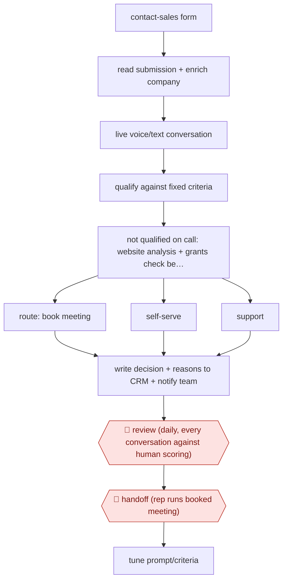

# Inbound qualify-and-book agent

`COM › SAL › PROSPECT` · sampled · evidence A · **draft: needs a reference example** ([how to add one](../../../../../CONTRIBUTING.md#1-add-an-example-run))

**Shape:** `contact-sales form → read submission + enrich company → live voice/text conversation → qualify against fixed criteria → not qualified on call: website analysis + grants check before disqualifying → route: book meeting | self-serve | support → write decision + reasons to CRM + notify team → 🛑 review (daily, every conversation against human scoring) → 🛑 handoff (rep runs booked meeting) → tune prompt/criteria`
**How it differs:** AWF-0020 Research-then-personalize outbound: that builds outbound lists and launches sequences after plan and sample gates. This one answers inbound leads in real time and books meetings on its own (sampled autonomy), with review after the fact. The deliverable is a booked meeting, not a launched sequence.
**Variants:** `elevenlabs-agents` · `salesforce` · `qualified-piper`

<!-- shape diagram: generated by scripts/build_diagrams.py from `shape`; don't edit -->

<!-- end shape diagram -->

## Steps
1. At the start of each call, the agent reviews the lead's contact-form submission. It answers product questions from a knowledge base of 100+ FAQs and docs [[1]](#sources).
2. Qualify in the conversation against defined criteria (use case, expected volume, timeline). Tune the agent to favour false positives over false negatives [[1]](#sources).
3. If the call is inconclusive, run a backend waterfall before disqualifying: AI analysis of the lead's company website plus a parallel startup-grants eligibility check [[2]](#sources).
4. Route the lead: book a meeting live by checking calendars across time zones, send them to self-serve, or hand them to support. Send a follow-up email with whatever the lead asked for [[1]](#sources)[[2]](#sources).
5. Write the use case, qualification decision and enrichment data to the CRM and notify the team, so both what was decided and why are visible [[2]](#sources).
6. 🛑 **Review**: the team reviews every conversation daily, qualified or not, for decision accuracy and helpfulness. Low- and high-CSAT calls are read first [[1]](#sources)[[2]](#sources).
7. 🛑 **Handoff**: a human seller runs the booked meeting, opening with what the agent captured [[3]](#sources).
8. Feed review findings back as prompt rules or workflow nodes, and switch models when tool-calling fails [[1]](#sources).

**Output:** Meetings booked on reps' calendars with CRM qualification records; unqualified leads routed to self-serve or support.
**Failure modes → guards:** Prompt bloats as edge-case rules pile up → split into workflow nodes [[1]](#sources). Leads try to bypass qualification by asking for a human → explicit guardrails [[1]](#sources). Silence during tool calls confuses callers → spoken status message [[1]](#sources). Cut-short calls get wrongly disqualified → website-analysis waterfall [[2]](#sources).

## Public runs

Coverage as of 2026-11-06: **Strong**: a first-hand, detailed run that matches most of the shape. Collected and re-checked in [Second collection pass](../../../../../research/2026-11-second-pass.md).

- [ElevenLabs, How our AI SDR qualifies leads in minutes](https://elevenlabs.io/blog/how-our-ai-sdr-qualifies-leads-in-minutes) (2026-09-15). Accuracy raised from 78% to 92% via waterfall; daily review of every call. "4 min median speed to qualification". *First-hand: yes; confidence: high.*
- [SaaStr, inbound AI agent guide](https://www.saastr.com/the-saastr-ai-guide-to-building-a-top-tier-inbound-ai-agent-17000-conversations-600-meetings-booked-and-60-more-new-business/) (2026-09-23). Inbound agent qualifies and books sponsorship meetings; three humans run it. "17,000 conversations with prospects in the last 12 months and booked about 600 meetings". *First-hand: yes; confidence: med.*

## Sources

1. ElevenLabs, How we scaled inbound sales with an AI SDR, 2025-10-10. https://elevenlabs.io/blog/how-we-scaled-inbound-sales
2. Eduard Toth, Jake Tennant (ElevenLabs), How our AI SDR qualifies leads in minutes, 2026-09-15. https://elevenlabs.io/blog/how-our-ai-sdr-qualifies-leads-in-minutes
3. Jason Lemkin (SaaStr), The SaaStr AI Guide to Building a Top-Tier Inbound AI Agent, 2026-09-23. https://www.saastr.com/the-saastr-ai-guide-to-building-a-top-tier-inbound-ai-agent-17000-conversations-600-meetings-booked-and-60-more-new-business/
