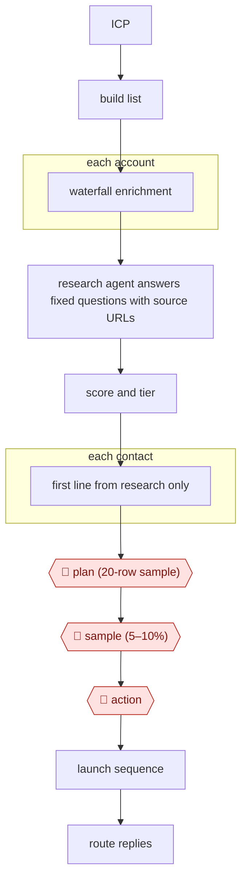

# Research-then-personalize outbound

`COM › SAL › PROSPECT` · checkpointed · evidence B · **draft: needs a reference example** ([how to add one](../../../../../CONTRIBUTING.md#1-add-an-example-run))

**Shape:** `ICP → build list → each account: waterfall enrichment → research agent answers fixed questions with source URLs → score and tier → each contact: first line from research only → 🛑 plan (20-row sample) → 🛑 sample (5–10%) → 🛑 action → launch sequence → route replies`
**Practitioner pattern:** run cheap enrichment first, and spend agent-research credits (Claygent) only on accounts that fit the ICP [[22]](#sources).

<!-- shape diagram: generated by scripts/build_diagrams.py from `shape`; don't edit -->

<!-- end shape diagram -->

## Background

Outbound prospecting means contacting companies that have not asked to hear from you. A sales or growth team defines the kind of customer it wants, builds a list of companies and people that fit, finds working email addresses, looks for a reason to write to each company now, and sends a short series of emails that open with that reason. By hand, researching each account is slow, so teams fall back on generic emails; done carelessly at scale, the emails make claims the research does not support, or go to dead addresses and damage the company's ability to deliver email at all. The agent does the research and writes each opening line only from cited evidence. A person checks a small sample before the full run, a share of finished rows after it, and approves the launch, because the emails go to real people in the company's name and a bad send is hard to undo.

**Terms:**
- **ICP (ideal customer profile)**: a description of the companies worth selling to; here written as **buyer archetypes**, a few typical kinds of buyer.
- **Signal (trigger)**: an event that makes a company worth contacting now, such as a new contract, funding or a job change.
- **Enrichment**: adding data to a list row, such as a verified email address; **waterfall enrichment** asks several data providers in turn until one has an answer.
- **Catch-all address**: a mail domain that accepts mail for any name, so an address on it cannot be confirmed as real.
- **Bounce**: an email returned as undeliverable.
- **Credits**: the per-row units a data tool charges for lookups and AI columns.
- **Clay, Claygent**: a spreadsheet-like tool that joins many data providers; Claygent and "Use AI" columns are its built-in AI research steps.
- **Fill rate**: the share of rows where a research question got an answer.
- **First line (opener)**: the personalised opening sentence of the first email.
- **Sequence, sequencer**: a timed series of emails to each contact, and the tool that sends it.
- **SPF, DKIM, DMARC**: email authentication records that let receiving servers trust a sending domain.
- **Secondary domain, warm-up**: a separate domain used for cold email, and a period of gradually increasing sending before a campaign.
- **SDR (sales development rep)**: the salesperson who follows up on replies and books meetings.
- **CRM**: the customer relationship management system where accounts and contacts are recorded.

## Build it with an agent

**Form:** `project`. One campaign owner runs it in the conversation, but the research fans out over hundreds of accounts between two checkpoints, and two rules must hold on every row and every send (no opener without evidence; no launch without approval), which need a script check and a hook.

**You need:** an ICP file with the archetypes, the scoring rules and one opener prompt per archetype; scripts or MCP servers, with their own API keys, for the signal sources and for each enrichment provider in order of cost; a table file or database for the list; the sequencer's import format; sending domains set up with SPF, DKIM and DMARC and warmed before launch, which happens outside the agent. Contact data is personal data: the campaign owner is responsible for the lawful basis for emailing each contact and for honouring opt-outs. Give the agent no tool that sends mail or launches a sequence.

| Step | Built as |
|---|---|
| ICP → build list | A skill reads the ICP file and builds the account list from the signal sources through scripts or MCP servers, removing duplicates by company domain. |
| each account: waterfall enrichment | A script beside the skill calls the providers in order of cost, stops at the first verified address and counts catch-all addresses as unverified. |
| research agent answers fixed questions with source URLs → score and tier | A dynamic workflow runs one subagent per qualified account with the fixed questions and a JSON schema. Each answer carries an evidence URL and a quote of 25 words or fewer, or "none". The same subagent scores the account and assigns an archetype. |
| each contact: first line from research only | The archetype's prompt, in the same workflow. A script rejects any row whose first line has no research field with an evidence URL behind it. |
| 🛑 plan (20-row sample) | The skill runs the workflow on 20 rows, writes them to a file and stops. |
| 🛑 sample (5–10%) | After the full run, the skill copies a random 5–10% of rows with their evidence URLs, and the fill rate and cost against the last run, into a review file and stops. |
| 🛑 action → launch sequence | The skill exports a file in the sequencer's import format. A person imports it and launches. |
| route replies | Not part of this build: the sequencer and the CRM route replies, as in source 21. |

**Checkpoints:** `plan`: the skill stops after writing the 20-row file and starts the full run only when the person says so. `sample`: the skill stops after writing the review file; the person reads a share of rows they did not check one by one, and the export waits for them. `action`: the agent has no tool that sends mail or uploads to the sequencer, and a `PreToolUse` hook blocks any command that calls the sequencer's API, so no email reaches anyone until a person imports the file and launches.

**Since the sources:** Sources date from 2026-06 to 2026-10. They describe practitioners running these steps in Clay, a spreadsheet-like data tool with built-in AI research columns, with an automation tool (n8n) for routing; no general agent runs the process, and the research step works row by row inside the table. The build moves the steps into a general agent with scripts. Clay's ready-made connections to many data providers are not reproduced, so each provider needs its own script and key. Reply routing and the warm-up of sending domains stay outside the build.

*A design based on this entry's steps and the tool documentation as of 2026-11, not a reported run.*

## Steps

*As reported by the sources.*

1. The campaign owner defines the ICP as buyer archetypes, then builds the account list from signals: a scraping service (ZenRows) reads public databases (USASpending.gov, SAM.gov, the FedRAMP Marketplace), a search service (Exa) searches trade press, and Clay's native signals add job changes and company news. The table refreshes daily and dedupes on company domain [[21]](#sources).
2. For each account, the table runs waterfall enrichment with the cheapest, highest-coverage providers first and expensive specialists last [[22]](#sources). One HR-tech run used FullEnrich, then Leads Magic, then Blitz API for real-time validation. The campaign owner turns on "Only mark 'Safe to Send' emails as valid" so catch-all addresses don't count as verified [[21]](#sources).
3. The research agent (Claygent or a Use AI column) runs only on rows that passed qualification, gated with "Only run if" [[21]](#sources) [[22]](#sources). It gets fixed questions written "like a spec" with a JSON output schema [[22]](#sources). Each answer returns a status plus `evidence_url` and an `evidence_quote` of 25 words or fewer, and the prompt says to answer "none" when nothing is found [[21]](#sources). Typical questions are latest funding round and hiring focus [[20]](#sources).
4. An AI prompt scores each account against the target profile, and contacts are looked up only after scoring. Each account is assigned to an archetype; an automation tool (n8n) does this in [[21]](#sources).
5. For each contact, the agent writes the first line only from the research fields: each archetype has its own prompt chain, and every email opens with the trigger that put the account in the queue. Event-specific openers beat feature-based ones by 3.4x on average in one campaign [[21]](#sources).
6. 🛑 **Plan**: the campaign owner checks a 20-row sample (research answers, evidence URLs, scores, first lines) before the full table runs. Practitioners do this on 25–50 rows in a separate test table, checking "fill rate and accuracy" and per-row credit cost [[22]](#sources).
7. 🛑 **Sample**: after the full run, a reviewer reads 5–10% of finished rows, checking that each first line traces to an evidence URL, and compares fill rate and cost with the last run before scaling [[22]](#sources).
8. 🛑 **Action**: a person approves the launch once sending infrastructure is ready: secondary domains with SPF, DKIM and DMARC, warmed for three to four weeks (30 days for one client, three weeks for another) [[21]](#sources).
9. The sequencer (EmailBison or Salesforge) launches the sequence and replies are routed: n8n pushes accounts into the CRM (HubSpot or Attio), and a prospect who opens twice without replying triggers a Slack alert to the SDR within 15 minutes [[21]](#sources).

**Output:** A launched sequence with every opener backed by a cited research field, and engaged accounts routed to the CRM and to SDRs.
**Failure modes → guards:** High bounces from a stale list ("22%") → a rebuilt waterfall with validation, which "bounced at 1.3%" on first sends [[21]](#sources); bounces above 2 percent "signal list quality problems" → always end the email waterfall with verification [[22]](#sources). Catch-all addresses counted as valid by default → the "Safe to Send" setting plus a re-check before a contact enters a campaign [[21]](#sources). Personalization the research doesn't support → evidence URL and quote on every field, and "none" when nothing is found [[21]](#sources). Credits wasted on poor-fit rows → "Only run if" gates and researching only qualified rows [[21]](#sources) [[22]](#sources). Burned sending domains (14% bounce, mail held in Microsoft 365 quarantine) → new secondary domains and inboxes with warm-up [[21]](#sources). Weak triggers such as a new executive hire → prioritize stronger signals [[21]](#sources).

## Public runs

Coverage as of 2026-11-06: **Partial**: first-hand runs that cover part of the shape or put checkpoints elsewhere. From [Where are the real runs?](../../../../../research/2026-11-real-runs.md); every number was re-checked against its page.

- [Grigorij Altshuler, RevSculpt](https://revsculpt.com/articles/clay-for-outbound) (2026-10-05). Signals → waterfall enrichment → research columns with evidence URLs → scoring → openers → CRM routing. "86% verified emails"; "bounced at 1.3%" vs "22%"; "About 48 held (55 booked)". *First-hand: yes (unnamed clients); confidence: med.*
- [Clay, Rippling customer story](https://clay.com/customers/rippling) (undated). Enrich → persona segments → 12+ variants → sequencer. "2x year over year performance of our cold email channel in 2023". *First-hand: vendor; confidence: low.*
- [Jack Jundanian, Lindy, *Clay review*](https://wf.lindy.ai/blog/clay-review) (updated 2026-10-19). A four-week tool test; no Clay outcomes given. "the same 200-contact list". *First-hand: no (tool review); confidence: low.*

## Sources

20. Lindy, *Clay review*. https://wf.lindy.ai/blog/clay-review
21. Grigorij Altshuler (RevSculpt), Clay for outbound: our 6-step workflow from signal to meeting, 2026-10-05. https://revsculpt.com/articles/clay-for-outbound
22. Dimitar Petkov (LeadHaste), Clay Best Practices 2026: Tips From Top Outbound Teams, 2026-06-15 (updated 2026-09-21). https://leadhaste.com/blog/clay-best-practices-2026
