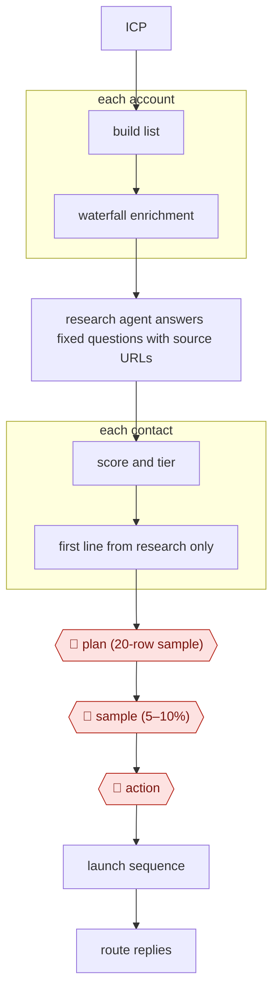

# Research-then-personalize outbound

`COM › SAL › PROSPECT` · checkpointed · evidence B · **draft: needs a reference example** ([how to add one](../../../../../CONTRIBUTING.md#1-add-an-example-run))

**Shape:** `ICP → build list → each account: waterfall enrichment → research agent answers fixed questions with source URLs → score and tier → each contact: first line from research only → 🛑 plan (20-row sample) → 🛑 sample (5–10%) → 🛑 action → launch sequence → route replies`
**Practitioner pattern:** run cheap enrichment first, and spend agent-research credits (Claygent) only on accounts that fit the ICP [[20]](#sources).

<!-- shape diagram: generated by scripts/build_diagrams.py from `shape`; don't edit -->

<!-- end shape diagram -->

## Public runs

Coverage as of 2026-11-06: **Partial**: first-hand runs that cover part of the shape or put checkpoints elsewhere. From [Where are the real runs?](../../../../../research/2026-11-real-runs.md); every number was re-checked against its page.

- [Grigorij Altshuler, RevSculpt](https://revsculpt.com/articles/clay-for-outbound) (2026-10-05). Signals → waterfall enrichment → research columns with evidence URLs → scoring → openers → CRM routing. "86% verified emails"; "bounced at 1.3%" vs "22%"; "About 48 held (55 booked)". *First-hand: yes (unnamed clients); confidence: med.*
- [Clay, Rippling customer story](https://clay.com/customers/rippling) (undated). Enrich → persona segments → 12+ variants → sequencer. "2x year over year performance of our cold email channel in 2023". *First-hand: vendor; confidence: low.*
- [Jack Jundanian, Lindy, *Clay review*](https://wf.lindy.ai/blog/clay-review) (updated 2026-10-19). A four-week tool test; no Clay outcomes given. "the same 200-contact list". *First-hand: no (tool review); confidence: low.*

## Sources

20. Lindy, *Clay review*. https://wf.lindy.ai/blog/clay-review
