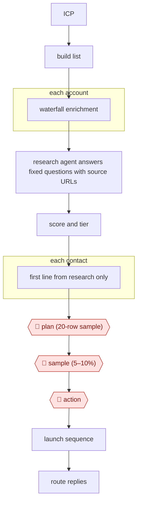

# Research-then-personalize outbound

`COM › SAL › PROSPECT` · checkpointed · evidence B · **draft: needs a reference example** ([how to add one](../../../../../CONTRIBUTING.md#1-add-an-example-run))

**Shape:** `ICP → build list → each account: waterfall enrichment → research agent answers fixed questions with source URLs → score and tier → each contact: first line from research only → 🛑 plan (20-row sample) → 🛑 sample (5–10%) → 🛑 action → launch sequence → route replies`
**Practitioner pattern:** run cheap enrichment first, and spend agent-research credits (Claygent) only on accounts that fit the ICP [[22]](#sources).

<!-- shape diagram: generated by scripts/build_diagrams.py from `shape`; don't edit -->

<!-- end shape diagram -->

## Steps
1. Define the ICP as buyer archetypes, then build the account list from signals: scrape public databases (ZenRows over USASpending.gov, SAM.gov, the FedRAMP Marketplace), search trade press with Exa, and add Clay's native signals such as job changes and company news. The table refreshes daily and dedupes on company domain [[21]](#sources).
2. For each account, run waterfall enrichment with the cheapest, highest-coverage providers first and expensive specialists last [[22]](#sources). One HR-tech run used FullEnrich, then Leads Magic, then Blitz API for real-time validation. Turn on "Only mark 'Safe to Send' emails as valid" so catch-all addresses don't count as verified [[21]](#sources).
3. Run the research agent (Claygent or a Use AI column) only on rows that passed qualification, gated with "Only run if" [[21]](#sources) [[22]](#sources). Give it fixed questions written "like a spec" with a JSON output schema [[22]](#sources). Each answer returns a status plus `evidence_url` and an `evidence_quote` of 25 words or fewer, and the prompt says to answer "none" when nothing is found [[21]](#sources). Typical questions are latest funding round and hiring focus [[20]](#sources).
4. Score each account against the target profile with an AI prompt, and look up contacts only after scoring. Assign each account to an archetype; n8n does this in [[21]](#sources).
5. For each contact, write the first line only from the research fields: each archetype has its own prompt chain, and every email opens with the trigger that put the account in the queue. Event-specific openers beat feature-based ones by 3.4x on average in one campaign [[21]](#sources).
6. 🛑 **Plan**: the campaign owner checks a 20-row sample (research answers, evidence URLs, scores, first lines) before the full table runs. Practitioners do this on 25–50 rows in a separate test table, checking "fill rate and accuracy" and per-row credit cost [[22]](#sources).
7. 🛑 **Sample**: after the full run, a reviewer reads 5–10% of finished rows, checking that each first line traces to an evidence URL, and compares fill rate and cost with the last run before scaling [[22]](#sources).
8. 🛑 **Action**: a person approves the launch once sending infrastructure is ready: secondary domains with SPF, DKIM and DMARC, warmed for three to four weeks (30 days for one client, three weeks for another) [[21]](#sources).
9. Launch the sequence in the sequencer (EmailBison or Salesforge) and route replies: n8n pushes accounts into HubSpot or Attio, and a prospect who opens twice without replying triggers a Slack alert to the SDR within 15 minutes [[21]](#sources).

**Output:** A launched sequence with every opener backed by a cited research field, and engaged accounts routed to the CRM and to SDRs.
**Failure modes → guards:** High bounces from a stale list ("22%") → a rebuilt waterfall with validation, which "bounced at 1.3%" on first sends [[21]](#sources); bounces above 2 percent "signal list quality problems" → always end the email waterfall with verification [[22]](#sources). Catch-all addresses counted as valid by default → the "Safe to Send" setting plus a re-check before a contact enters a campaign [[21]](#sources). Personalization the research doesn't support → evidence URL and quote on every field, and "none" when nothing is found [[21]](#sources). Credits wasted on poor-fit rows → "Only run if" gates and researching only qualified rows [[21]](#sources) [[22]](#sources). Burned sending domains (14% bounce, mail held in Microsoft 365 quarantine) → new secondary domains and inboxes with warm-up [[21]](#sources). Weak triggers such as a new executive hire → prioritize stronger signals [[21]](#sources).

## Public runs

Coverage as of 2026-11-06: **Partial**: first-hand runs that cover part of the shape or put checkpoints elsewhere. From [Where are the real runs?](../../../../../research/2026-11-real-runs.md); every number was re-checked against its page.

- [Grigorij Altshuler, RevSculpt](https://revsculpt.com/articles/clay-for-outbound) (2026-10-05). Signals → waterfall enrichment → research columns with evidence URLs → scoring → openers → CRM routing. "86% verified emails"; "bounced at 1.3%" vs "22%"; "About 48 held (55 booked)". *First-hand: yes (unnamed clients); confidence: med.*
- [Clay, Rippling customer story](https://clay.com/customers/rippling) (undated). Enrich → persona segments → 12+ variants → sequencer. "2x year over year performance of our cold email channel in 2023". *First-hand: vendor; confidence: low.*
- [Jack Jundanian, Lindy, *Clay review*](https://wf.lindy.ai/blog/clay-review) (updated 2026-10-19). A four-week tool test; no Clay outcomes given. "the same 200-contact list". *First-hand: no (tool review); confidence: low.*

## Sources

20. Lindy, *Clay review*. https://wf.lindy.ai/blog/clay-review
21. Grigorij Altshuler (RevSculpt), Clay for outbound: our 6-step workflow from signal to meeting, 2026-10-05. https://revsculpt.com/articles/clay-for-outbound
22. Dimitar Petkov (LeadHaste), Clay Best Practices 2026: Tips From Top Outbound Teams, 2026-06-15 (updated 2026-09-21). https://leadhaste.com/blog/clay-best-practices-2026
