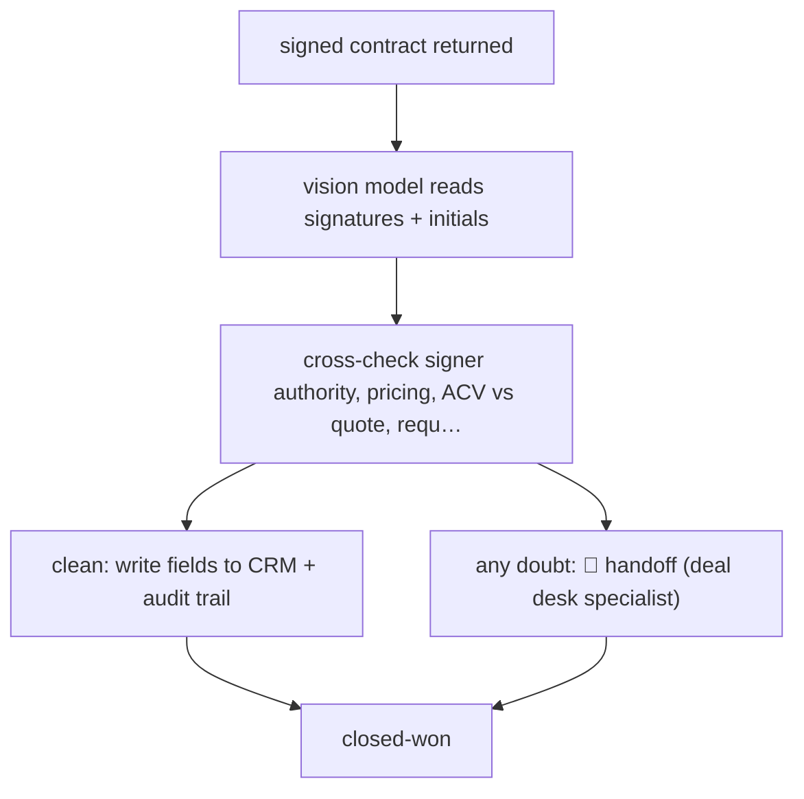

# Exception-only contract validation

`COM › SAL › REVOPS` · sampled · evidence A · **draft: needs a reference example** ([how to add one](../../../../../CONTRIBUTING.md#1-add-an-example-run))

**Shape:** `signed contract returned → vision model reads signatures + initials → cross-check signer authority, pricing, ACV vs quote, required clauses → clean: write fields to CRM + audit trail | any doubt: 🛑 handoff (deal desk specialist) → closed-won`
**How it differs:** AWF-0052 Propose-confirm pipeline sweep: that has a human confirm each CRM write-back and reviews the pipeline weekly. This one writes clean contracts to the CRM with no per-item approval and sends humans only the exceptions (sampled autonomy). The deliverable is a validated closed-won record, not a pipeline exceptions view.
**Variants:** `salesforce` · `docusign` · `gemini-vision` · `claude-sonnet`

<!-- shape diagram: generated by scripts/build_diagrams.py from `shape`; don't edit -->

<!-- end shape diagram -->

## Steps
1. Pick the worst bottleneck first (end-of-quarter signed-contract validation). Sit next to a specialist and record every check they do and every reason they escalate [[1]](#sources).
2. Set the bar as 'accuracy over speed': if the agent has any doubt, the contract goes to a human [[1]](#sources).
3. Split the system in two: an AI agent for the validation logic, and a middleware layer for CRM orchestration and audit trails [[1]](#sources).
4. Read the signed PDF with a vision model (signatures, initials). Use a reasoning model to check signer authority, pricing and ACV against the quote, and required clauses against the CRM record [[1]](#sources).
5. Clean contracts flow through: fields are written back to Salesforce automatically under the same access controls, approvals and audit paths as a human [[1]](#sources).
6. 🛑 **Handoff**: a deal-desk specialist takes every contract the agent flags as possibly wrong [[1]](#sources).

**Output:** Closed-won CRM records with validated contract fields for finance and legal, plus a queue of flagged contracts for specialists.
**Failure modes → guards:** Reviewers eyeballing valid contracts slows end of quarter → automate the documented happy path only [[1]](#sources). Model drift or a middleware fault lets bad data into finance systems → separate audit layer and escalate on doubt [[1]](#sources).

## Public runs

Coverage as of 2026-11-06: **Strong**: a first-hand, detailed run that matches most of the shape. Collected and re-checked in [Second collection pass](../../../../../research/2026-11-second-pass.md).

- [Henry Schuck, ZoomInfo deal desk agent](https://www.linkedin.com/posts/hschuck_in-q4-we-built-an-ai-agent-to-replace-our-activity-7419740825846194176-3GNa) (2026-01-21). ~100,000 deals a year; specialists touch only flagged contracts; ~2 months to production. "~85% of signed contract validations are now fully automated". *First-hand: yes; confidence: high.*

## Sources

1. Henry Schuck (CEO, ZoomInfo), In Q4, we built an AI agent to replace our Deal Desk, LinkedIn, 2026-01-21. https://www.linkedin.com/posts/hschuck_in-q4-we-built-an-ai-agent-to-replace-our-activity-7419740825846194176-3GNa
