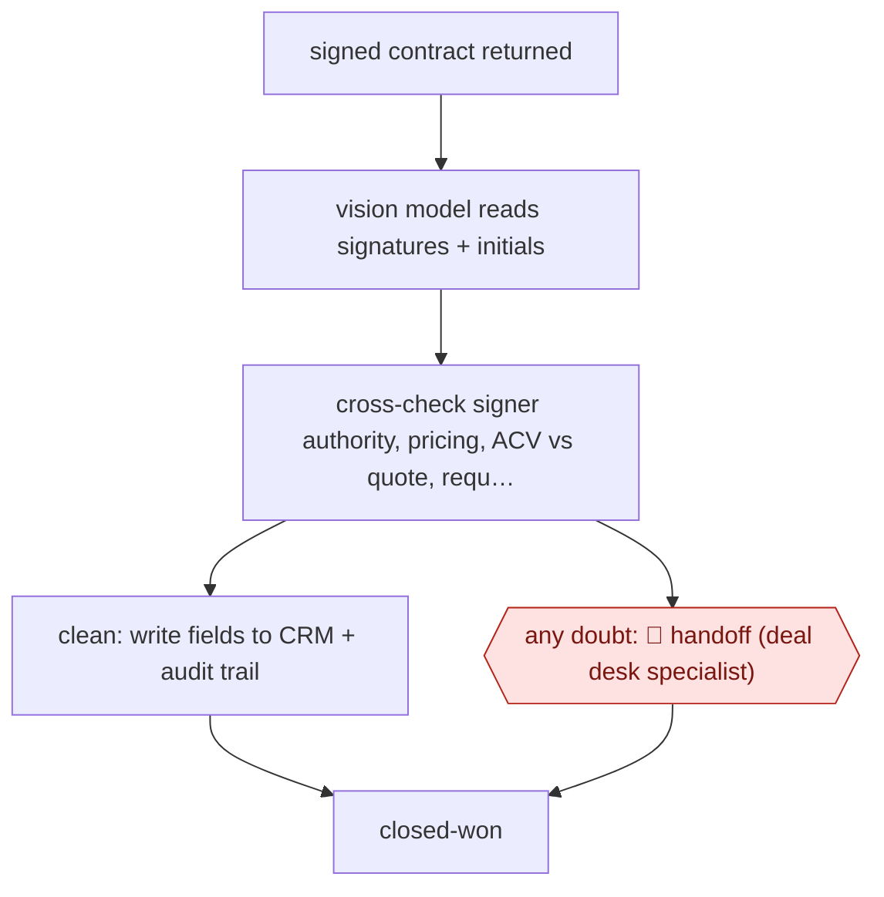

# Exception-only contract validation

`COM › SAL › REVOPS` · sampled · evidence A · **draft: needs a reference example** ([how to add one](../../../../../CONTRIBUTING.md#1-add-an-example-run))

**Shape:** `signed contract returned → vision model reads signatures + initials → cross-check signer authority, pricing, ACV vs quote, required clauses → clean: write fields to CRM + audit trail | any doubt: 🛑 handoff (deal desk specialist) → closed-won`
**Variants:** `salesforce` · `docusign` · `gemini-vision` · `claude-sonnet`

<!-- shape diagram: generated by scripts/build_diagrams.py from `shape`; don't edit -->

<!-- end shape diagram -->

## Background

Revenue operations (RevOps) runs the systems and checks between a signed sale and the company's books. One of those checks happens when a customer returns a signed contract: before the deal is recorded as won, someone confirms that the signer may sign for the customer, that prices and annual value match the approved quote, and that the required initials and clauses are present. A deal desk specialist usually does this by hand, contract by contract, and at the end of a quarter, when most contracts arrive together, the queue holds up recording revenue. Here an agent runs the checks on every contract, the clean ones are written to the CRM without anyone looking, and every contract it doubts goes to a specialist. A person keeps those cases because a wrong contract recorded as won misstates revenue for finance and can commit the company to terms nobody approved.

**Terms:**
- **RevOps (revenue operations)**: the team that runs the sales systems, data and processes behind revenue.
- **Deal desk**: the team that checks and approves the commercial terms of deals.
- **Signer authority**: whether the person who signed is entitled to commit the customer's company.
- **ACV**: annual contract value, what the contract is worth per year.
- **Quote**: the approved offer, with products and prices, that the contract should match.
- **Initials**: the signer's initials on particular pages or clauses, showing they were seen and accepted.
- **CRM**: the customer relationship management system where deals are recorded.
- **Closed-won**: the CRM stage for a signed deal; finance and legal work from it.
- **Happy path**: the ordinary case in which every check passes.
- **Middleware**: a separate program between the agent and the CRM that does the writing and keeps the audit trail, the record of what was checked and written.
- **Model drift**: a model's behaviour changing over time, for example after an update.

## Build it with an agent

**Form:** `service`. Each check starts when a signed contract returns, with nobody present, and people see only the contracts the agent doubts.

**You need:** a notice from the e-signature service when a contract is completed that starts your own program; read access to the signed PDF and to the matching CRM record and quote, through an MCP server or scripts; a checklist file written from the specialist's checks and reasons for escalating; a queue for the deal desk; a separate program that writes the CRM fields and the audit record. Give the agent itself no tool that writes to the CRM.

| Step | Built as |
|---|---|
| signed contract returned | The e-signature service's notice starts an Agent SDK program, or `claude -p`, with the contract's identifier. |
| vision model reads signatures + initials | The agent reads the PDF, including the signature and initial pages as images. |
| cross-check signer authority, pricing, ACV vs quote, required clauses | A skill holding the checklist, run against the CRM record fetched read-only. The agent returns each check as pass, fail or unsure, with the page it relied on. |
| clean: write fields to CRM + audit trail | The calling program, not the agent, writes the fields and the audit record, only when every check passed. |
| any doubt: 🛑 handoff (deal desk specialist) → closed-won | Any other result goes to the deal desk queue with the PDF and the result; the specialist moves the deal to closed-won in the CRM. |

**Checkpoints:** `handoff`: the calling program sends every result that is not all-pass to the deal desk queue. The agent has no CRM write tool, so a doubtful contract cannot be recorded as won except by a specialist; the program writes clean contracts under the same access rights a specialist has.

**Since the sources:** The one source dates from 2026-01. It is a company chief executive's post about an in-house build at ZoomInfo that split the work between an AI agent for the checks and middleware for writing and audit. The build keeps that split. The source used a vision model and a reasoning model; a current general agent can read the PDF pages and run the checks in one run, but nothing here shows it does so as reliably. AWF-0222 Signed-contract validation describes the same source and the same steps; a maintainer should consider merging the two entries.

*A design based on this entry's steps and the tool documentation as of 2026-11, not a reported run.*

## Steps

*As reported by the sources.*

1. The team picks the worst bottleneck first (end-of-quarter signed-contract validation). Someone sits next to a specialist and records every check they do and every reason they escalate [[1]](#sources).
2. The team sets the bar as 'accuracy over speed': if the agent has any doubt, the contract goes to a human [[1]](#sources).
3. The team splits the system in two: an AI agent for the validation logic, and a middleware layer for CRM orchestration and audit trails [[1]](#sources).
4. A vision model reads the signed PDF (signatures, initials). A reasoning model checks signer authority, pricing and ACV against the quote, and required clauses against the CRM record [[1]](#sources).
5. Clean contracts flow through: the middleware writes the fields back to Salesforce automatically under the same access controls, approvals and audit paths as a human [[1]](#sources).
6. 🛑 **Handoff**: a deal-desk specialist takes every contract the agent flags as possibly wrong [[1]](#sources).

**Output:** Closed-won CRM records with validated contract fields for finance and legal, plus a queue of flagged contracts for specialists.
**Failure modes → guards:** Reviewers eyeballing valid contracts slows end of quarter → automate the documented happy path only [[1]](#sources). Model drift or a middleware fault lets bad data into finance systems → separate audit layer and escalate on doubt [[1]](#sources).
**How it differs:** AWF-0052 Propose-confirm pipeline sweep: that has a human confirm each CRM write-back and reviews the pipeline weekly. This one writes clean contracts to the CRM with no per-item approval and sends humans only the exceptions (sampled autonomy). The deliverable is a validated closed-won record, not a pipeline exceptions view.

## Public runs

Coverage as of 2026-11-06: **Strong**: a first-hand, detailed run that matches most of the shape. Collected and re-checked in [Second collection pass](../../../../../research/2026-11-second-pass.md).

- [Henry Schuck, ZoomInfo deal desk agent](https://www.linkedin.com/posts/hschuck_in-q4-we-built-an-ai-agent-to-replace-our-activity-7419740825846194176-3GNa) (2026-01-21). ~100,000 deals a year; specialists touch only flagged contracts; ~2 months to production. "~85% of signed contract validations are now fully automated". *First-hand: yes; confidence: high.*

## Sources

1. Henry Schuck (CEO, ZoomInfo), In Q4, we built an AI agent to replace our Deal Desk, LinkedIn, 2026-01-21. https://www.linkedin.com/posts/hschuck_in-q4-we-built-an-ai-agent-to-replace-our-activity-7419740825846194176-3GNa
