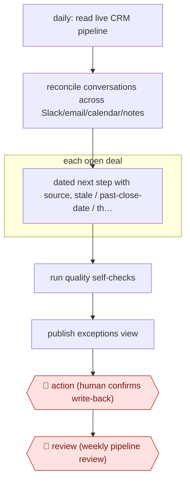

# Propose-confirm pipeline sweep

`COM › SAL › REVOPS` · checkpointed · evidence B · **draft: needs a reference example** ([how to add one](../../../../../CONTRIBUTING.md#1-add-an-example-run))

**Shape:** `daily: read live CRM pipeline → reconcile conversations across Slack/email/calendar/notes → each open deal: dated next step with source, stale / past-close-date / thin-committee checks → run quality self-checks → publish exceptions view → 🛑 action (human confirms write-back) → 🛑 review (weekly pipeline review)`
**Variants:** `claude-salesforce-mcp`

<!-- shape diagram: generated by scripts/build_diagrams.py from `shape`; don't edit -->

<!-- end shape diagram -->

## Background

A sales pipeline is the set of all deals a company is currently trying to win, kept as records in its CRM. Revenue operations (RevOps), the team that runs the sales systems and the forecast, needs every open deal to show a current next step, a realistic close date and the right people on the buyer's side, because the forecast and the weekly pipeline review are built from those records. By hand, keeping hundreds of deals current is tedious, so records go stale and reviews are prepared from snapshots that are already out of date. Here an agent sweeps the whole pipeline every weekday, compares the records with recent conversations in chat, email, calendars and meeting notes, and publishes a list of problems with proposed corrections. A person confirms each correction before it is written, and people still hold the weekly review, because leadership commits to the forecast these records feed and each rep answers for their own deals.

**Terms:**
- **CRM**: customer relationship management system, where accounts, contacts and deals are recorded.
- **Pipeline, open deal**: all deals not yet won or lost; one such deal.
- **RevOps (revenue operations)**: the team that runs the sales systems, data and forecast.
- **Next step**: the dated action that moves a deal forward, such as a scheduled demo.
- **Close date**: the date a deal is expected to be signed; one already in the past means the record is stale.
- **Buying committee**: the people at the customer who decide on the purchase; a **thin committee** means too few of them are known.
- **Write-back**: a correction written into the CRM record.
- **Exceptions view**: a list of only the deals with problems, each with the proposed fix.
- **Pipeline review**: the weekly meeting where sales leaders go through the open deals.

## Build it with an agent

**Form:** `service`. The sweep starts on a schedule every weekday with nobody present, and people see only the exceptions view and the write-backs they are asked to confirm.

**You need:** read-only access to the live CRM through its MCP server; read access to chat, email, calendar and meeting notes through connectors; a file of the run's quality checks; a place to publish the exceptions view, such as a shared document or a chat channel. Give the scheduled run no tool that writes to the CRM. Conversations and contacts are personal data: use connectors your organisation has approved for them.

| Step | Built as |
|---|---|
| daily: read live CRM pipeline | A cloud scheduled task each weekday that reads the CRM live through its MCP server, never an export. |
| reconcile conversations across Slack/email/calendar/notes | Connectors for each channel; a dynamic workflow gives each subagent a batch of deals and their recent conversations. |
| each open deal: dated next step with source, stale / past-close-date / thin-committee checks | The same subagents return, per deal, a next step with its date and source and the flags that apply. |
| run quality self-checks | The checks file; the run grades itself against it and lists the failures at the top of the view. |
| publish exceptions view | The skill's last step: post the view, with each proposed write-back as an item a person can confirm. |
| 🛑 action (human confirms write-back) | A separate, interactive session or an Agent SDK program that writes only the confirmed items, with the CRM update tool under an ask rule or routed through `canUseTool`. |
| 🛑 review (weekly pipeline review) | People, in their meeting, starting from the view. |

**Checkpoints:** `action`: the scheduled run has no CRM write tool, so it can only propose; each write-back happens in a second step that writes only the items a person confirmed, and each update asks before it runs. `review`: the weekly review is a meeting of people, outside the agent's tools.

**Since the sources:** The one source dates from 2026-09. It is a consultancy's account of running a Claude and CRM setup on its own pipeline for four months, and it reports the checks and the rule that a person confirms every write-back, not how the run is scheduled. Cloud scheduled tasks, in research preview as of 2026-11, can supply the weekday schedule without a scheduler of your own. The build splits proposing from writing so that the unattended run never holds a write tool.

*A design based on this entry's steps and the tool documentation as of 2026-11, not a reported run.*

## Steps

*As reported by the sources.*

1. Every weekday, the agent reads the live pipeline, never an export or a saved copy [[1]](#sources).
2. The agent reconciles conversations across Slack, email, calendar and meeting notes so a relationship isn't flagged cold when someone spoke to the contact yesterday [[1]](#sources).
3. For every open deal, the agent writes a dated next step with its source, maps the buying committee, and flags stalled deals, close dates already in the past, and missing signers [[1]](#sources).
4. The agent grades the run on fifteen quality checks and reports the failures openly [[1]](#sources).
5. 🛑 **Action**: nothing is written back to Salesforce unless a person clicks [[1]](#sources).
6. 🛑 **Review**: the weekly pipeline review starts from the exceptions view instead of a hand-built deck [[1]](#sources).

**Output:** A daily exceptions view of the whole book, human-confirmed CRM corrections, and a ready pipeline review.
**Failure modes → guards:** Dashboards built on stale snapshots → read live records only [[1]](#sources). False 'cold' flags → reconcile across channels [[1]](#sources). Unsupervised writes damage trust → propose, then a human confirms write-back [[1]](#sources).
**How it differs:** The DEAL workflow in this batch makes per-call, rep-approved updates. This one is a book-wide daily sweep owned by RevOps. AWF-0006 Governed query answers ad-hoc questions and does not maintain records.

## Public runs

Coverage as of 2026-11-06: **Weak**: only anonymous, vendor-linked or journalist-told accounts. Collected and re-checked in [New workflows for empty categories](../../../../../research/2026-11-new-workflows.md).

- [Truffle Corp, Claudeforce on our Salesforce pipeline](https://www.trufflecorp.com/post/claudeforce-salesforce-pipeline) (2026-09-17). Consultancy ran a CRO agent on its own Salesforce for four months; human confirms write-back. "Contact categorization improved from 31% in July to 88% in August and 95% in September". *First-hand: vendor; confidence: med.*

## Sources

1. Truffle Corp, Claudeforce for Revenue Operations: We Put It on Our Salesforce Pipeline, 2026-09-17. https://www.trufflecorp.com/post/claudeforce-salesforce-pipeline
