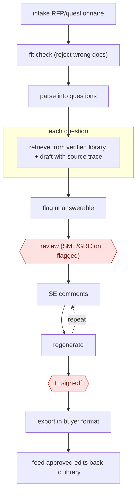

# Governed-library response draft

`COM › SAL › RFP` · checkpointed · evidence A · **draft: needs a reference example** ([how to add one](../../../../../CONTRIBUTING.md#1-add-an-example-run))

**Shape:** `intake RFP/questionnaire → fit check (reject wrong docs) → parse into questions → each question: retrieve from verified library + draft with source trace → flag unanswerable → 🛑 review (SME/GRC on flagged) → (SE comments ⟲ regenerate) → 🛑 sign-off → export in buyer format → feed approved edits back to library`
**Variants:** `in-house-agentic-rag` · `conveyor` · `responsive`

<!-- shape diagram: generated by scripts/build_diagrams.py from `shape`; don't edit -->

<!-- end shape diagram -->

## Background

Companies that sell to large organisations receive requests for proposal (RFPs) and security questionnaires: long lists of questions about the product, its security and its compliance that must be answered before the buyer will consider it. A sales engineer usually assembles the answers, pulling in product experts and the security and compliance team. By hand this takes weeks, the same questions are answered again and again, and an answer copied from an old document can promise a feature or a certification the company no longer has, which the buyer may later hold it to. The agent answers each question only from an approved library of current answers and documents, cites the source of each answer and flags what the library cannot answer. Experts check the flagged items and the sales engineer approves the final response, because every answer is a statement the company is accountable for.

**Terms:**
- **RFP, RFI**: request for proposal, and the earlier and lighter request for information, sent by a buyer to possible suppliers.
- **Security questionnaire**: a buyer's list of questions about how the supplier protects data, often hundreds long.
- **SE (sales engineer)**: the technical member of the sales team who owns the answers.
- **SME (subject-matter expert)**: a specialist asked to answer or check questions in their area.
- **GRC (governance, risk and compliance)**: the team that owns the company's security and compliance statements.
- **Verified library (governed corpus)**: the approved set of past answers, current product documentation and compliance certificates that answers may draw on.
- **Source trace (lineage)**: the link from each answer to the library item it came from.
- **Agentic retrieval**: an agent searching the library in several steps, rather than a single lookup.
- **Fit check**: confirming at intake that the document is one the library can answer.

## Build it with an agent

**Form:** `skill`. One sales engineer works on one questionnaire at a time and stays in the conversation, so a skill with the library beside it is enough.

**You need:** the RFP or questionnaire file; the verified library, as reference files beside the skill or through a read-only knowledge-base MCP server; the buyer's template (spreadsheet or document) and a way to write into it, such as a document skill or a script; a list of who answers flagged questions in each area. Use only material approved for sharing with buyers, and a setup your organisation has approved for it. Give the agent no tool that sends mail or uploads to the buyer's portal.

| Step | Built as |
|---|---|
| intake RFP/questionnaire → fit check (reject wrong docs) → parse into questions | The skill's first instruction: check the document is a questionnaire the library covers; if not, stop and say what is needed. Then split it into numbered questions. |
| each question: retrieve from verified library + draft with source trace → flag unanswerable | Built-in subagents take groups of questions, search the library and return answer, source and confidence, or "no source: flagged". A script beside the skill rejects any answer without a source. |
| 🛑 review (SME/GRC on flagged) | The skill stops and writes the flagged questions, grouped by the team that must answer them. |
| (SE comments ⟲ regenerate) | The main conversation: the SE comments on answers and the agent redrafts them from the library, keeping the source on each. |
| 🛑 sign-off → export in buyer format | See Checkpoints. |
| feed approved edits back to library | The skill proposes new or changed library entries from the approved answers; the library owner accepts or drops each. |

**Checkpoints:** `review`: the skill stops after listing the flagged questions; the experts answer outside the conversation and the SE brings their answers back. `sign-off`: the skill writes the final answers into the buyer's template and stops; the agent has no tool to send or upload, so the SE submits the response.

**Since the sources:** Sources date from 2026-02 to 2026-03. Source 1 describes an in-house RFP assistant at Palo Alto Networks built on agentic retrieval over a verified corpus; source 2 is a questionnaire vendor's account of how Zapier uses its product. Both describe dedicated systems wired into where sales already works. The build is a single skill for one SE: the routing of flagged questions to the security team inside a shared tool (source 2) becomes a list the SE forwards, and keeping the library current is left to its owner.

*A design based on this entry's steps and the tool documentation as of 2026-11, not a reported run.*

## Steps

*As reported by the sources.*

1. The company builds the knowledge base only from verified, continuously updated product documentation and compliance certificates [[1]](#sources). Zapier connected 434 knowledge items and 2,675 past answers into one library [[2]](#sources).
2. The salesperson or sales engineer uploads the request where sales already works. The agent first checks it can answer this document, rejecting the wrong one and telling the seller what is needed [[2]](#sources).
3. The agent's agentic retrieval checks each question against the approved corpus and traces every answer to its source. The agent cannot invent features or claim compliance the company lacks [[1]](#sources).
4. 🛑 **Review**: the security/GRC team is tagged only where a human eye is actually needed [[2]](#sources). The sales engineer comments on the draft and the AI regenerates updated versions [[1]](#sources).
5. 🛑 **Sign-off**: the sales engineer edits for the customer's goals and approves the final response. The system learns from each interaction [[1]](#sources).

**Output:** A completed RFP, RFI or security questionnaire in the buyer's format, ready to submit, and a library improved by the approved edits.
**Failure modes → guards:** Stale or deprecated specs get into answers → only a governed corpus with lineage per answer [[1]](#sources). The agent answers off-scope documents → intake fit check [[2]](#sources). Over-reliance hides gaps → route flagged questions to the security team [[2]](#sources).
**How it differs:** None close. AWF-0024 Playbook contract review reviews inbound contracts against a playbook; this workflow drafts outbound answers from an approved library.

## Public runs

Coverage as of 2026-11-06: **Strong**: a first-hand, detailed run that matches most of the shape. Collected and re-checked in [New workflows for empty categories](../../../../../research/2026-11-new-workflows.md).

- [Palo Alto Networks, From Weeks to Minutes](https://www.paloaltonetworks.com/perspectives/from-weeks-to-minutes-how-we-applied-an-ai-first-transformation-to-the-rfp-bottleneck/) (2026-03-26). Internal 'customer zero' RFP copilot; SEs edit and regenerate AI drafts grounded in a verified corpus. "delivering RFPs in days instead of weeks". *First-hand: yes; confidence: high.*
- [Conveyor, Zapier playbook](https://www.conveyor.com/blog/steal-the-playbook-zapier) (2026-02-24). Zapier GRC team reviews only flagged questions from agent-drafted questionnaires. "only 20% of security questions require a security team member which is down from 90%". *First-hand: vendor; confidence: med.*

## Sources

1. Sandeep Uttamchandani / Palo Alto Networks, From Weeks to Minutes: How We Applied an AI-First Transformation to the RFP Bottleneck, 2026-03-26. https://www.paloaltonetworks.com/perspectives/from-weeks-to-minutes-how-we-applied-an-ai-first-transformation-to-the-rfp-bottleneck/
2. Marcus Andrews / Conveyor, Steal the Playbook: How Zapier made 80% of customer security reviews touchless, 2026-02-24. https://www.conveyor.com/blog/steal-the-playbook-zapier
