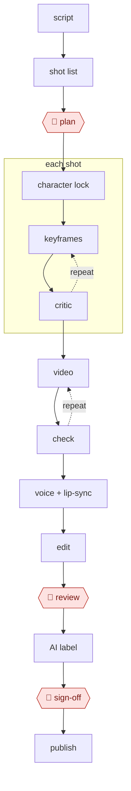

# AI shot factory

`CRE › MED › AIGCVIDEO` · checkpointed · evidence A · **draft: needs a reference example** ([how to add one](../../../../../CONTRIBUTING.md#1-add-an-example-run))

**Shape:** `script → shot list → 🛑 plan → character lock → each shot: (keyframes ⟲ critic) → (video ⟲ check) → voice + lip-sync → edit → 🛑 review → AI label → 🛑 sign-off → publish`

<!-- shape diagram: generated by scripts/build_diagrams.py from `shape`; don't edit -->

<!-- end shape diagram -->

| Step | Tools (CN / global) |
|---|---|
| Shot list (分镜: number, framing, camera move, action, dialogue, duration) | Doubao, DeepSeek, Claude, GPT |
| Character lock | 即梦 / Midjourney references; ComfyUI + per-character LoRA; Kling multi-image reference, 1–4 references per generation [[17]](#sources) |
| Keyframes | 即梦/Seedream, Flux, Midjourney |
| Motion | 可灵 Kling, 海螺 Hailuo, Vidu, Seedance, Veo, Runway |
| Voice and lip-sync | MiniMax, 火山引擎 TTS, ElevenLabs; lip-sync tools or native audio-video models |
| Assembly | 剪映/CapCut, Premiere |

## Steps
1. Script → 20–40-shot list. 🛑 **Plan**: the director approves the shot list and style frames.
2. Lock the characters. Practitioners generate front, side, and back views plus expression sheets, and use them as references in every later generation [[16]](#sources).
3. Generate 4 keyframe candidates per shot in parallel. A vision-model critic filters, then a human selects.
4. Image → video per shot. Re-roll on morphing or physics breaks.
5. Generate voice per line with emotion tags, then lip-sync.
6. Assemble and check the first-3-seconds hook.
7. 🛑 **Review**: the director lists re-rolls (loop back to step 3 or 4).
8. 🛑 **Sign-off**: compliance and labeling. CN rules require explicit and implicit labels on AI-generated content (in force since September 1, 2025 [[15]](#sources)). The draft 微短剧 regulation also requires a label in a visible position in every AI-generated episode [[14]](#sources).

**Reported economics (B):** a brokerage report citing Ocean Engine data puts traditional 漫剧 at ¥2–5k per minute and AI-assisted production at ¥1–2.5k. It also reports one company cutting 11 production stages to 5 [[16]](#sources).
**Metrics to record in examples:** usable-shot rate per generation, cost per finished minute, hours per episode.

## Public runs

Coverage as of 2026-11-06: **Partial**: first-hand runs that cover part of the shape or put checkpoints elsewhere. From [Where are the real runs?](../../../../../research/2026-11-real-runs.md); every number was re-checked against its page.

- [新民周刊 p.41](https://img1.xinmin.cn/xmzk/2026-07-13/410713.pdf) (Xinmin Weekly, 2026-07-13). AI review before human review; scripts expanded for AI production. "近七成都无法过审"; "5万字…可能要补充到8万字". *First-hand: interview; confidence: med.*
- [毒眸 on 钛媒体](https://www.tmtpost.com/7712427.html) (How a 10-person team made an AI manhua drama in 45 days, 2025-10-02). 珀乐互动: artist-drawn originals → AI video → edit; weekly director review. "一个仅10人的团队，用45天时间，完成了50集《明日周一》". *First-hand: interview; confidence: high.*
- [PJ Ace, *I can't believe Disney allowed us to run this AI ad*](https://pjace.beehiiv.com/p/i-can-t-believe-disney-allowed-us-to-run-this-ai-ad-during-the-nba-finals-f77e73388ab4ca62) (2025-06-11). Rough script → AI shot list and prompts → generate and re-prompt → edit. "300–400 generations to get 15 usable clips"; "One person, two days.". *First-hand: yes; confidence: high.*
- [金姬, 新民周刊](https://www.xinminweekly.com.cn/bianjituijian/2026/04/08/41135.html) (A one-person animation factory?, 2026-04-08). Storyboard frames picked from many generations → image-to-video. "110多张分镜与定稿图的1700多次AI'抽卡'"; "近20人的团队". *First-hand: interview; confidence: med.*

## Sources

14. 新华网, 微短剧分类分层审核 (February 2025). https://www.news.cn/politics/20250205/3fbf8abbfa344641b01f799ae42a6318/c.html · 新华网, 《微短剧发展管理办法(征求意见稿)》 (June 2026). https://www.news.cn/politics/20260624/5794e5cd877e440cb678a7f27112ffc7/c.html · IT之家. https://www.ithome.com/0/984/306.htm
15. 国家网信办, 《人工智能生成合成内容标识办法》 (March 14, 2025; in force September 1, 2025). https://www.cac.gov.cn/2025-03/14/c_1743654685899683.htm
16. Brokerage report on AI 漫剧 (October 2025). https://pdf.dfcfw.com/pdf/H3_AP202510241768351710_1.pdf · Practitioner storyboard notes: https://www.woshipm.com/it/6295336.html
17. Kuaishou, *Kling AI Unveils Multi-Image Reference* (January 2025). https://seekingalpha.com/pr/19978699-kuaishou-kling-ai-unveils-multi-image-reference-feature-to-further-tackle-ai-video · 环球网 coverage of Kling 3.0: https://tech.huanqiu.com/article/4QFI3Up2VEA
