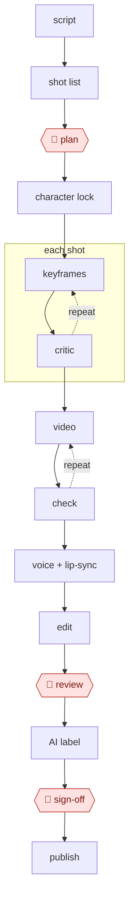

# AI shot factory

`CRE › MED › AIGCVIDEO` · checkpointed · evidence A · **draft: needs a reference example** ([how to add one](../../../../../CONTRIBUTING.md#1-add-an-example-run))

**Shape:** `script → shot list → 🛑 plan → character lock → each shot: (keyframes ⟲ critic) → (video ⟲ check) → voice + lip-sync → edit → 🛑 review → AI label → 🛑 sign-off → publish`

<!-- shape diagram: generated by scripts/build_diagrams.py from `shape`; don't edit -->

<!-- end shape diagram -->

## Background

An AI-generated episode is a short video story whose pictures, motion and voices come from generation models instead of a camera, actors and animators. Small studios and solo creators make them for short-video platforms, often as 漫剧 (comic-style short dramas), starting from a finished script. The work is a chain: break the script into shots, fix how each character looks, generate still frames, turn them into moving clips, add voices, then edit. Each generation is a gamble, so most of the effort goes on generating many candidates and throwing most of them away, and on keeping a character's face the same from shot to shot. The agent can draft the shot list, run the generation batches and screen the candidates against the plan. A director still approves the plan and the cut, because only a person can judge whether the episode works as a story, and a person must sign off the AI label and compliance check, because the publisher answers to the regulator for what goes out.

**Terms:**
- **漫剧**: a short drama in an animated or comic style; here, one whose images and video are AI-generated.
- **微短剧**: the regulator's name for short serial dramas with episodes under 20 minutes, mostly watched on phones.
- **Shot list (分镜)**: the shot-by-shot plan of an episode: number, framing, camera move, action, dialogue and duration for each shot.
- **Style frames**: sample images that fix the look of the episode before production.
- **Character lock**: making a fixed set of reference images for each character (front, side and back views, expression sheets) and feeding them into every later generation so the character stays recognisable.
- **LoRA**: a small add-on trained on one character's images that steers an image model towards that character.
- **Keyframe**: the still image a shot starts from, later turned into motion.
- **Image-to-video**: generating a moving clip from a still image and a text prompt.
- **Re-roll**: generating a shot again because the result is unusable; also called 抽卡 (drawing cards).
- **Morphing or physics breaks**: faces or objects that melt into each other, or movement that could not happen in reality.
- **Lip-sync**: matching a character's mouth movements to the generated voice.
- **Hook**: the opening seconds that must stop a viewer scrolling past.
- **AI label (显式/隐式标识)**: the explicit notice viewers see and the implicit marker embedded in the file, both required in China for AI-generated content.

## Build it with an agent

**Form:** `platform`. Keyframes, motion, voice and lip-sync come from image, video and speech generation models that a general agent cannot replace. A general agent can run the planning, screening and paperwork steps as a `project`: a skill for the shot list, a subagent as the keyframe critic, and scripts that submit batches to the generation platforms where they have an API.

**You need:** the finished script as a file; accounts on the image, video and speech generation platforms the studio uses, with API keys if batches are to be submitted by script; the character reference images kept as files the agent can read; a folder for candidates and chosen takes; the rights to any source story and any real person's likeness. Keep publishing credentials for the video platforms away from the agent.

| Step | Built as |
|---|---|
| script → shot list → 🛑 plan | A skill turns the script into a shot-list table (number, framing, camera move, action, dialogue, duration, prompt) and stops. |
| character lock | The generation platform makes the reference sheets. The skill records which reference files every shot must use. |
| each shot: (keyframes ⟲ critic) | A script beside the skill submits the candidates to the image platform's API. A subagent looks at each candidate against the shot-list row and the reference sheets and returns keep or re-roll with a reason; a person picks from what is kept. |
| (video ⟲ check) | The video platform. The same subagent checks a frame grab of each clip for morphing or physics breaks and lists re-rolls. |
| voice + lip-sync | Speech and lip-sync tools. The skill prepares the line list with emotion tags from the script. |
| edit → 🛑 review | An editing tool, outside the agent. The skill writes the edit list from the shot table and stops for the director's re-roll list. |
| AI label → 🛑 sign-off → publish | The skill prepares a compliance sheet: which shots are AI-generated, where the visible label sits, which assets came from where. A person checks it and publishes. |

**Checkpoints:** `plan`: the skill writes the shot list to a file and stops until the director approves it; generation batches cost money, so a permission rule asks before the batch script runs. `review`: the skill stops after the edit list; the director watches the cut in the editing tool and hands back a re-roll list. `sign-off`: the agent has no upload or publishing tool and no platform credentials, so an episode without the AI label cannot go out through it; a person signs the compliance sheet and publishes.

**Since the sources:** Sources and public runs date from 2025-01 to 2026-07. The public runs describe people using generation tools by hand, with directors reviewing on a schedule; none reports an agent running the chain, and the vision-model critic in step 3 has no cited source. The build above is a proposal for the steps around the generation models. Step 8 cites the 微短剧 regulation as a draft; the IT之家 report in source 14 says the final 《微短剧发展管理办法》 was issued on 2026-07-31 and took effect on 2026-09-01, keeping the label in a visible position in every AI-generated episode. A line where people review at every stage is a different entry: [AWF-0137 Gated AI 漫剧 line](../../SHORTDRAMA/gated-ai-manju-line/).

*A design based on this entry's steps and the tool documentation as of 2026-11, not a reported run.*

## Steps

*As reported by the sources.*

1. A language model turns the script into a 20–40-shot list. 🛑 **Plan**: the director approves the shot list and style frames.
2. The team locks the characters. Practitioners generate front, side, and back views plus expression sheets, and use them as references in every later generation [[16]](#sources).
3. An image model generates 4 keyframe candidates per shot in parallel. A vision-model critic filters them, then a person selects.
4. A video model turns each keyframe into a clip (image-to-video). The operator re-rolls on morphing or physics breaks.
5. A speech model generates voice per line with emotion tags, then a lip-sync tool matches the mouths.
6. The editor assembles the episode and checks the first-3-seconds hook.
7. 🛑 **Review**: the director lists re-rolls (loop back to step 3 or 4).
8. 🛑 **Sign-off**: a person checks compliance and labeling. CN rules require explicit and implicit labels on AI-generated content (in force since September 1, 2025 [[15]](#sources)). The draft 微短剧 regulation also requires a label in a visible position in every AI-generated episode [[14]](#sources).

Tools reported for each step:

| Step | Tools (CN / global) |
|---|---|
| Shot list (分镜: number, framing, camera move, action, dialogue, duration) | Doubao, DeepSeek, Claude, GPT |
| Character lock | 即梦 / Midjourney references; ComfyUI + per-character LoRA; Kling multi-image reference, 1–4 references per generation [[17]](#sources) |
| Keyframes | 即梦/Seedream, Flux, Midjourney |
| Motion | 可灵 Kling, 海螺 Hailuo, Vidu, Seedance, Veo, Runway |
| Voice and lip-sync | MiniMax, 火山引擎 TTS, ElevenLabs; lip-sync tools or native audio-video models |
| Assembly | 剪映/CapCut, Premiere |

**Reported economics (B):** a brokerage report citing Ocean Engine data puts traditional 漫剧 at ¥2–5k per minute and AI-assisted production at ¥1–2.5k. It also reports one company cutting 11 production stages to 5 [[16]](#sources).
**Metrics to record in examples:** usable-shot rate per generation, cost per finished minute, hours per episode.

## Public runs

Coverage as of 2026-11-06: **Partial**: first-hand runs that cover part of the shape or put checkpoints elsewhere. From [Where are the real runs?](../../../../../research/2026-11-real-runs.md); every number was re-checked against its page.

- [新民周刊 p.41](https://img1.xinmin.cn/xmzk/2026-07-13/410713.pdf) (Xinmin Weekly, 2026-07-13). AI review before human review; scripts expanded for AI production. "近七成都无法过审"; "5万字…可能要补充到8万字". *First-hand: interview; confidence: med.*
- [毒眸 on 钛媒体](https://www.tmtpost.com/7712427.html) (How a 10-person team made an AI manhua drama in 45 days, 2025-10-02). 珀乐互动: artist-drawn originals → AI video → edit; weekly director review. "一个仅10人的团队，用45天时间，完成了50集《明日周一》". *First-hand: interview; confidence: high.*
- [PJ Ace, *I can't believe Disney allowed us to run this AI ad*](https://pjace.beehiiv.com/p/i-can-t-believe-disney-allowed-us-to-run-this-ai-ad-during-the-nba-finals-f77e73388ab4ca62) (2025-06-11). Rough script → AI shot list and prompts → generate and re-prompt → edit. "300–400 generations to get 15 usable clips"; "One person, two days.". *First-hand: yes; confidence: high.*
- [金姬, 新民周刊](https://www.xinminweekly.com.cn/bianjituijian/2026/04/08/41135.html) (A one-person animation factory?, 2026-04-08). Storyboard frames picked from many generations → image-to-video. "110多张分镜与定稿图的1700多次AI'抽卡'"; "近20人的团队". *First-hand: interview; confidence: med.*

## Sources

14. 新华网, 微短剧分类分层审核 (February 2025). https://www.news.cn/politics/20250205/3fbf8abbfa344641b01f799ae42a6318/c.html · 新华网, 《微短剧发展管理办法(征求意见稿)》 (June 2026). https://www.news.cn/politics/20260624/5794e5cd877e440cb678a7f27112ffc7/c.html · IT之家. https://www.ithome.com/0/984/306.htm
15. 国家网信办, 《人工智能生成合成内容标识办法》 (March 14, 2025; in force September 1, 2025). https://www.cac.gov.cn/2025-03/14/c_1743654685899683.htm
16. Brokerage report on AI 漫剧 (October 2025). https://pdf.dfcfw.com/pdf/H3_AP202510241768351710_1.pdf · Practitioner storyboard notes: https://www.woshipm.com/it/6295336.html
17. Kuaishou, *Kling AI Unveils Multi-Image Reference* (January 2025). https://seekingalpha.com/pr/19978699-kuaishou-kling-ai-unveils-multi-image-reference-feature-to-further-tackle-ai-video · 环球网 coverage of Kling 3.0: https://tech.huanqiu.com/article/4QFI3Up2VEA
