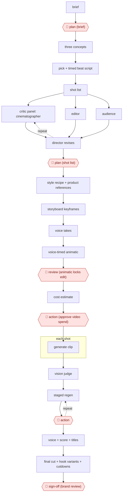

# Animatic-gated AI commercial

`CRE › MED › AIGCVIDEO` · checkpointed · evidence A · **draft: needs a reference example** ([how to add one](../../../../../CONTRIBUTING.md#1-add-an-example-run))

**Shape:** `brief → 🛑 plan (brief) → three concepts → pick + timed beat script → shot list → (critic panel: cinematographer | editor | audience ⟲ director revises) → 🛑 plan (shot list) → style recipe + product references → storyboard keyframes → voice takes → voice-timed animatic → 🛑 review (animatic locks edit) → cost estimate → 🛑 action (approve video spend) → each shot: generate clip → vision judge → (staged regen ⟲ 🛑 action) → voice + score + titles → final cut + hook variants + cutdowns → 🛑 sign-off (brand review)`
**How it differs:** AWF-0015 AI shot factory (closest). 0015 produces drama episodes with a plan gate, per-shot critic loops and a final review/AI label/sign-off. This one delivers a client ad spot plus variants, adds a voice-timed animatic gate that locks the edit before any video generation, and a separate per-batch money approval for every generation and regeneration; brand review replaces the platform AI-label step. A practitioner cannot swap them without changing deliverable and checkpoints.
**Variants:** `claude-seedance-elevenlabs-remotion` · `nano-banana-kling-veo-premiere`

<!-- shape diagram: generated by scripts/build_diagrams.py from `shape`; don't edit -->

<!-- end shape diagram -->

## Steps
1. Intake: an agent turns the product description into a one-card brief (product truth, audience, one value proposition, tone, CTA, compliance guardrails). 🛑 **Plan**: the human approves the brief before anything else runs [[1]](#sources). In-house brand practice forces the brief to one page and one spine sentence and gets concept approval by day two [[2]](#sources).
2. A creative-director agent pitches three different concepts; the human picks one and the agent writes a timed beat script (hook, problem, demo, proof, CTA) with VO paced to real reading speed, plus alternate opening hooks [[1]](#sources).
3. A breakdown agent drafts the shot list (one subject, one action, one camera move per shot). Three critic agents attack it in parallel (cinematographer, editor, audience) and a director agent revises and logs changes; deterministic lints run alongside. On the reported project the room made 19 revisions before any spend. 🛑 **Plan**: the human approves the shot list [[1]](#sources).
4. Lock the look: a style recipe (lighting with colour temperatures, lens, palette, grade intent) is pasted into every image and video prompt; real product photos ride along as identity references. Brand work builds a product-reference pipeline before generation to stop label drift; look approval lands on day three [[1]](#sources)[[2]](#sources).
5. Generate one storyboard keyframe per shot in parallel (about five cents a frame), then generate the real voice takes, measure them and build a voice-timed animatic from the keyframes. 🛑 **Review**: approving the animatic locks the edit and the generation plan (generation-seconds vs edit-seconds) [[1]](#sources).
6. 🛑 **Action**: nothing generates until the human approves the staged video jobs and their total cost estimate; each project has a hard budget cap [[1]](#sources).
7. Each clip is scored by a vision-model judge on six dimensions; failures get a one-clause corrective fix staged as a regeneration that again waits for approval. Recurring failures become lessons injected into later prompts. In brand work the director reviews every take: 63 takes reviewed, 18 used, ~71% rejected [[1]](#sources)[[2]](#sources).
8. Assemble: voice takes, generated score ducked under the voice, rendered titles and end cards; render hook variants and cutdowns (6s / 15s / vertical) without new video generation [[1]](#sources)[[2]](#sources).
9. 🛑 **Sign-off**: brand review of the hero film; in the in-house case it passed on the first structured revision round, turned around the same day [[2]](#sources).

**Output:** A finished 30-60s commercial plus hook variants and cutdowns, handed to the brand/paid-media team for release.
**Failure modes → guards:** Label/pack drift across takes → product-reference assets + frame-by-frame accuracy passes; hand-product interaction fails → budget extra takes and a compositing pass; generated garbled on-screen text → judge flags it and text is rendered in post; money burned on footage that gets cut → animatic lock and explicit spend approval before any video call.

## Public runs

Coverage as of 2026-11-13: **Strong**: a first-hand, detailed run that matches most of the shape. Collected and re-checked in [Fourth collection pass](../../../../../research/2026-11-fourth-pass.md).

- [Micheal Lanham, Commercial Creator walkthrough](https://medium.com/@Micheal-Lanham/i-built-an-ai-agency-that-makes-finished-tv-commercials-for-15-heres-the-full-walkthrough-275795f9465d) (2026-07-11). Five finished spots through brief, shot-list, animatic and spend gates with a vision judge. "Each cost between $14 and $27 in API spend.". *First-hand: yes; confidence: high.*
- [Mohammad Nasravi, AI food commercial case study](https://nasravi.com/ai-creative-insights/ai-food-commercial-case-study/) (2026-08-31). In-house FMCG 30s film; concept and look approvals, one revision round, brand review. "Generated takes reviewed | 63". *First-hand: yes; confidence: high.*
- [Nik Aslam, Making Deriv's tagline video](https://derivai.substack.com/p/making-derivs-tagline-video) (2025-12-08). Brand team's 45s video: start/end frames, 5–10 clips per scene, pick best. "Usable generation ratio: ~13.3%". *First-hand: yes; confidence: med.*

## Sources

1. Micheal Lanham, I Built an AI Agency That Makes Finished TV Commercials for ~$15 — Here's the Full Walkthrough, 2026-07-11. https://medium.com/@Micheal-Lanham/i-built-an-ai-agency-that-makes-finished-tv-commercials-for-15-heres-the-full-walkthrough-275795f9465d
2. Mohammad Nasravi, Case Study: A Cinematic AI Ad for a Food Brand — With the Numbers Included, 2026-08-31. https://nasravi.com/ai-creative-insights/ai-food-commercial-case-study/
3. Nik Aslam (Deriv), Making Deriv's tagline video, 2025-12-08. https://derivai.substack.com/p/making-derivs-tagline-video
