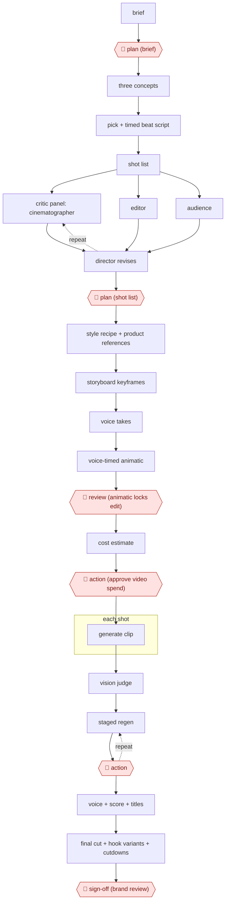

# Animatic-gated AI commercial

`CRE › MED › AIGCVIDEO` · checkpointed · evidence A · **draft: needs a reference example** ([how to add one](../../../../../CONTRIBUTING.md#1-add-an-example-run))

**Shape:** `brief → 🛑 plan (brief) → three concepts → pick + timed beat script → shot list → (critic panel: cinematographer | editor | audience ⟲ director revises) → 🛑 plan (shot list) → style recipe + product references → storyboard keyframes → voice takes → voice-timed animatic → 🛑 review (animatic locks edit) → cost estimate → 🛑 action (approve video spend) → each shot: generate clip → vision judge → (staged regen ⟲ 🛑 action) → voice + score + titles → final cut + hook variants + cutdowns → 🛑 sign-off (brand review)`
**Variants:** `claude-seedance-elevenlabs-remotion` · `nano-banana-kling-veo-premiere`

<!-- shape diagram: generated by scripts/build_diagrams.py from `shape`; don't edit -->

<!-- end shape diagram -->

## Background

A commercial is a short film, usually 15 to 60 seconds, made to sell one product. The client (the brand) pays for it and answers for what it says. Normally an agency writes a brief, develops concepts, plans the shots, films them and edits the result. Here the pictures and clips come from image and video generation models, and each clip costs money to generate and is usable only some of the time. The expensive mistake is generating video for a shot that is later cut or changed, so the work settles the plan, the shot list and a rough timed cut built from still images before any video is generated, and approves spend in batches. The agent writes the brief, concepts and shot list, has several critic roles attack the shot list, and assembles the cut. People approve each gate, because the client owns the message and the budget and the brand answers for the claims and the look of the finished film.

**Terms:**
- **Brief**: a one-page statement of the product, the audience, the one thing the ad must say, the tone and the call to action.
- **CTA**: call to action, the line telling the viewer what to do next.
- **Beat script**: the ad written as timed beats (hook, problem, demo, proof, CTA) with the voice-over paced to real reading speed.
- **Hook**: the opening seconds that must stop a viewer scrolling past.
- **Shot list**: the shot-by-shot plan of the film, here one subject, one action and one camera move per shot.
- **Keyframe / storyboard**: the still image a shot starts from; one per shot makes a storyboard.
- **Animatic**: a rough film made from the stills and the recorded voice, timed to the final length. Approving it fixes the edit.
- **Style recipe**: a fixed description of lighting, lens, palette and grade pasted into every image and video prompt so the shots match.
- **Vision judge**: an image-understanding model that scores each generated clip against the shot list and the style recipe.
- **Hook variants and cutdowns**: alternative opening seconds, and shorter or vertical versions (6 s, 15 s) cut from the same footage.
- **Label drift**: the product's label or pack changing shape from take to take.

## Build it with an agent

**Form:** `platform`. The keyframes and clips come from image and video generation models that a general agent cannot replace. A general agent can run every other step as a `project`: skills for the brief, beat script and shot list, subagents as the critic panel and the vision judge, and a hook that stops any paid generation call that has not been approved.

**You need:** the product description and real product photos as files; accounts and API keys for the image, video and voice generation services the studio uses; a project budget cap written down where the agent can read it; a folder for keyframes, takes and the animatic; the client's compliance guardrails for the product category.

| Step | Built as |
|---|---|
| brief → 🛑 plan (brief) | A skill fills in the one-card brief from the product description, then stops. |
| three concepts → pick + timed beat script | The skill drafts three different concepts and stops for the pick; it then writes the beat script and alternate hooks. |
| shot list → (critic panel ⟲ director revises) → 🛑 plan (shot list) | The skill drafts the shot list. Three read-only subagents (cinematographer, editor, audience) each return their objections; the main conversation revises and logs the changes. A script checks the one-subject, one-action, one-move rule. |
| style recipe + product references → storyboard keyframes | A reference file holds the style recipe, pasted into every prompt by the skill. A script submits one keyframe per shot to the image service, with the product photos as references. |
| voice takes → voice-timed animatic → 🛑 review | A script requests the voice takes and measures their length; the skill lists the keyframes against those timings. The animatic is assembled in an editing tool outside the agent. |
| cost estimate → 🛑 action (approve video spend) | The skill totals the staged video jobs against the budget cap and stops. See Checkpoints. |
| each shot: generate clip → vision judge → (staged regen ⟲ 🛑 action) | A script submits only approved jobs to the video service. A subagent scores each clip on the shot list and style recipe and returns pass or a one-clause fix; a fix is staged as a new job and waits for approval. |
| voice + score + titles → final cut + hook variants + cutdowns | An editing or rendering tool, outside the agent. The skill writes the cut list and the titles text. |
| 🛑 sign-off (brand review) | A person at the brand. See Checkpoints. |

**Checkpoints:** `plan`: the skill stops after the brief and again after the revised shot list, and does not go on until the person approves each file. `review`: the skill stops after listing the animatic's timings and shots; approving the animatic locks the edit and the generation plan. `action`: video generation costs money, so the agent has no direct key to the video service. A `PreToolUse` hook blocks the submit script unless the job is on an approved list the person writes, and every regeneration is a new job needing the same approval. `sign-off`: the agent has no upload or publish tool, and the brand reviews the hero film in its own channel.

**Since the sources:** Sources date from 2025-12 to 2026-08. They describe individual practitioners and one in-house team running these gates with generation tools; the lines naming "agents" (creative director, breakdown, critics) are roles that a skill and subagents can play today. The build keeps the money gates the sources report and leaves out their specific tools, which are listed under `variants`. Source 1 could not be opened in this session (the site refused the request), so its steps are taken from the entry text. No part of this build has been run; the reported runs used hand-built setups.

*A design based on this entry's steps and the tool documentation as of 2026-11, not a reported run.*

## Steps

*As reported by the sources.*

1. The agent turns the product description into a one-card brief (product truth, audience, one value proposition, tone, CTA, compliance guardrails). 🛑 **Plan**: the human approves the brief before anything else runs [[1]](#sources). In-house brand practice forces the brief to one page and one spine sentence and gets concept approval by day two [[2]](#sources).
2. A creative-director agent pitches three different concepts; the human picks one and the agent writes a timed beat script (hook, problem, demo, proof, CTA) with VO paced to real reading speed, plus alternate opening hooks [[1]](#sources).
3. A breakdown agent drafts the shot list (one subject, one action, one camera move per shot). Three critic agents attack it in parallel (cinematographer, editor, audience) and a director agent revises and logs changes; deterministic lints run alongside. On the reported project the room made 19 revisions before any spend. 🛑 **Plan**: the human approves the shot list [[1]](#sources).
4. The team locks the look: a style recipe (lighting with colour temperatures, lens, palette, grade intent) is pasted into every image and video prompt; real product photos ride along as identity references. Brand work builds a product-reference pipeline before generation to stop label drift; look approval lands on day three [[1]](#sources)[[2]](#sources).
5. The agent generates one storyboard keyframe per shot in parallel (about five cents a frame), then generates the real voice takes, measures them and builds a voice-timed animatic from the keyframes. 🛑 **Review**: approving the animatic locks the edit and the generation plan (generation-seconds vs edit-seconds) [[1]](#sources).
6. 🛑 **Action**: no video is generated until the human approves the staged video jobs and their total cost estimate; each project has a hard budget cap [[1]](#sources).
7. A vision-model judge scores each clip on six dimensions; failures get a one-clause corrective fix staged as a regeneration that again waits for approval. Recurring failures become lessons injected into later prompts. In brand work the director reviews every take: 63 takes reviewed, 18 used, ~71% rejected [[1]](#sources)[[2]](#sources).
8. The agent assembles the voice takes, generated score ducked under the voice, rendered titles and end cards; it renders hook variants and cutdowns (6s / 15s / vertical) without new video generation [[1]](#sources)[[2]](#sources).
9. 🛑 **Sign-off**: brand review of the hero film; in the in-house case it passed on the first structured revision round, turned around the same day [[2]](#sources).

**Output:** A finished 30-60s commercial plus hook variants and cutdowns, handed to the brand/paid-media team for release.
**Failure modes → guards:** Label/pack drift across takes → product-reference assets + frame-by-frame accuracy passes; hand-product interaction fails → budget extra takes and a compositing pass; generated garbled on-screen text → judge flags it and text is rendered in post; money burned on footage that gets cut → animatic lock and explicit spend approval before any video call.
**How it differs:** AWF-0015 AI shot factory (closest). 0015 produces drama episodes with a plan gate, per-shot critic loops and a final review/AI label/sign-off. This one delivers a client ad spot plus variants, adds a voice-timed animatic gate that locks the edit before any video generation, and a separate per-batch money approval for every generation and regeneration; brand review replaces the platform AI-label step. A practitioner cannot swap them without changing deliverable and checkpoints.

## Public runs

Coverage as of 2026-11-13: **Strong**: a first-hand, detailed run that matches most of the shape. Collected and re-checked in [Fourth collection pass](../../../../../research/2026-11-fourth-pass.md).

- [Micheal Lanham, Commercial Creator walkthrough](https://medium.com/@Micheal-Lanham/i-built-an-ai-agency-that-makes-finished-tv-commercials-for-15-heres-the-full-walkthrough-275795f9465d) (2026-07-11). Five finished spots through brief, shot-list, animatic and spend gates with a vision judge. "Each cost between $14 and $27 in API spend.". *First-hand: yes; confidence: high.*
- [Mohammad Nasravi, AI food commercial case study](https://nasravi.com/ai-creative-insights/ai-food-commercial-case-study/) (2026-08-31). In-house FMCG 30s film; concept and look approvals, one revision round, brand review. "Generated takes reviewed | 63". *First-hand: yes; confidence: high.*
- [Nik Aslam, Making Deriv's tagline video](https://derivai.substack.com/p/making-derivs-tagline-video) (2025-12-08). Brand team's 45s video: start/end frames, 5–10 clips per scene, pick best. "Usable generation ratio: ~13.3%". *First-hand: yes; confidence: med.*

## Sources

1. Micheal Lanham, I Built an AI Agency That Makes Finished TV Commercials for ~$15 — Here's the Full Walkthrough, 2026-07-11. https://medium.com/@Micheal-Lanham/i-built-an-ai-agency-that-makes-finished-tv-commercials-for-15-heres-the-full-walkthrough-275795f9465d
2. Mohammad Nasravi, Case Study: A Cinematic AI Ad for a Food Brand — With the Numbers Included, 2026-08-31. https://nasravi.com/ai-creative-insights/ai-food-commercial-case-study/
3. Nik Aslam (Deriv), Making Deriv's tagline video, 2025-12-08. https://derivai.substack.com/p/making-derivs-tagline-video
