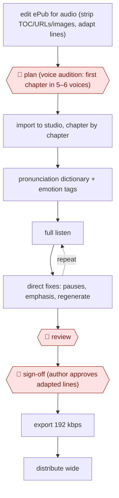

# Directed AI audiobook

`CRE › MED › AUDIO` · assist · evidence A · **draft: needs a reference example** ([how to add one](../../../../../CONTRIBUTING.md#1-add-an-example-run))

**Shape:** `edit ePub for audio (strip TOC/URLs/images, adapt lines) → 🛑 plan (voice audition: first chapter in 5–6 voices) → import to studio, chapter by chapter → pronunciation dictionary + emotion tags → (full listen ⟲ direct fixes: pauses, emphasis, regenerate) → 🛑 review → 🛑 sign-off (author approves adapted lines) → export 192 kbps → distribute wide`
**How it differs:** AWF-0078 Episode post-production chain cleans up and captions recorded podcast audio. This run synthesises a book-length narration from text, with voice casting up front and a directed full listen. The source (text, not recording), the deliverable and the checkpoints all differ.
**Variants:** `elevenlabs-studio` · `findaway-voices`

<!-- shape diagram: generated by scripts/build_diagrams.py from `shape`; don't edit -->

<!-- end shape diagram -->

## Steps
1. Prepare the manuscript as an audio adaptation. Delete the table of contents, URLs and images. The author may rewrite sentences that read badly aloud [[1]](#sources).
2. 🛑 **Plan**: generate the first chapter in five or six voices and commit to one before producing the book [[1]](#sources).
3. Load the ePub into ElevenLabs Studio, which splits it into chapters and paragraphs. Fix names once with a pronunciation dictionary (for example the 'desert'/'dessert' slip) [[1]](#sources).
4. Add v3 emotion tags such as [whispers] or [shouts]. An auto-tag button suggests them, and they are not read aloud [[1]](#sources).
5. 🛑 **Review**: the producer listens end to end, 'directing' with added pauses, breaths, emphasis and regenerations. Fiction needs two or three days, while non-fiction is close to one listen [[1]](#sources).
6. 🛑 **Sign-off**: the author approves the line changes in the adaptation. A producer working for an author can't make those changes alone [[1]](#sources).
7. Export at 192 kbps (the Pro tier) and distribute wide: Findaway to Spotify, BookFunnel, own website [[1]](#sources).

**Output:** WAV/MP3 audiobook masters the publisher owns, distributed outside Audible exclusivity.
**Failure modes → guards:** Committing to a voice that grates a few chapters in → voice audition up front. Mispronounced names and homographs → global pronunciation dictionary. Flat dialogue → emotion tags plus full directed listen.

## Public runs

Coverage as of 2026-11-06: **Partial**: first-hand runs that cover part of the shape or put checkpoints elsewhere. Collected and re-checked in [Second collection pass](../../../../../research/2026-11-second-pass.md).

- [The Creative Penn, Producing AI-Narrated Audiobooks Using ElevenLabs](https://www.thecreativepenn.com/2025/06/27/producing-ai-narrated-audiobooks-using-elevenlabs-with-simon-patrick/) (2025-06-27). Producer's own process; novella Death Valley made with author's voice clone. "Your novella, Death Valley, was six and a half hours long. That took 18 hours of editing.". *First-hand: interview (producer on the author's podcast); confidence: high.*

## Sources

1. Joanna Penn with Simon Patrick, The Creative Penn podcast, 'Producing AI-Narrated Audiobooks Using ElevenLabs With Simon Patrick', 2025-06-27. https://www.thecreativepenn.com/2025/06/27/producing-ai-narrated-audiobooks-using-elevenlabs-with-simon-patrick/
