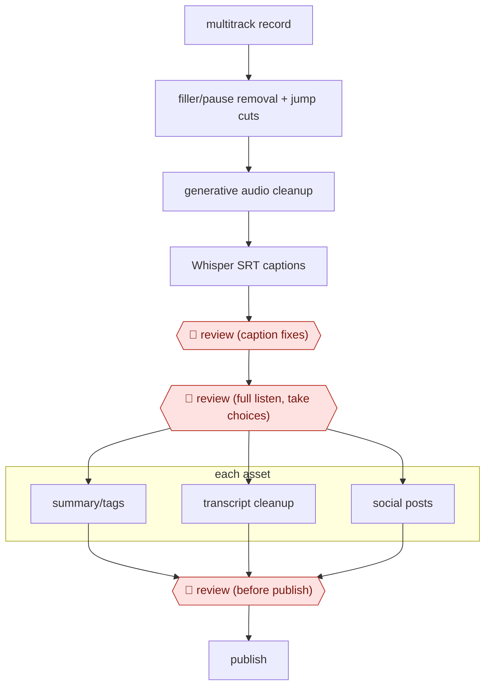

# Episode post-production chain

`CRE › MED › AUDIO` · assist · evidence A · **draft: needs a reference example** ([how to add one](../../../../../CONTRIBUTING.md#1-add-an-example-run))

**Shape:** `multitrack record → filler/pause removal + jump cuts → generative audio cleanup → Whisper SRT captions → 🛑 review (caption fixes) → 🛑 review (full listen, take choices) → each asset: summary/tags | transcript cleanup | social posts → 🛑 review (before publish) → publish`
**How it differs:** AWF-0017 Dubbing pipeline translates and re-voices audio. This workflow edits and packages an original-language episode.
**Variants:** `descript` · `adobe-premiere-adobe-podcast-whisper`

<!-- shape diagram: generated by scripts/build_diagrams.py from `shape`; don't edit -->

<!-- end shape diagram -->

## Steps
1. Record each speaker and camera as a separate track (StreamYard) so tracks can be edited independently [[1]](#sources).
2. Remove pauses and filler words and make jump cuts in Descript or Adobe Premiere. Clean poor recordings with Adobe Podcast's generative enhancement [[1]](#sources).
3. Generate captions in SRT format with Whisper. 🛑 **Review**: correct the SRT by hand rather than trusting the tool's guesses [[1]](#sources).
4. 🛑 **Review**: the producer listens to the full episode to check the storyline and make judgment calls, such as which of a guest's takes to keep [[1]](#sources).
5. Generate intro and outro music with Soundraw (often 10 to 15 variations), plus audiograms or highlight reels (Headliner, Descript) [[1]](#sources).
6. Separate prompts draft the YouTube summary and tags, clean up the website transcript (Gemini) and draft social posts. 🛑 **Review**: a person checks transcripts, summaries and social posts for errors before publishing [[1]](#sources).

**Output:** An episode on YouTube and podcast feeds, with a cleaned web transcript, captions and social posts.
**Failure modes → guards:** Filler removal clipping mid-sentence or cutting wanted pauses → the full-listen review. Errors in AI transcripts or summaries → review before anything publishes. Generated music needing many tries → budget 10 to 15 generations.

## Public runs

Coverage as of 2026-11-06: **Partial**: first-hand runs that cover part of the shape or put checkpoints elsewhere. Collected and re-checked in [New workflows for empty categories](../../../../../research/2026-11-new-workflows.md).

- [Trust Insights, So What? AI Podcast Editing](https://www.trustinsights.ai/blog/2024/06/so-what-ai-podcast-editing-level-up-your-workflow/) (2024-06-07). Team's own show production: time budgets, tools and where people review. "usually three hours for 30 minutes worth of stuff" (Wall, AI-generated transcript). *First-hand: yes; confidence: med.*

## Sources

1. Trust Insights (Kelsey Richard, page author; with John Wall, Christopher Penn, Katie Robbert), So What? AI Podcast Editing: Level Up Your Workflow, 2024-06-07. https://www.trustinsights.ai/blog/2024/06/so-what-ai-podcast-editing-level-up-your-workflow/
