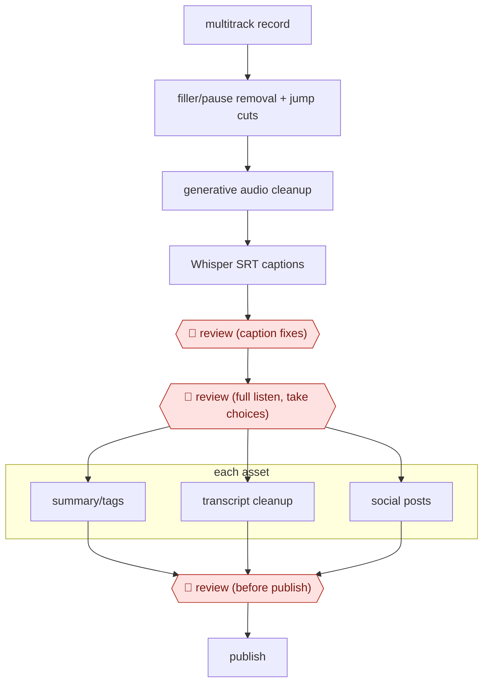

# Episode post-production chain

`CRE › MED › AUDIO` · assist · evidence A · **draft: needs a reference example** ([how to add one](../../../../../CONTRIBUTING.md#1-add-an-example-run))

**Shape:** `multitrack record → filler/pause removal + jump cuts → generative audio cleanup → Whisper SRT captions → 🛑 review (caption fixes) → 🛑 review (full listen, take choices) → each asset: summary/tags | transcript cleanup | social posts → 🛑 review (before publish) → publish`
**Variants:** `descript` · `adobe-premiere-adobe-podcast-whisper`

<!-- shape diagram: generated by scripts/build_diagrams.py from `shape`; don't edit -->

<!-- end shape diagram -->

## Background

A podcast episode starts as a raw recording of people talking, often on separate tracks, one per speaker or camera. Before it is published someone has to cut the pauses and "um"s, repair poor sound, add captions, add music, listen to the whole episode to decide which takes stay, and write the supporting material: a description with tags, a cleaned transcript for the website and posts for social media. The editing and the packaging are repetitive and take hours for a short show. The agent can produce the captions and draft the written assets from the transcript, and audio tools do the cutting and cleanup. A person still listens to the whole episode and approves what is published, because only a listener can judge whether a cut sounds natural or a guest's remark was kept in context, and the show is answerable for what appears under its name.

**Terms:**
- **Multitrack recording**: each speaker or camera saved as its own audio or video track, so one can be edited without disturbing the others.
- **Jump cut**: removing a pause or a mistake so the speech skips straight to the next words.
- **Generative audio cleanup**: an AI tool that repairs noisy or thin recordings by regenerating clearer speech.
- **SRT**: a plain-text caption file; each entry has a number, a start and end time and the words shown.
- **Whisper**: a speech-recognition model that turns audio into text and timed captions.
- **Audiogram**: a short video of a waveform and captions, used to promote an episode on social media.
- **Show notes**: the written description of an episode, with a summary and tags.

## Build it with an agent

**Form:** `skill`. One producer edits one episode at a time and stays in the conversation, so a skill that holds the packaging steps is enough. The audio cutting and generative cleanup run in the audio editor the producer already uses, outside the agent. (Weighed against `platform`; chosen `skill` because the agent's own steps are all text.)

**You need:** the episode audio exported as a file; a way to run a speech-recognition model such as Whisper on it, locally or as a service; the show's house style for descriptions, tags and social posts as a reference file; the producer's audio editor. Keep guests' unreleased material out of any service the show has not approved.

| Step | Built as |
|---|---|
| multitrack record → filler/pause removal + jump cuts → generative audio cleanup | The producer, in the audio editor. The agent takes no part. |
| Whisper SRT captions → 🛑 review (caption fixes) | A script beside the skill runs Whisper and writes the SRT. The skill lists names and uncommon words for the producer to check, then stops. |
| 🛑 review (full listen, take choices) | The producer listens to the whole episode in the editor. The skill stops until the producer says the cut is final. |
| each asset: summary/tags \| transcript cleanup \| social posts | Three drafts from the final transcript. Built-in subagents can write them in parallel, each following the house-style file. |
| 🛑 review (before publish) → publish | See Checkpoints. |

**Checkpoints:** `review`: the skill stops three times, after the SRT, after the producer's full listen and after the drafts. At each stop it presents the file and waits. The agent has no publishing tool and no access to the show's accounts, so publishing is done by the producer from the podcast host and video site.

**Since the sources:** The one source and the one public run date from 2024-06. A newer account of the same practice: Descript's June 2026 post says its in-app agent Underlord can now analyse video visually, not only the transcript ([Descript blog](https://www.descript.com/blog/article/underlord-ai-can-watch-videos)), and Anthropic's customer case study says Underlord runs on Claude ([Claude customer case study](https://claude.com/es/customers/descript)). So the editing steps that the source did by hand with transcript-based tools may now be done by an agent inside the editor; this build does not rely on that and leaves the cutting with the producer. The source's separate prompts for the summary and the social posts are now a normal use of a general model on a transcript. This build leaves out music generation and audiograms, which the source covers.

*A design based on this entry's steps and the tool documentation as of 2026-11, not a reported run.*

## Steps

*As reported by the sources.*

1. The producer records each speaker and camera as a separate track (StreamYard) so tracks can be edited independently [[1]](#sources).
2. The producer removes pauses and filler words and makes jump cuts in Descript or Adobe Premiere, and cleans poor recordings with Adobe Podcast's generative enhancement [[1]](#sources).
3. Whisper generates captions in SRT format. 🛑 **Review**: correct the SRT by hand rather than trusting the tool's guesses [[1]](#sources).
4. 🛑 **Review**: the producer listens to the full episode to check the storyline and make judgment calls, such as which of a guest's takes to keep [[1]](#sources).
5. The producer generates intro and outro music with Soundraw (often 10 to 15 variations), and makes audiograms or highlight reels (Headliner, Descript) [[1]](#sources).
6. The producer uses separate prompts to draft the YouTube summary and tags, clean up the website transcript (Gemini) and draft social posts. 🛑 **Review**: a person checks transcripts, summaries and social posts for errors before publishing [[1]](#sources).

**Output:** An episode on YouTube and podcast feeds, with a cleaned web transcript, captions and social posts.
**Failure modes → guards:** Filler removal clipping mid-sentence or cutting wanted pauses → the full-listen review. Errors in AI transcripts or summaries → review before anything publishes. Generated music needing many tries → budget 10 to 15 generations.
**How it differs:** AWF-0017 Dubbing pipeline translates and re-voices audio. This workflow edits and packages an original-language episode.

## Public runs

Coverage as of 2026-11-06: **Partial**: first-hand runs that cover part of the shape or put checkpoints elsewhere. Collected and re-checked in [New workflows for empty categories](../../../../../research/2026-11-new-workflows.md).

- [Trust Insights, So What? AI Podcast Editing](https://www.trustinsights.ai/blog/2024/06/so-what-ai-podcast-editing-level-up-your-workflow/) (2024-06-07). Team's own show production: time budgets, tools and where people review. "usually three hours for 30 minutes worth of stuff" (Wall, AI-generated transcript). *First-hand: yes; confidence: med.*

## Sources

1. Trust Insights (Kelsey Richard, page author; with John Wall, Christopher Penn, Katie Robbert), So What? AI Podcast Editing: Level Up Your Workflow, 2024-06-07. https://www.trustinsights.ai/blog/2024/06/so-what-ai-podcast-editing-level-up-your-workflow/
