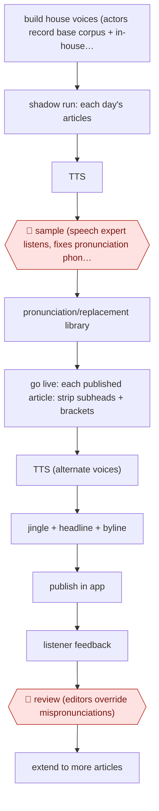

# House-voice article audio

`CRE › MED › AUDIO` · sampled · evidence B · **draft: needs a reference example** ([how to add one](../../../../../CONTRIBUTING.md#1-add-an-example-run))

**Shape:** `build house voices (actors record base corpus + in-house sentences) → shadow run: each day's articles → TTS → 🛑 sample (speech expert listens, fixes pronunciation phonetically) → pronunciation/replacement library → go live: each published article: strip subheads + brackets → TTS (alternate voices) → jingle + headline + byline → publish in app → listener feedback → 🛑 review (editors override mispronunciations) → extend to more articles`
**How it differs:** Nearest is AWF-0139 (Directed AI audiobook). That is an assist-level, chapter-by-chapter directed listen of one book with author sign-off. Here a newsroom pipeline narrates every article unattended after a sampled shadow period, and people only maintain the lexicon and answer feedback. Deliverable (per-article audio stream), autonomy (sampled) and checkpoints all differ. AWF-0078 is podcast post-production of recorded audio.
**Variants:** `azure-speech-custom-voice` · `google-wavenet-speechbert` · `elevenlabs-beyondwords`

<!-- shape diagram: generated by scripts/build_diagrams.py from `shape`; don't edit -->

<!-- end shape diagram -->

## Steps
1. Build house voices: actors record the vendor's base corpus plus 400 sentences taken from the paper's own articles, so the voice handles the paper's long, quote-heavy style. Le Monde used a male and a female voice that alternate per article (not for interviews or editorials) [[1]](#sources).
2. 🛑 **Sample**: in a 2-month shadow run, 20 articles a day are generated automatically and not broadcast. A speech expert listens and corrects words phonetically [[1]](#sources).
3. Keep a replacement/pronunciation library so editors can override default pronunciation of difficult words. The library grows over time [[1]](#sources)[[2]](#sources).
4. Go live: each selected article is converted automatically, excluding subheads and anything in brackets, with a jingle, headline, intro and writer, and published in the subscriber app [[1]](#sources).
5. 🛑 **Review**: editors correct reported mispronunciations through the admin interface's replacements area [[2]](#sources).
6. Collect listener feedback (launch pop-up), watch completion and listening time, then extend coverage. Le Monde went from 20 articles a day to the whole paper, excluding articles with many maps or graphics [[1]](#sources).

**Output:** Audio versions of articles in the publisher's app or site, generated as articles publish.
**Failure modes → guards:** Generic voices sound alike and tire listeners → custom house voices, alternated [1]. The house style breaks TTS rhythm → train on in-house sentences instead of changing the writing [1]. Mispronunciations erode trust → shadow period with an expert listener + a persistent replacement library [1][2].

## Public runs

Coverage as of 2026-11-13: **Weak**: only anonymous, vendor-linked or journalist-told accounts. Collected and re-checked in [Third collection pass](../../../../../research/2026-11-third-pass.md).

- [Microsoft, Le Monde audio articles](https://www.microsoft.com/en/customers/story/1642942168798077445-lemonde-media-entertainment-azure-en-france) (page dated 2023-06-03, text since updated). Shadow run with an expert listener, then daily audio for 20 articles, then the whole paper. "Over a 2-month period, 20 articles were generated automatically in audio format every day without being broadcasted"; "72% of the article read on average"; "over 100 articles a day". *First-hand: vendor; confidence: med.*
- [Diesdas Digital, Speechbert for ZEIT ONLINE](https://www.diesdas.digital/en/cases/speechbert) (undated). Article-to-audio within seconds of publishing; editors keep a replacement library for pronunciation. "over 250,000 text-to-speech conversions since launch". *First-hand: vendor; confidence: med.*

## Sources

1. Microsoft customer story, Introducing Audio Articles: A New Service for Subscribers of Le Monde Powered by Microsoft Azure Cognitive Services (vendor, quotes Le Monde staff). https://www.microsoft.com/en/customers/story/1642942168798077445-lemonde-media-entertainment-azure-en-france
2. Diesdas Digital (agency case), From articles to audio with Speechbert (ZEIT ONLINE). https://www.diesdas.digital/en/cases/speechbert
