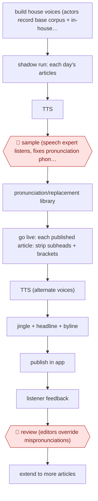

# House-voice article audio

`CRE › MED › AUDIO` · sampled · evidence B · **draft: needs a reference example** ([how to add one](../../../../../CONTRIBUTING.md#1-add-an-example-run))

**Shape:** `build house voices (actors record base corpus + in-house sentences) → shadow run: each day's articles → TTS → 🛑 sample (speech expert listens, fixes pronunciation phonetically) → pronunciation/replacement library → go live: each published article: strip subheads + brackets → TTS (alternate voices) → jingle + headline + byline → publish in app → listener feedback → 🛑 review (editors override mispronunciations) → extend to more articles`
**Variants:** `azure-speech-custom-voice` · `google-wavenet-speechbert` · `elevenlabs-beyondwords`

<!-- shape diagram: generated by scripts/build_diagrams.py from `shape`; don't edit -->

<!-- end shape diagram -->

## Background

Some newspapers and news sites offer a spoken version of each article, so subscribers can listen while commuting or cooking. Having a human narrator record every article, every day, is not practical, so the audio is generated by a text-to-speech (TTS) system that reads the article aloud. The risk is that the generated voice mispronounces names and unusual words, which readers notice and which erodes trust in the paper. The system therefore uses voices made specially for the publication, and keeps a growing list of corrections. After the voices are built and tested, the pipeline converts each article as it is published, without anyone starting it. A speech expert first listens to a sample of the output to find recurring errors, and later the editors fix any mispronunciation that listeners report, because only a person who knows the subject and the paper's names can say how a word should sound.

**Terms:**
- **TTS (text-to-speech)**: software that generates spoken audio from written text.
- **House voice**: a synthetic voice built from recordings by actors hired by the publisher, so that it is the publication's own and not a stock voice.
- **Corpus**: the set of sentences the actors read, from which the voice is trained.
- **Shadow run**: a trial period in which audio is generated every day but not released to listeners.
- **Pronunciation or replacement library**: a list of words and the spellings or sounds that make the TTS say them correctly.
- **Subheads**: the short headings inside an article, which are left out of the audio.
- **Jingle**: a short fixed sound played before the narration.

## Build it with an agent

**Form:** `platform`. The voices come from a custom speech model that a general agent cannot replace. A general agent can run everything around it as a `service`: it starts when an article is published and nobody is at the keyboard, and people see only a review queue.

**You need:** the publisher's content system, reached by an MCP connector or an API, that signals a published article; a custom-voice TTS service and the house voices built with it; a store for the pronunciation library, plus a place for the sampled audio and the listener reports; an editor queue (a ticket system or shared folder). The agent must not hold unpublished articles beyond what the TTS service is approved to receive.

| Step | Built as |
|---|---|
| build house voices | Done with the TTS vendor and the actors, outside the agent. |
| shadow run → 🛑 sample | A cloud scheduled task, or your own scheduler starting `claude -p`, picks the day's articles. A script sends each to the TTS service. A fixed share is put in a review folder for the speech expert; nothing is released to listeners. |
| pronunciation/replacement library | A file or table that the script applies before synthesis. The agent proposes additions from the expert's notes; a person accepts them. |
| go live: strip subheads + brackets → TTS → jingle + headline + byline | A script strips the parts to be left out, calls the TTS service, and adds the jingle and the spoken headline and byline. |
| publish in app → listener feedback | The content system publishes the audio. Reports of mispronunciations arrive in the queue; the agent groups them by word. |
| 🛑 review → extend to more articles | See Checkpoints. |

**Checkpoints:** `sample`: during the shadow run and afterwards, a fixed share of each day's audio is copied to the speech expert's queue; the expert's corrections feed the library and decide when the run goes live. `review`: the agent only proposes a replacement for each reported word and posts it to the editors' queue. It has no tool that edits the live library; an editor applies the change in the admin screen.

**Since the sources:** Source 1 is a vendor story whose page is dated 2023-06 and has since been updated; source 2 is undated. No newer first-hand account of this workflow was found as of 2026-11. Newer material is vendor-side: BeyondWords describes pronunciation rules that editors set in project settings or through an API ([BeyondWords blog](https://beyondwords.io/blog/enhancing-ai-generated-audio-articles-with-pronunciation-rules-2/)), and the South China Morning Post announced improved narration of its articles ([SCMP](https://www.scmp.com/announcements/article/3367019/high-quality-natural-audio-listen-scmp-articles-improved-narration)). The vendor tool in source 1, Azure custom voice, remains a Limited Access feature: only approved customers can use it ([Microsoft Learn](https://learn.microsoft.com/en-us/azure/ai-services/cognitive-services-limited-access)). A publisher without that approval would use another TTS vendor's custom or cloned voice. Both sources are vendor or agency accounts, not an independent report.

*A design based on this entry's steps and the tool documentation as of 2026-11, not a reported run.*

## Steps

*As reported by the sources.*

1. The newsroom builds house voices: actors record the vendor's base corpus plus 400 sentences taken from the paper's own articles, so the voice handles the paper's long, quote-heavy style. Le Monde used a male and a female voice that alternate per article (not for interviews or editorials) [[1]](#sources).
2. 🛑 **Sample**: in a 2-month shadow run, the system generates 20 articles a day automatically and does not broadcast them. A speech expert listens and corrects words phonetically [[1]](#sources).
3. The newsroom keeps a replacement/pronunciation library so editors can override default pronunciation of difficult words. The library grows over time [[1]](#sources)[[2]](#sources).
4. At go-live, the system converts each selected article automatically, excluding subheads and anything in brackets, adds a jingle, headline, intro and writer, and publishes it in the subscriber app [[1]](#sources).
5. 🛑 **Review**: editors correct reported mispronunciations through the admin interface's replacements area [[2]](#sources).
6. The newsroom collects listener feedback (launch pop-up), watches completion and listening time, then extends coverage. Le Monde went from 20 articles a day to the whole paper, excluding articles with many maps or graphics [[1]](#sources).

**Output:** Audio versions of articles in the publisher's app or site, generated as articles publish.
**Failure modes → guards:** Generic voices sound alike and tire listeners → custom house voices, alternated [1]. The house style breaks TTS rhythm → train on in-house sentences instead of changing the writing [1]. Mispronunciations erode trust → shadow period with an expert listener + a persistent replacement library [1][2].
**How it differs:** Nearest is AWF-0139 (Directed AI audiobook). That is an assist-level, chapter-by-chapter directed listen of one book with author sign-off. Here a newsroom pipeline narrates every article unattended after a sampled shadow period, and people only maintain the lexicon and answer feedback. Deliverable (per-article audio stream), autonomy (sampled) and checkpoints all differ. AWF-0078 is podcast post-production of recorded audio.

## Public runs

Coverage as of 2026-11-13: **Weak**: only anonymous, vendor-linked or journalist-told accounts. Collected and re-checked in [Third collection pass](../../../../../research/2026-11-third-pass.md).

- [Microsoft, Le Monde audio articles](https://www.microsoft.com/en/customers/story/1642942168798077445-lemonde-media-entertainment-azure-en-france) (page dated 2023-06-03, text since updated). Shadow run with an expert listener, then daily audio for 20 articles, then the whole paper. "Over a 2-month period, 20 articles were generated automatically in audio format every day without being broadcasted"; "72% of the article read on average"; "over 100 articles a day". *First-hand: vendor; confidence: med.*
- [Diesdas Digital, Speechbert for ZEIT ONLINE](https://www.diesdas.digital/en/cases/speechbert) (undated). Article-to-audio within seconds of publishing; editors keep a replacement library for pronunciation. "over 250,000 text-to-speech conversions since launch". *First-hand: vendor; confidence: med.*

## Sources

1. Microsoft customer story, Introducing Audio Articles: A New Service for Subscribers of Le Monde Powered by Microsoft Azure Cognitive Services (vendor, quotes Le Monde staff). https://www.microsoft.com/en/customers/story/1642942168798077445-lemonde-media-entertainment-azure-en-france
2. Diesdas Digital (agency case), From articles to audio with Speechbert (ZEIT ONLINE). https://www.diesdas.digital/en/cases/speechbert
