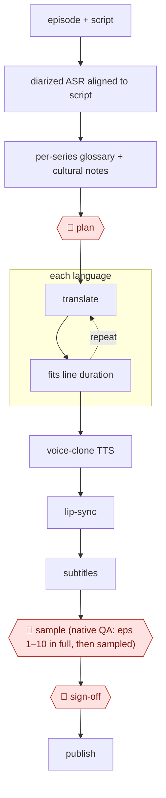

# Dubbing pipeline

`CRE › MED › DUB` · sampled · evidence A · **draft: needs a reference example** ([how to add one](../../../../../CONTRIBUTING.md#1-add-an-example-run))

**Shape:** `episode + script → diarized ASR aligned to script → per-series glossary + cultural notes → 🛑 plan → each language: (translate ⟲ fits line duration) → voice-clone TTS → lip-sync → subtitles → 🛑 sample (native QA: eps 1–10 in full, then sampled) → 🛑 sign-off → publish`
**Tags:** overseas (出海) apps. ReelShort and DramaBox made roughly $130M and $120M in IAP in Q1 2025 [[18]](#sources). Vendor claims for AI dubbing throughput (e.g. "120 minutes in 4–5 hours") are evidence B and unverified.

<!-- shape diagram: generated by scripts/build_diagrams.py from `shape`; don't edit -->

<!-- end shape diagram -->

## Steps
1. Rebuild the screenplay from the episode. Dashverse feeds speech-to-text, voice-activity and visual signals with the video into a multimodal LLM, processes the show in chunks and reconciles character identities across them. It also tags each line's emotion and non-verbal sounds and builds a show-wide character roster (age, gender, role, aliases, honorifics) [[19]](#sources). Where scripts are missing or messy, clean and normalize the text first [[20]](#sources).
2. Build the per-series glossary and cultural notes: localized character names, honorifics, places, currencies, units and idioms, each mapped in context, so translation looks terms up instead of guessing [[19]](#sources). Add market rules such as Japanese honorific levels, Latin-American family terms and Arabic-market sensitive content [[20]](#sources).
3. 🛑 **Plan**: agree with the client on target languages, delivery spec, character list, voice references, subtitle format, review requirements and release schedule before batch work starts [[20]](#sources). Reviewers can still steer translation, names and casting [[19]](#sources).
4. For each language, translate, then fit each line to its time slot. Dashverse routes lines to per-language, per-register fine-tuned models and rephrases over-long lines rather than speeding audio past 1.15×; in a Chinese-to-Hindi sample the median first take was 1.45× the slot and the accepted take 1.02× [[19]](#sources). Transn's post-editors check meaning, naturalness, character voice and line length [[20]](#sources).
5. Voice the lines. Transn clones each character's voice from a few reference clips [[20]](#sources). Dashverse casts from about 3,000 hand-labelled prebuilt voices instead, because cloning carried accents and mispronunciations, and uses action tags such as `[whispers]` or `[sobs]` rather than abstract ones [[19]](#sources).
6. Sync, mix and subtitle: duration prediction and audio-video sync [[20]](#sources); remix background music with ducking under dialogue, and generate SRTs [[19]](#sources). Dashverse's pipeline does not include lip-sync; lip-sync tools such as Heygen are named in trade coverage [[21]](#sources).
7. 🛑 **Sample**: native-speaker QA. The shape's plan is eps 1–10 in full, then a sample. The cited teams check more than that: Dashverse reviews every show and kept about 95% of speaker labels, 89% of translated lines and 96% of casting as generated [[19]](#sources); Transn's AI review flags omissions, inconsistent names, sensitive wording, sync and audio faults, and people handle the low-confidence share (about 15%) [[20]](#sources).
8. 🛑 **Sign-off**: a human re-check before delivery is not skipped even when nothing changes [[21]](#sources). Pick the delivery tier (quick preview, social, or premium app with manual polish) for that show [[20]](#sources), then publish.

**Output:** dubbed, mixed and subtitled episodes per language, plus a glossary, voice settings and review rules reused on the next show of the same type [[20]](#sources).
**Failure modes → guards:** Diarization degrades over long shows with 20–40 characters → ensemble labelling plus reconciliation across chunks; reviewers relabelled 5.2% of lines [[19]](#sources). Literal translation changes the plot (oppa rendered as bhaiya, lottery stakes shrunk) → glossary and roster built before translation [[19]](#sources). Models default to bookish register in Tamil and Telugu → fine-tuning on about 340,000 lines of in-house dialogue [[19]](#sources). Lines run long → rephrase to fit; speed-up only within a narrow range [[19]](#sources). Mistranslation or cultural taboo ("臣妾做不到啊" rendered as a maid unable to work) → mandatory human re-check [[21]](#sources). Sensitive expressions for a market → AI flags plus human cultural review [[20]](#sources).

## Public runs

Coverage as of 2026-11-06: **Strong**: a first-hand, detailed run that matches most of the shape. From [Where are the real runs?](../../../../../research/2026-11-real-runs.md); every number was re-checked against its page.

- [Goel & Tetali, Dashverse](https://insiders.dashverse.ai/building-an-ai-dubbing-pipeline-for-micro-dramas/) (2026-10-12). Diarized script rebuild → per-show glossary → duration-fit translation → cast TTS → human review of every show. "about 1,400 hours of micro-dramas across 16 languages"; reviewers kept "about 95%…89%…96%". *First-hand: yes; confidence: high.*
- [传神语联 via 数据猿, Tencent Cloud](https://developer.cloud.tencent.com/article/2708997) (Transn multilingual short-drama case, 2026-07-14). Story understanding → AI translation → post-edit with duration fit → voice-clone dubbing → AI and human QA. "每月配音短剧数量300部起，配音集数超2000集"; "AI负责约85%". *First-hand: vendor; confidence: med.*
- [娱乐资本论 on 钛媒体](https://www.tmtpost.com/7526126.html) (Who holds the key to AI dubbing?, 2025-04-08). A studio reruns a client drama through an AI dubbing tool, with human re-checks mandatory. "把一周的工作压缩到了一天". *First-hand: interview (studio unnamed); confidence: low.*

## Sources

18. Short-drama app revenue, Sensor Tower Q1 2025 data, via https://www.webull.com/news/12816921610159104 and https://gamebiz.jp/news/406943
19. Anjay Goel, Sagar Tetali (Dashverse), Building an AI Dubbing Pipeline for Micro-Dramas, 2026-10-12. https://insiders.dashverse.ai/building-an-ai-dubbing-pipeline-for-micro-dramas/
20. 传神语联 via 数据猿 (vendor case submission), 传神多语短剧出海全栈数智化服务, 2026-07-14. https://developer.cloud.tencent.com/article/2708997
21. 娱乐资本论 on 钛媒体, 冲破短剧出海天花板：谁掌握了AI译制的最强密码？, 2025-04-08. https://www.tmtpost.com/7526126.html
