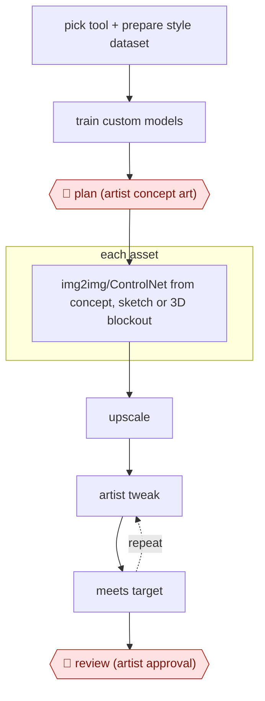

# Concept-led SD asset stream

`CRE › MED › GAMEART` · assist · evidence B · **draft: needs a reference example** ([how to add one](../../../../../CONTRIBUTING.md#1-add-an-example-run))

**Shape:** `pick tool + prepare style dataset → train custom models → 🛑 plan (artist concept art) → each asset: img2img/ControlNet from concept, sketch or 3D blockout → upscale → (artist tweak ⟲ meets target) → 🛑 review (artist approval)`
**Variants:** `stable-diffusion-controlnet`

<!-- shape diagram: generated by scripts/build_diagrams.py from `shape`; don't edit -->

<!-- end shape diagram -->

## Background

Games need large numbers of 2D pictures: collectable cards, decorations, backgrounds. Normally a concept artist designs each one and other artists render it, which takes days per set. Here an image generation model, trained on the game's own art style, makes the first version of each asset from an artist's concept, sketch or rough 3D model, and artists then paint over it until it meets the studio's standard. Left to text prompts alone the model's output is unpredictable, and it shows flaws such as broken structure or a drifting style, so the artist's concept comes first and the artist's approval comes last. The agent can prepare the training sets, keep track of settings and batches and check outputs against the brief, but the picture itself comes from the image model, and the artist decides whether it is good enough for the game.

**Terms:**
- **Stable Diffusion**: an open image-generation model that can be installed on the studio's own machines and trained further on its own images.
- **Fine-tuning / custom model**: further training on the studio's art so that the model draws in the game's style. Hypernetworks and embeddings are two small add-ons of this kind.
- **img2img**: generating a new picture starting from an existing image, which fixes the composition.
- **Denoising strength**: how far img2img may depart from the starting image; low values stay close to it.
- **ControlNet**: an add-on that makes the model follow a pose, outline or depth layout from a guide image.
- **Inpainting**: regenerating only a marked part of a picture.
- **3D blockout**: a rough 3D scene of plain shapes that fixes camera angle and composition.
- **Upscaling**: enlarging a picture while adding detail.

## Build it with an agent

**Form:** `platform`. The pictures come from an image model trained on the studio's style, which a general agent cannot replace. A general agent can handle the preparation and the bookkeeping as a `skill`, because one artist works on one asset at a time and stays in the conversation.

**You need:** the studio's own art, with the right to train on it, as the style dataset; a local install of the image model and its training tools; the artist's concept art, sketch or 3D blockout for each asset; a brief that states the target (size, style, what must be in the picture); a folder for generated candidates and the artist's overpaints.

| Step | Built as |
|---|---|
| pick tool + prepare style dataset | The skill checks the dataset for duplicates, captions each image with the artist's terms and lists what is missing. A person chooses the tool. |
| train custom models | A script runs the training. The skill records each run's settings and a sample sheet so runs can be compared. |
| 🛑 plan (artist concept art) | See Checkpoints. |
| each asset: img2img/ControlNet from concept, sketch or 3D blockout → upscale | A script beside the skill submits the generation with the settings the skill records for that asset type, then runs the upscaler. |
| (artist tweak ⟲ meets target) | The artist paints over the output in an image editor. The skill checks the result against the brief's size and content list and notes what is still missing. |
| 🛑 review (artist approval) | See Checkpoints. |

**Checkpoints:** `plan`: the skill will not queue an asset until the artist's concept, sketch or blockout for it is in the project folder and the artist has said to go. `review`: the skill presents the finished asset beside its concept and the brief and stops; the artist approves or sends it back. The agent has no tool that copies an asset into the game's art folder, so only the artist moves approved art there.

**Since the sources:** Source 1 dates from 2023-07 and source 2 is undated. Newer practice reported in community guides: a 2026 indie guide describes ComfyUI, a graph-based interface, as a common way to chain a model, ControlNet and an upscaler, and says final passes still need a human ([Stray Spark Studio](https://www.strayspark.studio/blog/comfyui-game-asset-pipeline-indie-2026)); a 2025 studio report found custom training necessary for usable output ([Room 8 Group](https://room8group.com/wp-content/uploads/2025/01/AI-in-2d-gam-dev_-Report_final.pdf)). Both are secondary accounts, not a rerun of this workflow. The sources report an artist-led process with an in-house AI department, not an agent running it, so this build adds only the preparation and the bookkeeping.

*A design based on this entry's steps and the tool documentation as of 2026-11, not a reported run.*

## Steps

*As reported by the sources.*

1. The team chooses a tool that supports fine-tuning and inpainting with local install (Stable Diffusion). The team prepares a dataset for each new art stream (a few hours) and trains custom models; it trained over 100 (hypernetworks, embeddings) to find working parameters [[1]](#sources).
2. A dedicated internal AI department handles tool analysis, training, pipeline integration and artist support [[1]](#sources).
3. 🛑 **Plan**: an artist produces a detailed concept first, because text-only prompts are unpredictable [[1]](#sources).
4. The team generates from the concept with img2img. Environment pieces can start from a sketch plus text, and backgrounds from a basic 3D model at low denoising (up to 0.4) and/or ControlNet to set angle and composition. Detailed or animated objects are generated part by part [[1]](#sources).
5. The team upscales, then artists touch up by hand until the asset meets the target. 🛑 **Review**: artists approve or redo outputs; a similar postmortem describes artists holding 'artistic veto power' [[1]](#sources)[[2]](#sources).

**Output:** 2D game assets (collectable cards, decorations, backgrounds) handed to the game's art integration.
**Failure modes → guards:** Structural artifacts and inconsistent style → artists paint over, blend and stitch multiple passes, and a style-trained model keeps the look consistent. Unpredictable prompt-only output → always start from concept, sketch or 3D input.
**How it differs:** AWF-0015 AI shot factory makes video shots for drama. AWF-0008 Design to code is UI. None close for game assets.

## Public runs

Coverage as of 2026-11-06: **Partial**: first-hand runs that cover part of the shape or put checkpoints elsewhere. Collected and re-checked in [New workflows for empty categories](../../../../../research/2026-11-new-workflows.md).

- [Belka Games, Working AI into your art pipeline](https://www.pocketgamer.biz/feature/81986/working-ai-into-your-art-pipeline-expectations-vs-reality/) (2023-07-17). Collectable-card set for Solitaire Cruise made with the AI pipeline instead of concept plus 2D render. about 3 work-hours with AI for a 10-card collection, versus about 240 work-hours traditionally. *First-hand: yes; confidence: med.*

## Sources

1. Anton Danko (Belka Games), Working AI into your art pipeline: expectations vs reality, PocketGamer.biz, 2023-07-17. https://www.pocketgamer.biz/feature/81986/working-ai-into-your-art-pipeline-expectations-vs-reality/
2. Absolutist, Rethinking the Art Production Pipeline: A Postmortem of Hidden Objects Getaway (undated). https://wellgames.com/news/rethinking-art-production-pipeline-176712/
