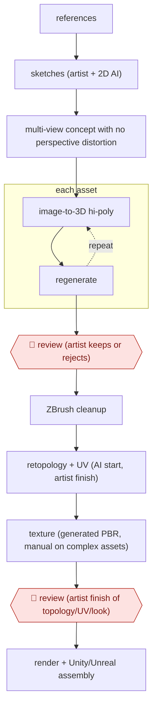

# Image-to-3D asset packs

`CRE › MED › GAMEART` · assist · evidence A · **draft: needs a reference example** ([how to add one](../../../../../CONTRIBUTING.md#1-add-an-example-run))

**Shape:** `references → sketches (artist + 2D AI) → multi-view concept with no perspective distortion → each asset: (image-to-3D hi-poly ⟲ regenerate) → 🛑 review (artist keeps or rejects) → ZBrush cleanup → retopology + UV (AI start, artist finish) → texture (generated PBR, manual on complex assets) → 🛑 review (artist finish of topology/UV/look) → render + Unity/Unreal assembly`
**How it differs:** AWF-0079 Concept-led SD asset stream makes 2D assets from artist concepts with custom-trained models. This run produces engine-ready 3D meshes with retopology, UV and baking, and adds a keep/reject triage step for generations. The deliverable differs, and so does the extra checkpoint.
**Variants:** `meshy` · `tripo` · `zbrush` · `blender` · `substance-painter`

<!-- shape diagram: generated by scripts/build_diagrams.py from `shape`; don't edit -->

<!-- end shape diagram -->

## Steps
1. Collect references, then draw sketches or generate them with 2D AI models (via Fal) [[1]](#sources).
2. Prepare multi-view concepts with no perspective distortion, made for 3D generation [[1]](#sources).
3. Meshy builds the hi-poly model with Image-to-3D or Multi-Image-to-3D, regenerating as needed [[1]](#sources).
4. 🛑 **Review**: an artist triages the generations. About 20–30% never reach production, about 30% more need several rounds, and characters need regeneration about 60–70% of the time [[1]](#sources).
5. Clean up the hi-poly in ZBrush. Meshy's retopology gives a starting point, artists finish it in Blender or TopoGun, and AI assistants take part of the routine UV work [[1]](#sources).
6. Texturing starts from Meshy's generated PBR maps. Complex assets get manual work in Substance Painter [[1]](#sources).
7. 🛑 **Review**: artists finish topology, UV and the final look by hand wherever the work must be exact, then do final renders and assemble in Unity or Unreal [[1]](#sources).

**Output:** Game-ready low-poly assets with baked PBR, packaged as asset packs for Unity and Unreal.
**Failure modes → guards:** Bad topology on cars and complex characters, messy UVs → artists rebuild by hand. Low keep rate on characters → multi-view concepts plus regeneration rounds and artist triage.

## Public runs

Coverage as of 2026-11-06: **Strong**: a first-hand, detailed run that matches most of the shape. Collected and re-checked in [Second collection pass](../../../../../research/2026-11-second-pass.md).

- [RetroStyle Games, Asset Packs in a Week](https://retrostylegames.com/blog/asset-packs-in-a-week-meshy-case-study/) (2026-10-15). Grand Theft Motel pack (19 unique assets, 66 prefabs) built in one week. "about 20 to 30% of generated models did not make it into production"; a pack takes "about a week" instead of "about a month" (rough estimates, per the page). *First-hand: yes; confidence: high.*

## Sources

1. Oleksandr Salabai, RetroStyle Games, 'Asset Packs in a Week: How We Use Meshy in 3D Production', 2026-10-15. https://retrostylegames.com/blog/asset-packs-in-a-week-meshy-case-study/
