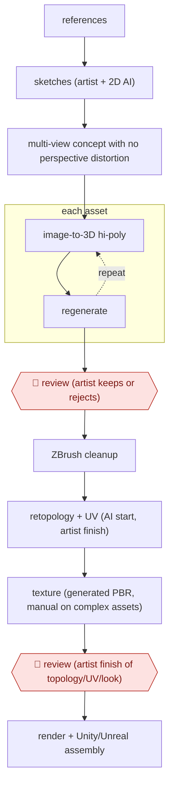

# Image-to-3D asset packs

`CRE › MED › GAMEART` · assist · evidence A · **draft: needs a reference example** ([how to add one](../../../../../CONTRIBUTING.md#1-add-an-example-run))

**Shape:** `references → sketches (artist + 2D AI) → multi-view concept with no perspective distortion → each asset: (image-to-3D hi-poly ⟲ regenerate) → 🛑 review (artist keeps or rejects) → ZBrush cleanup → retopology + UV (AI start, artist finish) → texture (generated PBR, manual on complex assets) → 🛑 review (artist finish of topology/UV/look) → render + Unity/Unreal assembly`
**Variants:** `meshy` · `tripo` · `zbrush` · `blender` · `substance-painter`

<!-- shape diagram: generated by scripts/build_diagrams.py from `shape`; don't edit -->

<!-- end shape diagram -->

## Background

A 3D game asset, such as a car, a prop or a character, is a model made of a surface mesh, an unfolded flat map of that surface for painting (the UV map), and surface textures. Building one by hand takes an artist a long time, and a studio that sells asset packs to other developers needs dozens of them in consistent style. Here image-to-3D generation models build a first, very detailed model from concept images, and artists decide which results are worth keeping and then finish them to the standard a game engine needs. The agent can prepare the reference sheets, keep the log of which generations were kept or rejected and prepare the assembly lists. The models create the geometry, and artists approve the work, because generated meshes often have broken structure and only an artist can judge whether a model is clean enough to ship in a pack.

**Terms:**
- **Image-to-3D**: a generation model that builds a 3D model from one image or several images of the same object.
- **Multi-view concept**: drawings of an object from several sides (front, side, back) without perspective distortion, used as input to 3D generation.
- **Hi-poly model**: a very detailed model with a very large number of surface polygons; too heavy for a game.
- **Retopology**: rebuilding the surface of a hi-poly model as a clean, light mesh (low-poly) a game engine can run.
- **UV map**: the unfolded flat layout of a model's surface onto which textures are painted.
- **PBR**: physically based rendering, a set of texture maps (colour, roughness, metal and so on) that make a surface look right under any light.
- **Baking**: copying the detail of the hi-poly model onto textures for the low-poly one.
- **Prefab**: a ready-made, reusable object assembled in the game engine.
- **Unity / Unreal**: the two common game engines.

## Build it with an agent

**Form:** `platform`. The geometry comes from image-to-3D generation models and the finishing from 3D sculpting and painting tools, which a general agent cannot replace. A general agent can run the preparation and record keeping as a `skill`, because one artist works through one asset at a time.

**You need:** reference images for the pack; accounts for the image-generation and image-to-3D services the studio uses; the 3D tools (a sculpting tool, a mesh editor and a texture painter) with the artist at the controls; a log file for each asset; the rights to use every reference image. Do not feed the services anyone else's unlicensed models.

| Step | Built as |
|---|---|
| references → sketches (artist + 2D AI) | The artist sketches. The skill collects and names the references and lists the views each asset needs. |
| multi-view concept with no perspective distortion | Generated in the 2D image tool. The skill writes the prompt per view and checks that front, side and back views are all present. |
| each asset: (image-to-3D hi-poly ⟲ regenerate) | A script beside the skill submits the views to the image-to-3D service and saves each generation with its settings. |
| 🛑 review (artist keeps or rejects) | See Checkpoints. |
| ZBrush cleanup → retopology + UV → texture | The artist, in the 3D tools. The skill keeps the log of what was kept and what each asset still needs. |
| 🛑 review (artist finish of topology/UV/look) | See Checkpoints. |
| render + Unity/Unreal assembly | The artist and the engine. The skill drafts the assembly list of assets and prefabs for the pack. |

**Checkpoints:** `review`: after each batch of generations the skill presents them in a sheet beside their concept images and stops until the artist marks each one keep or reject; rejected ones are regenerated and kept ones go forward. At the end the skill stops again with the checklist of topology, UV and look for each asset; the artist finishes and signs off in the 3D tools. The agent has no write access to the pack folder or the engine project.

**Since the sources:** The only source and the one public run date from 2026-10, so no newer-account search was needed. Neither page could be opened in this session (the site refused the request), so the entry text is the only evidence for these steps. The source describes artists using named generation services and 3D tools; it does not describe an agent running the process. This build adds only the preparation and record keeping, and the generation and finishing stay with the tools and the artists. The service and tool names under `variants` change quickly; check them before use.

*A design based on this entry's steps and the tool documentation as of 2026-11, not a reported run.*

## Steps

*As reported by the sources.*

1. The artists collect references, then draw sketches or generate them with 2D AI models (via Fal) [[1]](#sources).
2. The artists prepare multi-view concepts with no perspective distortion, made for 3D generation [[1]](#sources).
3. Meshy builds the hi-poly model with Image-to-3D or Multi-Image-to-3D, regenerating as needed [[1]](#sources).
4. 🛑 **Review**: an artist triages the generations. About 20–30% never reach production, about 30% more need several rounds, and characters need regeneration about 60–70% of the time [[1]](#sources).
5. An artist cleans up the hi-poly in ZBrush. Meshy's retopology gives a starting point, artists finish it in Blender or TopoGun, and AI assistants take part of the routine UV work [[1]](#sources).
6. Texturing starts, for the artist, from Meshy's generated PBR maps. Complex assets get manual work in Substance Painter [[1]](#sources).
7. 🛑 **Review**: artists finish topology, UV and the final look by hand wherever the work must be exact, then do final renders and assemble in Unity or Unreal [[1]](#sources).

**Output:** Game-ready low-poly assets with baked PBR, packaged as asset packs for Unity and Unreal.
**Failure modes → guards:** Bad topology on cars and complex characters, messy UVs → artists rebuild by hand. Low keep rate on characters → multi-view concepts plus regeneration rounds and artist triage.
**How it differs:** AWF-0079 Concept-led SD asset stream makes 2D assets from artist concepts with custom-trained models. This run produces engine-ready 3D meshes with retopology, UV and baking, and adds a keep/reject triage step for generations. The deliverable differs, and so does the extra checkpoint.

## Public runs

Coverage as of 2026-11-06: **Strong**: a first-hand, detailed run that matches most of the shape. Collected and re-checked in [Second collection pass](../../../../../research/2026-11-second-pass.md).

- [RetroStyle Games, Asset Packs in a Week](https://retrostylegames.com/blog/asset-packs-in-a-week-meshy-case-study/) (2026-10-15). Grand Theft Motel pack (19 unique assets, 66 prefabs) built in one week. "about 20 to 30% of generated models did not make it into production"; a pack takes "about a week" instead of "about a month" (rough estimates, per the page). *First-hand: yes; confidence: high.*

## Sources

1. Oleksandr Salabai, RetroStyle Games, 'Asset Packs in a Week: How We Use Meshy in 3D Production', 2026-10-15. https://retrostylegames.com/blog/asset-packs-in-a-week-meshy-case-study/
