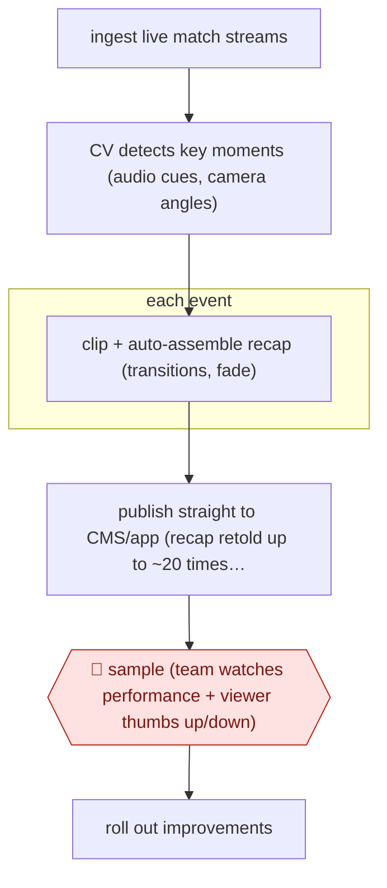

# Autonomous live recap

`CRE › MED › POST` · sampled · evidence A · **draft: needs a reference example** ([how to add one](../../../../../CONTRIBUTING.md#1-add-an-example-run))

**Shape:** `ingest live match streams → CV detects key moments (audio cues, camera angles) → each event: clip + auto-assemble recap (transitions, fade) → publish straight to CMS/app (recap retold up to ~20 times per match) → 🛑 sample (team watches performance + viewer thumbs up/down) → roll out improvements`
**Variants:** `aws-media-replay-engine` · `amazon-rekognition`

<!-- shape diagram: generated by scripts/build_diagrams.py from `shape`; don't edit -->

<!-- end shape diagram -->

## Background

A live match produces a stream of moments a viewer wants to see again within seconds: the goal, the save, the incident. Broadcasters cut those clips by hand from a gallery, which caps how many they can make and how fast, and during a tournament the audience has moved on before the clip is up. This arrangement removes the hand. A computer-vision model watches several concurrent feeds for the cues that reliably precede a key moment — the crowd noise, the commentator's pitch, the cut to a particular camera — cuts a clip around each event, and rebuilds a running recap that is republished many times during the match. Nothing goes to a person before it appears in the app. That is the whole point and the whole risk: the editorial scope has to be narrow enough that a machine can be trusted with it, which here means match events only, with no comment, context or story. Afterwards the team watches how the output performed, reads the viewers' thumbs up and down, and adds or fixes event types. Anyone who wants to approve each clip is choosing a different workflow.

**Terms:**
- **recap**: a short auto-assembled summary of the match so far, updated as events happen.
- **event**: one detected moment — a goal, a save, a penalty — with its in and out points.
- **computer vision (CV) model**: a model that classifies what is happening in video and audio, here trained on cues that precede an event.
- **audio cue**: a signal in the sound, such as a crowd roar or the commentator's tone, used to find a moment without watching every frame.
- **CMS**: the content management system the app reads from.
- **sampled autonomy**: publishing without per-item approval, with a share of the output reviewed afterwards.
- **event type**: the class of moment being detected; adding one is how coverage improves.

## Build it with an agent

**Form:** `platform`. Detection and assembly are specialist video work — a CV model over live audio and video plus a rendering pipeline running at match tempo — which a general agent cannot do; the agent's part is what surrounds it: the event vocabulary, the clip spec, the sampling report and the improvement loop.

**You need:** rights to the feeds and a licence that permits automated clipping; the live streams with their timing information; a CV model trained on the sport's own cues, with labelled past matches to measure it against; a clipping and rendering service that can produce and republish a recap within the match; the CMS or app endpoint that accepts a publish with no human step; the analytics — views, completion, thumbs — that the sample reads. The build needs a hard stop for anything outside the narrow editorial scope: no clip carrying comment about a person, no injury footage, no sponsor-sensitive moment, and that exclusion belongs in the event vocabulary, not in a prompt.

| Step | Built as |
|---|---|
| ingest live match streams | Platform work: several feeds cut into short segments for inference, with each segment's timestamp carried through so a detected moment maps back to broadcast time. |
| CV detects key moments | The trained model scores every segment; a threshold turns scores into events, and the threshold is a setting the team owns and can move after a bad night. |
| each event: clip + auto-assemble recap | The clipping service cuts around the event with pre- and post-roll, assembles the recap with the house transitions, and writes a new version rather than editing the old one, so a wrong clip can be withdrawn without a rebuild. |
| publish straight to CMS/app | A publish call with no approval step, constrained by a template that only accepts match-event labels; the agent's contribution is the caption template and the event labels, both versioned. |
| 🛑 sample (team watches performance + viewer thumbs up/down) | A daily pass by the agent over the published set: which event types fired, which clips were watched to the end, where the thumbs went down, and which moments in the same window the model missed — the misses are what no dashboard shows. |
| roll out improvements | Findings become a proposed change to the vocabulary or the threshold, reviewed like any other change to the pipeline. |

**Checkpoints:** `sample`: by design there is no per-clip gate, so the control is afterwards and has to be systematic — a fixed daily review of published clips plus the viewer signal, with false-positive and missed-event counts reported per event type. Because publication is automatic, the exclusions have to be structural: the vocabulary cannot emit a clip type the rights or editorial policy forbids, and the publish template accepts only labels that vocabulary defines, so a model that starts firing on an injury cannot publish a clip of it.

**Since the sources:** Sources date from 2023-07: one trade-press case study of a World Cup deployment, opened this month. It is older than twelve months, so the practice was searched again. What has changed since: this is now a product category rather than one broadcaster's build. The 2026 platforms sell the same detect-and-assemble chain across dozens of sports, several with vertical reframing and rolling recaps, and they split over exactly the decision this entry makes — one markets "AI detects the moments, you decide what gets published", while others publish automatically. A mid-tier league can now buy the capability instead of building it, which moves the question from whether this can be built to what editorial scope justifies publishing unattended; the answer here, match events only, is narrower than what the products now offer.

*A design based on this entry's steps and the tool documentation as of 2026-11, not a reported run.*

## Steps

*As reported by the sources.*

1. Ingest several concurrent broadcast streams and cut clips for inference with Amazon's open-source Media Replay Engine [[1]](#sources).
2. A computer-vision model trained on audio cues and camera angles finds key match moments [[1]](#sources).
3. For each new event, the recap is rebuilt and auto-assembled with transitions and a fade to black. It goes straight into the CMS and to the FOX Sports app, retelling the game 'upwards of 20 times per match' [[1]](#sources).
4. 🛑 **Sample**: there is no per-clip approval. The team monitors performance and rolls out fixes, such as a thumbs-up/down and new event types like saves and penalty kicks [[1]](#sources). The page describes this checkpoint only briefly.

**Output:** Running highlight recaps published to the app during each match.
**Failure modes → guards:** Football lacks set patterns, so detection misses or misfires → model trained on audio and camera cues, with fixes rolled out based on performance. No human on each clip → only safe if the editorial scope is narrow (match events only).
**How it differs:** AWF-0077 Transcript-first video edit has an author review content cuts and sign off a watch-through before render. This run publishes with no per-item approval, and people only monitor the stream of output. The autonomy level (sampled vs checkpointed) and the deliverable (live recaps updated many times a match) differ.

## Public runs

Coverage as of 2026-11-06: **Partial**: first-hand runs that cover part of the shape or put checkpoints elsewhere. Collected and re-checked in [Second collection pass](../../../../../research/2026-11-second-pass.md).

- [SVG, How FOX Teamed Up with AWS for AI-Powered Highlights](https://www.sportsvideo.org/2023/07/24/case-study-how-fox-teamed-up-with-aws-for-ai-powered-highlights/) (2023-07-24). FIFA World Cup 2022 recaps published with very little human input. "731 recap videos were published autonomously across 61 matches". *First-hand: interview; confidence: med.*

## Sources

1. Jason Dachman, Sports Video Group, 'Case Study: How FOX Teamed Up with AWS for AI-Powered Highlights', 2023-07-24. https://www.sportsvideo.org/2023/07/24/case-study-how-fox-teamed-up-with-aws-for-ai-powered-highlights/
