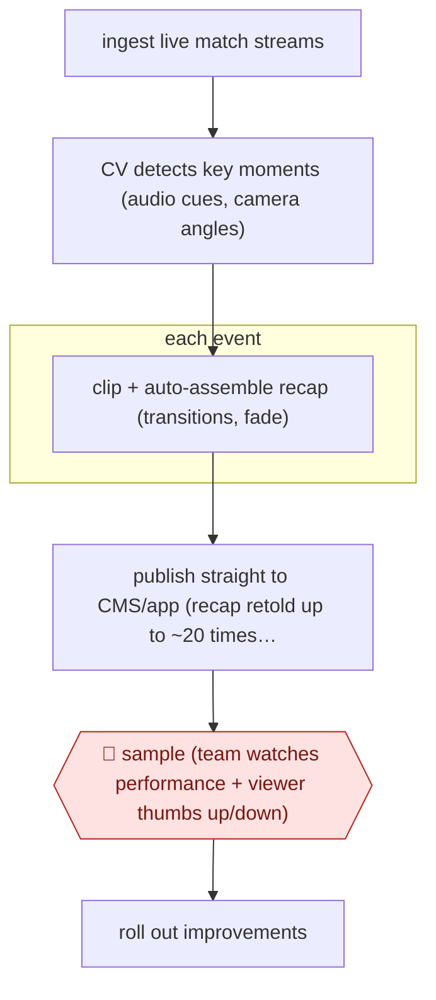

# Autonomous live recap

`CRE › MED › POST` · sampled · evidence A · **draft: needs a reference example** ([how to add one](../../../../../CONTRIBUTING.md#1-add-an-example-run))

**Shape:** `ingest live match streams → CV detects key moments (audio cues, camera angles) → each event: clip + auto-assemble recap (transitions, fade) → publish straight to CMS/app (recap retold up to ~20 times per match) → 🛑 sample (team watches performance + viewer thumbs up/down) → roll out improvements`
**How it differs:** AWF-0077 Transcript-first video edit has an author review content cuts and sign off a watch-through before render. This run publishes with no per-item approval, and people only monitor the stream of output. The autonomy level (sampled vs checkpointed) and the deliverable (live recaps updated many times a match) differ.
**Variants:** `aws-media-replay-engine` · `amazon-rekognition`

<!-- shape diagram: generated by scripts/build_diagrams.py from `shape`; don't edit -->

<!-- end shape diagram -->

## Steps
1. Ingest several concurrent broadcast streams and cut clips for inference with Amazon's open-source Media Replay Engine [[1]](#sources).
2. A computer-vision model trained on audio cues and camera angles finds key match moments [[1]](#sources).
3. For each new event, the recap is rebuilt and auto-assembled with transitions and a fade to black. It goes straight into the CMS and to the FOX Sports app, retelling the game 'upwards of 20 times per match' [[1]](#sources).
4. 🛑 **Sample**: there is no per-clip approval. The team monitors performance and rolls out fixes, such as a thumbs-up/down and new event types like saves and penalty kicks [[1]](#sources). The page describes this checkpoint only briefly.

**Output:** Running highlight recaps published to the app during each match.
**Failure modes → guards:** Football lacks set patterns, so detection misses or misfires → model trained on audio and camera cues, with fixes rolled out based on performance. No human on each clip → only safe if the editorial scope is narrow (match events only).

## Public runs

Coverage as of 2026-11-06: **Partial**: first-hand runs that cover part of the shape or put checkpoints elsewhere. Collected and re-checked in [Second collection pass](../../../../../research/2026-11-second-pass.md).

- [SVG, How FOX Teamed Up with AWS for AI-Powered Highlights](https://www.sportsvideo.org/2023/07/24/case-study-how-fox-teamed-up-with-aws-for-ai-powered-highlights/) (2023-07-24). FIFA World Cup 2022 recaps published with very little human input. "731 recap videos were published autonomously across 61 matches". *First-hand: interview; confidence: med.*

## Sources

1. Jason Dachman, Sports Video Group, 'Case Study: How FOX Teamed Up with AWS for AI-Powered Highlights', 2023-07-24. https://www.sportsvideo.org/2023/07/24/case-study-how-fox-teamed-up-with-aws-for-ai-powered-highlights/
