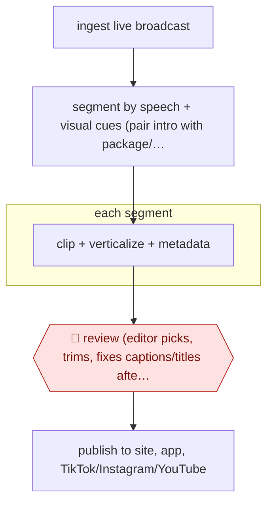

# Editor-curated broadcast clips

`CRE › MED › POST` · checkpointed · evidence B · **draft: needs a reference example** ([how to add one](../../../../../CONTRIBUTING.md#1-add-an-example-run))

**Shape:** `ingest live broadcast → segment by speech + visual cues (pair intro with package/interview) → each segment: clip + verticalize + metadata → 🛑 review (editor picks, trims, fixes captions/titles after the show) → publish to site, app, TikTok/Instagram/YouTube`
**How it differs:** Nearest is AWF-0138 (Autonomous live recap). That one publishes sports recaps straight to the CMS, and people only sample performance afterwards. Here an editor reviews and selects every news or talk segment before it publishes, so the checkpoint and autonomy (checkpointed) differ. AWF-0077 edits one recording from its transcript with the author, not a broadcast stream.
**Variants:** `framedrop` · `mediacorp-ai-smartcut`

<!-- shape diagram: generated by scripts/build_diagrams.py from `shape`; don't edit -->

<!-- end shape diagram -->

## Steps
1. Ingest the live broadcast or prime-time bulletin as it airs [[1]](#sources)[[2]](#sources).
2. The system segments the broadcast into distinct discussions or stories from speech and visual cues, pairing introductions with the matching packages or interviews [[1]](#sources)[[2]](#sources).
3. Each segment is cut into a clip, automatically verticalized for social platforms, and given metadata, ready for the CMS [[1]](#sources)[[2]](#sources).
4. 🛑 **Review**: when the programme ends, the editorial team reviews the pre-cut segments, selects the best and publishes. Audio refinement and dynamic reframing still need human oversight at Mediacorp [[1]](#sources)[[2]](#sources).
5. Publish to the website, app and social channels within minutes of the show [[1]](#sources)[[2]](#sources).

**Output:** Per-story or per-moment clips on web, app and social shortly after broadcast.
**Failure modes → guards:** Wrong segment boundaries (Mediacorp reports ~90% accuracy) → editor review before publish [1]. Reframing and audio problems → human oversight on those steps [1]. A statement taken out of context → humans choose and trim every clip [2].

## Public runs

Coverage as of 2026-11-13: **Weak**: only anonymous, vendor-linked or journalist-told accounts. Collected and re-checked in [Third collection pass](../../../../../research/2026-11-third-pass.md).

- [WAN-IFRA, How Singapore's Mediacorp is using AI](https://wan-ifra.org/2025/08/how-singapores-mediacorp-is-using-ai-to-reduce-friction-in-video-production/) (2025-08-11). Prime-time bulletins auto-segmented into digital clips; humans still handle audio and reframing. "clips can go live 'within minutes,' with approximately 90 percent accuracy". *First-hand: interview; confidence: med.*
- [Framedrop, Medialivre story](https://www.framedrop.ai/success-stories/medialivre) (undated). Daily show auto-segmented; team reviews and selects pre-cut clips after the show. "Clip production time reduced by ≈50%, from 20–30 minutes to 10–15 minutes"; "Published content increased by 62% between April and September". *First-hand: vendor; confidence: med.*

## Sources

1. Neha Gupta (WAN-IFRA), How Singapore's Mediacorp is using AI to reduce friction in video production, 2025-08-11 (talk by Lyn-Yi Chung, Deputy Chief Editor). https://wan-ifra.org/2025/08/how-singapores-mediacorp-is-using-ai-to-reduce-friction-in-video-production/
2. Framedrop customer story, How Medialivre Accelerated News Publishing & Boosted Engagement with AI (vendor; quotes David Novo, Record na Hora). https://www.framedrop.ai/success-stories/medialivre
