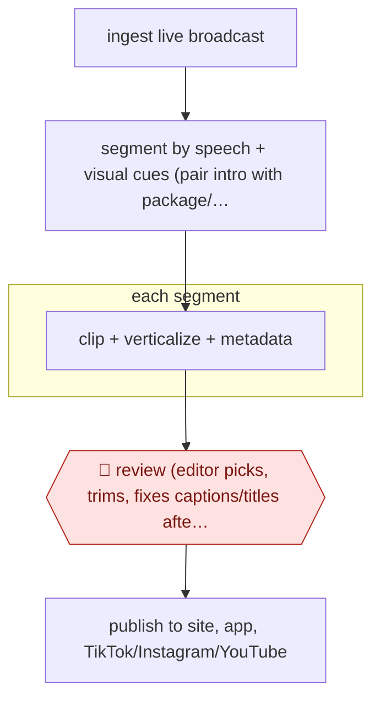

# Editor-curated broadcast clips

`CRE › MED › POST` · checkpointed · evidence B · **draft: needs a reference example** ([how to add one](../../../../../CONTRIBUTING.md#1-add-an-example-run))

**Shape:** `ingest live broadcast → segment by speech + visual cues (pair intro with package/interview) → each segment: clip + verticalize + metadata → 🛑 review (editor picks, trims, fixes captions/titles after the show) → publish to site, app, TikTok/Instagram/YouTube`
**Variants:** `framedrop` · `mediacorp-ai-smartcut`

<!-- shape diagram: generated by scripts/build_diagrams.py from `shape`; don't edit -->

<!-- end shape diagram -->

## Background

A broadcaster's programme is also a supply of short videos: one story, one interview, one good exchange is what gets watched on social platforms, and it has to go up while the programme is still being talked about. Someone has to watch a whole bulletin, decide which parts stand alone, trim them so they make sense without the rest, reformat for a vertical screen, write a title and publish. That is hours of work for a handful of clips, and it happens at the end of the day when the newsroom is thin. Here the segmentation is done while the programme airs: the system follows the speech and the picture to find where one story ends and the next begins, keeps each introduction with the package or interview it belongs to, cuts and verticalises each segment and attaches metadata. When the programme ends, an editor opens a folder of pre-cut clips, picks the ones worth posting, trims and fixes captions and titles, and publishes. That review is not a formality: a clip that cuts away from a quote is a correction or a complaint, and a face cropped out of frame in the vertical version is unusable, so both judgements stay with the editor.

**Terms:**
- **bulletin**: a scheduled news programme, live or pre-recorded.
- **segment**: one story or discussion in the programme, with a start and end.
- **package**: a pre-recorded report played inside a bulletin.
- **verticalise**: reformat a 16:9 frame for a 9:16 phone screen, which usually means tracking the subject rather than cropping the centre.
- **metadata**: title, description, tags and duration that the CMS and the social platforms need.
- **out of context**: a clip edited so the speaker appears to say something the full segment does not support.
- **reframing**: the automatic tracking and cropping that turns a wide frame into a vertical one.

## Build it with an agent

**Form:** `platform`. Segmentation, reframing and vertical rendering are video and speech model work on a live signal, which a general agent cannot run; the agent's part is the metadata, the caption text, the queue and the review sheet the editor works from.

**You need:** the broadcast feed with its timing; a segmentation model or service that uses speech and picture, and a rule for pairing an introduction with its package; a reframing and rendering step that produces the vertical file; the CMS and the social platform accounts, with publish rights that stay with the editor; the programme's rundown, where it exists, which is the strongest segmentation signal available. The build must not publish to any social account on its own, and the editor's trim decisions have to override the automatic boundaries rather than the other way round.

| Step | Built as |
|---|---|
| ingest live broadcast | The broadcast or the file is captured with timecode, so every segment points back to the programme's own clock. |
| segment by speech + visual cues (pair intro with package/interview) | A segmentation service finds boundaries; the rundown, where the newsroom has one, overrides the model, and each segment carries the reason it was cut there. |
| each segment: clip + verticalize + metadata | The rendering service cuts and reframes; the agent writes the title, the caption text and the tags from the transcript, and flags segments where the reframing lost the speaker. |
| 🛑 review (editor picks, trims, fixes captions/titles after the show) | The editor's queue shows the pre-cut clips with the transcript and the flag list; picking, trimming and publishing are actions in the CMS, which the build can only read. |
| publish to site, app, TikTok/Instagram/YouTube | The editor publishes per channel; the build logs what was published and where, so the performance can be compared with the programme's own. |

**Checkpoints:** `review`: nothing publishes without an editor, and the publish credentials belong to the editor's own accounts rather than the pipeline. The build's job is to make that review fast and honest: each clip arrives with its transcript, the reason it was cut there, and a flag wherever the automatic reframing or the audio would need attention, which is the part the sources say still needs a person.

**Since the sources:** Sources date from 2025-08 and one undated vendor story; both were opened this month. What has changed since: the checkpoint this entry chose has become the marketed position. The 2026 live-clipping platforms pair automatic moment detection with a human decision step and say so in as many words — one sells "AI detects the moments, you decide what gets published", with vertical reframing and one-click publishing to social accounts built in. That does not change the shape here; it changes the cost of building it, and it sharpens the open question: the editor's job moves from cutting to selecting, so the throughput limit becomes how fast a person can judge a queue of pre-cut clips rather than how many an editor can cut.

*A design based on this entry's steps and the tool documentation as of 2026-11, not a reported run.*

## Steps

*As reported by the sources.*

1. Ingest the live broadcast or prime-time bulletin as it airs [[1]](#sources)[[2]](#sources).
2. The system segments the broadcast into distinct discussions or stories from speech and visual cues, pairing introductions with the matching packages or interviews [[1]](#sources)[[2]](#sources).
3. Each segment is cut into a clip, automatically verticalized for social platforms, and given metadata, ready for the CMS [[1]](#sources)[[2]](#sources).
4. 🛑 **Review**: when the programme ends, the editorial team reviews the pre-cut segments, selects the best and publishes. Audio refinement and dynamic reframing still need human oversight at Mediacorp [[1]](#sources)[[2]](#sources).
5. Publish to the website, app and social channels within minutes of the show [[1]](#sources)[[2]](#sources).

**Output:** Per-story or per-moment clips on web, app and social shortly after broadcast.
**Failure modes → guards:** Wrong segment boundaries (Mediacorp reports ~90% accuracy) → editor review before publish [1]. Reframing and audio problems → human oversight on those steps [1]. A statement taken out of context → humans choose and trim every clip [2].
**How it differs:** Nearest is AWF-0138 (Autonomous live recap). That one publishes sports recaps straight to the CMS, and people only sample performance afterwards. Here an editor reviews and selects every news or talk segment before it publishes, so the checkpoint and autonomy (checkpointed) differ. AWF-0077 edits one recording from its transcript with the author, not a broadcast stream.

## Public runs

Coverage as of 2026-11-13: **Weak**: only anonymous, vendor-linked or journalist-told accounts. Collected and re-checked in [Third collection pass](../../../../../research/2026-11-third-pass.md).

- [WAN-IFRA, How Singapore's Mediacorp is using AI](https://wan-ifra.org/2025/08/how-singapores-mediacorp-is-using-ai-to-reduce-friction-in-video-production/) (2025-08-11). Prime-time bulletins auto-segmented into digital clips; humans still handle audio and reframing. "clips can go live 'within minutes,' with approximately 90 percent accuracy". *First-hand: interview; confidence: med.*
- [Framedrop, Medialivre story](https://www.framedrop.ai/success-stories/medialivre) (undated). Daily show auto-segmented; team reviews and selects pre-cut clips after the show. "Clip production time reduced by ≈50%, from 20–30 minutes to 10–15 minutes"; "Published content increased by 62% between April and September". *First-hand: vendor; confidence: med.*

## Sources

1. Neha Gupta (WAN-IFRA), How Singapore's Mediacorp is using AI to reduce friction in video production, 2025-08-11 (talk by Lyn-Yi Chung, Deputy Chief Editor). https://wan-ifra.org/2025/08/how-singapores-mediacorp-is-using-ai-to-reduce-friction-in-video-production/
2. Framedrop customer story, How Medialivre Accelerated News Publishing & Boosted Engagement with AI (vendor; quotes David Novo, Record na Hora). https://www.framedrop.ai/success-stories/medialivre
