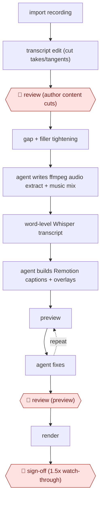

# Transcript-first video edit

`CRE › MED › POST` · checkpointed · evidence A · **draft: needs a reference example** ([how to add one](../../../../../CONTRIBUTING.md#1-add-an-example-run))

**Shape:** `import recording → transcript edit (cut takes/tangents) → 🛑 review (author content cuts) → gap + filler tightening → agent writes ffmpeg audio extract + music mix → word-level Whisper transcript → agent builds Remotion captions + overlays → (preview ⟲ agent fixes) → 🛑 review (preview) → render → 🛑 sign-off (1.5x watch-through)`
**How it differs:** AWF-0015 AI shot factory generates new video shots. This workflow edits real recorded footage, with the human owning the content cuts.
**Variants:** `descript-whisper-remotion-claude-code` · `premiere-text-based-editing`

<!-- shape diagram: generated by scripts/build_diagrams.py from `shape`; don't edit -->

<!-- end shape diagram -->

## Steps
1. Import raw footage into Descript and edit the transcript as text, deleting repeats, tangents and bad takes. 🛑 **Review**: the author makes every content cut (about 8 minutes per 30-minute recording) [[1]](#sources).
2. Shorten word gaps over 0.2 s and remove filler words selectively, then export a clean speaker-only MP4 [[1]](#sources).
3. Claude Code writes and runs FFmpeg commands to extract mono 16 kHz audio and mix licensed music under the speaker with fades [[1]](#sources).
4. Whisper API produces word-level timestamps as JSON. A dictionary script fixes jargon misspellings, and captions are eyeballed before rendering [[1]](#sources).
5. Claude Code builds Remotion (React) components for animated captions driven by the JSON, plus reusable lower-thirds, intro and outro [[1]](#sources).
6. 🛑 **Review**: the author previews in Remotion Studio and describes fixes to Claude Code, which edits the components, until the preview looks right. Then render [[1]](#sources).
7. 🛑 **Sign-off**: a mandatory 1.5x watch-through to catch duplicate sentences, caption errors, music misalignment and graphics mismatches [[1]](#sources).

**Output:** A final MP4 with captions and brand graphics, ready to upload to YouTube or social.
**Failure modes → guards:** Transcript timing offset when the transcript came from a proxy file → re-transcribe the exact export. Misspelled jargon in captions → a dictionary script plus a caption check. Duplicate sentences surviving the cut → the final watch-through.

## Public runs

Coverage as of 2026-11-06: **Partial**: first-hand runs that cover part of the shape or put checkpoints elsewhere. Collected and re-checked in [New workflows for empty categories](../../../../../research/2026-11-new-workflows.md).

- [Mejba Ahmed, Claude Code video editing workflow](https://www.mejba.me/blog/claude-code-video-editing-workflow) (2026-04-11). Eight weeks of solo YouTube production on the pipeline; editing time and output before and after. About 4 hours (sometimes 6) per video before; about 25 minutes of hands-on time now. *First-hand: yes; confidence: med.*

## Sources

1. Engr Mejba Ahmed, How I Automated Video Editing With Claude Code, 2026-04-11. https://www.mejba.me/blog/claude-code-video-editing-workflow
