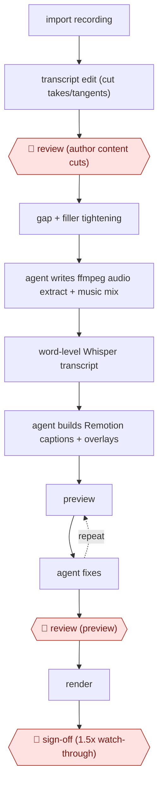

# Transcript-first video edit

`CRE › MED › POST` · checkpointed · evidence A · **draft: needs a reference example** ([how to add one](../../../../../CONTRIBUTING.md#1-add-an-example-run))

**Shape:** `import recording → transcript edit (cut takes/tangents) → 🛑 review (author content cuts) → gap + filler tightening → agent writes ffmpeg audio extract + music mix → word-level Whisper transcript → agent builds Remotion captions + overlays → (preview ⟲ agent fixes) → 🛑 review (preview) → render → 🛑 sign-off (1.5x watch-through)`
**Variants:** `descript-whisper-remotion-claude-code` · `premiere-text-based-editing`

<!-- shape diagram: generated by scripts/build_diagrams.py from `shape`; don't edit -->

<!-- end shape diagram -->

## Background

A person who talks to camera — a teacher, a founder, a YouTuber — records an hour and needs twenty minutes of it finished: the repeat takes gone, the dead air gone, captions on every word, a title bar and an end card in the house style. Editing software makes this a manual craft: scrub, cut, place, listen again. This workflow starts from the words instead. The recording is transcribed, the transcript is edited like a document, and the cuts fall out of the deleted sentences. Then the agent writes the technical steps as code — extracting and mixing the audio, laying music under the voice, timing each caption to its word, drawing the overlays — and re-renders in minutes when the author asks for a change. The author keeps the two decisions that a transcript cannot make: which words to keep, because that is the argument the video is making, and the final watch-through, because a duplicated sentence or a caption on the wrong word is only visible when you sit through the render. Everything else is a build the author owns and can extend.

**Terms:**
- **transcript-first editing**: cutting by deleting text, so the video follows the document rather than the timeline.
- **take**: one attempt at a passage; the earlier ones are usually discarded.
- **filler word**: "um", "uh", "kind of" — removed selectively, because some carry meaning.
- **word-level timing**: a timestamp for the start and end of every spoken word, which is what makes captions and word-synced graphics possible.
- **Remotion**: a framework that renders video from React components, so an edit is code that can be versioned and re-run.
- **lower third**: a name or title bar in the lower part of the frame.
- **render**: turning the composition into a finished video file.
- **watch-through**: playing the exported file from start to end, at speed, as the last check.

## Build it with an agent

**Form:** `project`. One author works one recording, but the value is in standing assets — the brand components, the transcript dictionary, the render scripts — that must be reused and must behave the same on every video, which is a project with `CLAUDE.md` and a repository, not a one-off skill run.

**You need:** the recording, and a transcript with word-level timing; a Node project with Remotion, and ffmpeg available to the agent; the brand assets — fonts, colours, logo, lower-third components, intro and outro; licensed music; a dictionary of the speaker's jargon and how it is spelled, because the transcriber will get names wrong; and a version-control habit, since every edit is a code change. The agent needs no publish access: uploading is the author's step.

| Step | Built as |
|---|---|
| import recording | The recording goes into the project folder and is committed or linked; `CLAUDE.md` states the output format, frame rate and naming so every video starts the same way. |
| transcript edit (cut takes/tangents) | The Skill works on the transcript as text and returns the exact cuts; it proposes, and does not decide, because deleted words cannot be recovered from the render. |
| 🛑 review (author content cuts) | The author reads the marked transcript and removes or restores passages; the cut list is a file, so the decision is visible and reversible. |
| gap + filler tightening | A script applies the rules the author set — gaps over a threshold, a list of fillers, a kept list of exceptions — rather than the agent judging each pause. |
| agent writes ffmpeg audio extract + music mix | ffmpeg commands written and run by the agent, with the music bed at a fixed offset and fades, so the mix is repeatable rather than tuned by ear. |
| word-level Whisper transcript | A transcription step on the exact exported file, not the source, because a proxy file's timing does not survive the cut. |
| agent builds Remotion captions + overlays | Components in the repository, driven by the timing JSON; the dictionary script fixes names before render, and the components are the reusable part. |
| preview ⟲ agent fixes | The author previews in the studio and describes the change; the agent edits the component and re-renders, which is the loop that replaces timeline scrubbing. |
| 🛑 review (preview) | The author approves the look before the full render, since a render is the slow step and a wrong graphic is cheap to fix beforehand. |
| render → 🛑 sign-off (1.5x watch-through) | The final render, then a mandatory watch-through by the author at speed for duplicated sentences, caption errors, misaligned music and graphics that do not match. |

**Checkpoints:** `review`: both gates are the author's, and the build makes them cheap rather than optional — the cut list is a file to edit, and the preview is a browser window. `sign-off`: the watch-through is the only step that catches the faults the earlier checks cannot, so the build should not call a video finished on a successful render; the render's exit code says the file exists, not that it is right.

**Since the sources:** Sources date from 2026-04: one first-hand account of eight weeks of solo production, opened this month, which is also the public run. What has changed since: the glue has started to be packaged. Remotion now publishes its own agent skill, so the component conventions and animation rules the author had to establish are [installed into a project and read by the agent on every session](https://www.claudiva.com/guides/edit-video-claude-code/), and a description such as "cut every filler word, trim pauses over 0.6 seconds, add word-by-word captions" is enough to produce a first render. There are also packaged skills that go further and generate the visuals from the script. That shifts this build's work from writing components to curating them: the parts worth keeping in your own repository are the brand components, the dictionary and the watch-through discipline, because those are what make the output yours rather than generic.

*A design based on this entry's steps and the tool documentation as of 2026-11, not a reported run.*

## Steps

*As reported by the sources.*

1. Import raw footage into Descript and edit the transcript as text, deleting repeats, tangents and bad takes. 🛑 **Review**: the author makes every content cut (about 8 minutes per 30-minute recording) [[1]](#sources).
2. Shorten word gaps over 0.2 s and remove filler words selectively, then export a clean speaker-only MP4 [[1]](#sources).
3. Claude Code writes and runs FFmpeg commands to extract mono 16 kHz audio and mix licensed music under the speaker with fades [[1]](#sources).
4. Whisper API produces word-level timestamps as JSON. A dictionary script fixes jargon misspellings, and captions are eyeballed before rendering [[1]](#sources).
5. Claude Code builds Remotion (React) components for animated captions driven by the JSON, plus reusable lower-thirds, intro and outro [[1]](#sources).
6. 🛑 **Review**: the author previews in Remotion Studio and describes fixes to Claude Code, which edits the components, until the preview looks right. Then render [[1]](#sources).
7. 🛑 **Sign-off**: a mandatory 1.5x watch-through to catch duplicate sentences, caption errors, music misalignment and graphics mismatches [[1]](#sources).

**Output:** A final MP4 with captions and brand graphics, ready to upload to YouTube or social.
**Failure modes → guards:** Transcript timing offset when the transcript came from a proxy file → re-transcribe the exact export. Misspelled jargon in captions → a dictionary script plus a caption check. Duplicate sentences surviving the cut → the final watch-through.
**How it differs:** AWF-0015 AI shot factory generates new video shots. This workflow edits real recorded footage, with the human owning the content cuts.

## Public runs

Coverage as of 2026-11-06: **Partial**: first-hand runs that cover part of the shape or put checkpoints elsewhere. Collected and re-checked in [New workflows for empty categories](../../../../../research/2026-11-new-workflows.md).

- [Mejba Ahmed, Claude Code video editing workflow](https://www.mejba.me/blog/claude-code-video-editing-workflow) (2026-04-11). Eight weeks of solo YouTube production on the pipeline; editing time and output before and after. About 4 hours (sometimes 6) per video before; about 25 minutes of hands-on time now. *First-hand: yes; confidence: med.*

## Sources

1. Engr Mejba Ahmed, How I Automated Video Editing With Claude Code, 2026-04-11. https://www.mejba.me/blog/claude-code-video-editing-workflow
