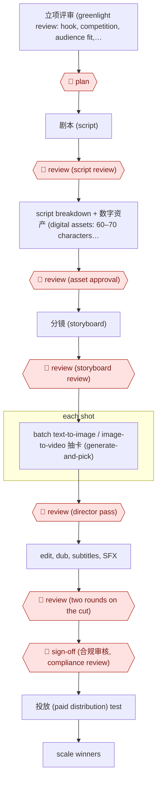

# Gated AI 漫剧 line

`CRE › MED › SHORTDRAMA` · checkpointed · evidence A · **draft: needs a reference example** ([how to add one](../../../../../CONTRIBUTING.md#1-add-an-example-run))

**Shape:** `立项评审 (greenlight review: hook, competition, audience fit, rights, AI feasibility, ROI) → 🛑 plan → 剧本 (script) → 🛑 review (script review) → script breakdown + 数字资产 (digital assets: 60–70 characters, scenes, costumes, props) → 🛑 review (asset approval) → 分镜 (storyboard) → 🛑 review (storyboard review) → each shot: batch text-to-image / image-to-video 抽卡 (generate-and-pick) → 🛑 review (director pass) → edit, dub, subtitles, SFX → 🛑 review (two rounds on the cut) → 🛑 sign-off (合规审核, compliance review) → 投放 (paid distribution) test → scale winners`
**Variants:** `jimeng-seedance` · `kling` · `volcengine`

<!-- shape diagram: generated by scripts/build_diagrams.py from `shape`; don't edit -->

<!-- end shape diagram -->

## Background

短剧 (short dramas) are serial stories told in episodes of a minute or two, watched on phones and sold largely through paid advertising. 漫剧 are short dramas in an animated or comic style, and an AI 漫剧 is one whose pictures and video come from image and video generation models, not from a film shoot. A studio makes them on a production line. It decides which story to make, writes the script, designs every character and setting once so they look the same in every shot, plans the shots, generates each shot many times and keeps the best take, then edits and adds voices and subtitles. The models do the drawing. People decide at each stage, because a mistake found late means regenerating everything after it, and because the studio answers for copyright and likeness in what it publishes.

**Terms:**
- **立项评审 (greenlight review)**: the decision to make a series or not, before any production money is spent.
- **Hook**: the opening seconds that must stop a viewer scrolling past.
- **数字资产 (digital assets)**: the approved reference images for each character, scene, costume and prop, reused in every shot to keep them consistent.
- **分镜 (storyboard)**: the shot-by-shot plan of an episode.
- **文生图 / 图生视频**: text-to-image and image-to-video generation.
- **抽卡 (generate-and-pick)**: generating many candidates for one shot and keeping the best, named after drawing cards in games.
- **合规审核 (compliance review)**: the check on copyright, likeness and platform rules before release.
- **投放 (paid distribution)**: buying advertising to bring viewers to the series; results show which series earn back their cost.
- **ROI**: return on investment, here the revenue a series brings in against its production and advertising cost.

## Build it with an agent

**Form:** `platform`. The shots are made by image and video generation models, which a general agent cannot replace, and in both sources people run every stage. A general agent can take on the text and coordination stages as a `project`: skills for the review checklists and the storyboard, with the generation platform reached through its API if it has one.

**You need:** accounts on an image and video generation platform; the script, the asset list and the storyboard kept as files the agent can read; the rights documents for the source story and any real person's likeness; the export of advertising results if the agent is to summarise them.

| Step | Built as |
|---|---|
| 立项评审 → 🛑 plan | A skill fills in the greenlight checklist (hook, competition, audience fit, rights, AI feasibility, ROI) from the pitch and the data it is given. People decide. |
| 剧本 → 🛑 review | Script drafting is its own workflow: [AWF-0014 Hook-cadence drama script](../../../WRI/SCREEN/hook-cadence-drama-script/). |
| script breakdown + 数字资产 → 🛑 review | The agent lists every character, scene, costume and prop from the script and writes a reference sheet for each. The images are made on the generation platform. |
| 分镜 → 🛑 review | The agent drafts the storyboard as a table: shot, framing, assets used, generation prompt. |
| each shot: 抽卡 → 🛑 review | The generation platform. Where it has an API, a script can submit the batches. A person picks the takes. |
| edit, dub, subtitles, SFX → 🛑 review | Editing and audio tools. The agent can prepare subtitle text from the script. |
| 🛑 sign-off (合规审核) | The agent assembles the file a reviewer needs: where each asset came from, the rights held, any real likeness, the AI label. A person signs. |
| 投放 test → scale winners | The advertising platform. The agent can summarise an export of the results for the next greenlight review. |

**Checkpoints:** `plan`: the greenlight skill stops after presenting the completed checklist. `review`: each skill stops after its draft (script, asset sheets, storyboard); takes and cuts are reviewed in the generation and editing tools, outside the agent. `sign-off`: the agent has no tool that publishes or buys advertising; a person releases the series.

**Since the sources:** Both sources date from 2026-08. They describe teams of people, such as one director with four image generators, using generation tools. Neither reports an agent that runs the line. This entry therefore records a production process with AI models as tools, and the build above is a proposal for its text stages only. A line where an automated critic checks each shot is a different entry: [AWF-0015 AI shot factory](../../AIGCVIDEO/ai-shot-factory/).

*A design based on this entry's steps and the tool documentation as of 2026-11, not a reported run.*

## Steps

*As reported by the sources.*

1. 🛑 **Plan**: the studio holds a 立项评审 (greenlight review) on several factors: the opening hook, how crowded the genre is, audience fit, copyright, whether AI can render the scenes, and projected ROI [[1]](#sources).
2. 🛑 **Review**: the producer takes the script from the writers, and the script must pass review before it goes to the AI art team [[1]](#sources).
3. The team breaks the script down and builds the full set of 数字资产 (digital assets) first. A series usually locks 60–70 character looks plus scene, costume and prop styles, and the assets must pass review before storyboards go out [[2]](#sources).
4. 🛑 **Review**: the 分镜 (storyboard) is reviewed [[1]](#sources). Then teams of one director and four image generators run batch text-to-image and image-to-video 抽卡 (generate-and-pick) for each shot [[2]](#sources).
5. 🛑 **Review**: the director reviews all generated clips, then editing, dubbing, music and subtitles follow [[2]](#sources). The cut gets two review rounds [[1]](#sources).
6. 🛑 **Sign-off**: the series passes 合规审核 (compliance review) on copyright and likeness, then goes to distribution and paid 投放 testing, which feeds back into scripts and visual style [[1]](#sources).

**Output:** A 漫剧 (AI comic-drama) series delivered to short-drama platforms (e.g. 红果 Hongguo), with 投放 data feeding the next greenlight decisions.
**Failure modes → guards:** Copying live-action shot grammar that AI can't render; assets drifting between shots → AI-feasibility check at greenlight plus asset approval before any shot. Unchecked full-auto output → three review rounds (script, storyboard, cut).
**How it differs:** AWF-0016 Live-action assist shoots with human actors. AWF-0015 AI shot factory (AIGCVIDEO) runs an automated keyframe critic per shot with one review and one sign-off. This line is a role crew (director plus 抽卡 generators) with a data-driven greenlight, an asset-library approval gate, and three review rounds plus compliance. The checkpoint arrangement and crew structure differ. It is a composite of two named teams' accounts, so treat it as medium confidence.

## Public runs

Coverage as of 2026-11-06: **Partial**: first-hand runs that cover part of the shape or put checkpoints elsewhere. Collected and re-checked in [Second collection pass](../../../../../research/2026-11-second-pass.md).

- [澎湃/DataEye, 潮汐剧场 interview](https://m.thepaper.cn/newsDetail_forward_33846624) (2026-08-27). Hundred-person team with node reviews on script, storyboard and cut, plus compliance. "每月上线近百部AI精品剧" (nearly 100 AI series launched per month). *First-hand: interview; confidence: med.*
- [华西都市报, 两年制作40余部剧](https://www.wccdaily.com.cn/shtml/hxdsb/20260824/251321.shtml) (2026-08-24). Student studio: asset library approved first, then batch generation and a director review. "常规S级精品短剧从数字资产确认到交付，周期在15到20天" (standard premium series: 15–20 days from asset sign-off to delivery). *First-hand: interview; confidence: med.*

## Sources

1. DataEye研究院 interview with 潮汐剧场 (Tide Theatre) lead 雪总, via 澎湃新闻 (The Paper), '网易文学、晋江、爱奇艺前主创下场押注AI赛道！百人团队，月产近百部AI剧！', 2026-08-27. https://m.thepaper.cn/newsDetail_forward_33846624
2. 华西都市报 (West China City Daily), '两年制作40余部剧，最快7天交付一部' (interview with 和景文化 founder 刘弥群), 2026-08-24. https://www.wccdaily.com.cn/shtml/hxdsb/20260824/251321.shtml
