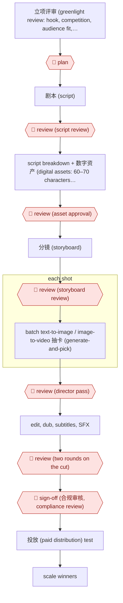

# Gated AI 漫剧 line

`CRE › MED › SHORTDRAMA` · checkpointed · evidence A · **draft: needs a reference example** ([how to add one](../../../../../CONTRIBUTING.md#1-add-an-example-run))

**Shape:** `立项评审 (greenlight review: hook, competition, audience fit, rights, AI feasibility, ROI) → 🛑 plan → 剧本 (script) → 🛑 review (script review) → script breakdown + 数字资产 (digital assets: 60–70 characters, scenes, costumes, props) → 🛑 review (asset approval) → 分镜 (storyboard) → 🛑 review (storyboard review) → each shot: batch text-to-image / image-to-video 抽卡 (generate-and-pick) → 🛑 review (director pass) → edit, dub, subtitles, SFX → 🛑 review (two rounds on the cut) → 🛑 sign-off (合规审核, compliance review) → 投放 (paid distribution) test → scale winners`
**How it differs:** AWF-0016 Live-action assist shoots with human actors. AWF-0015 AI shot factory (AIGCVIDEO) runs an automated keyframe critic per shot with one review and one sign-off. This line is a role crew (director plus 抽卡 generators) with a data-driven greenlight, an asset-library approval gate, and three review rounds plus compliance. The checkpoint arrangement and crew structure differ. It is a composite of two named teams' accounts, so treat it as medium confidence.
**Variants:** `jimeng-seedance` · `kling` · `volcengine`

<!-- shape diagram: generated by scripts/build_diagrams.py from `shape`; don't edit -->

<!-- end shape diagram -->

## Steps
1. 🛑 **Plan**: a multi-factor greenlight review covers the opening hook, how crowded the genre is, audience fit, copyright, whether AI can render the scenes, and projected ROI [[1]](#sources).
2. 🛑 **Review**: the producer takes the script from the writers, and the script must pass review before going to AI art [[1]](#sources).
3. The script is broken down and the full digital asset set is built first. A series usually locks 60–70 character looks plus scene, costume and prop styles, and assets must pass review before storyboards go out [[2]](#sources).
4. 🛑 **Review**: storyboard review [[1]](#sources). Then teams of one director and four image generators run batch text-to-image and image-to-video 抽卡 (generate-and-pick) per shot [[2]](#sources).
5. 🛑 **Review**: the director reviews all generated clips, then editing, dubbing, music and subtitles follow [[2]](#sources). The cut gets two review rounds [[1]](#sources).
6. 🛑 **Sign-off**: compliance review (copyright, likeness), then hand off to distribution and paid 投放 (distribution) testing, which feeds back into scripts and visual style [[1]](#sources).

**Output:** A 漫剧 (AI comic-drama) series delivered to short-drama platforms (e.g. 红果 Hongguo), with 投放 data feeding the next greenlight decisions.
**Failure modes → guards:** Copying live-action shot grammar that AI can't render; assets drifting between shots → AI-feasibility check at greenlight plus asset approval before any shot. Unchecked full-auto output → three review rounds (script, storyboard, cut).

## Public runs

Coverage as of 2026-11-06: **Partial**: first-hand runs that cover part of the shape or put checkpoints elsewhere. Collected and re-checked in [Second collection pass](../../../../../research/2026-11-second-pass.md).

- [澎湃/DataEye, 潮汐剧场 interview](https://m.thepaper.cn/newsDetail_forward_33846624) (2026-08-27). Hundred-person team with node reviews on script, storyboard and cut, plus compliance. "每月上线近百部AI精品剧" (nearly 100 AI series launched per month). *First-hand: interview; confidence: med.*
- [华西都市报, 两年制作40余部剧](https://www.wccdaily.com.cn/shtml/hxdsb/20260824/251321.shtml) (2026-08-24). Student studio: asset library approved first, then batch generation and a director review. "常规S级精品短剧从数字资产确认到交付，周期在15到20天" (standard premium series: 15–20 days from asset sign-off to delivery). *First-hand: interview; confidence: med.*

## Sources

1. DataEye研究院 interview with 潮汐剧场 (Tide Theatre) lead 雪总, via 澎湃新闻 (The Paper), '网易文学、晋江、爱奇艺前主创下场押注AI赛道！百人团队，月产近百部AI剧！', 2026-08-27. https://m.thepaper.cn/newsDetail_forward_33846624
2. 华西都市报 (West China City Daily), '两年制作40余部剧，最快7天交付一部' (interview with 和景文化 founder 刘弥群), 2026-08-24. https://www.wccdaily.com.cn/shtml/hxdsb/20260824/251321.shtml
