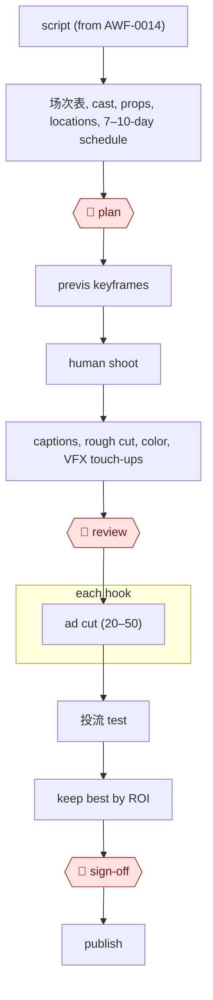

# Live-action assist

`CRE › MED › SHORTDRAMA` · assist · evidence A · **draft: needs a reference example** ([how to add one](../../../../../CONTRIBUTING.md#1-add-an-example-run))

**Shape:** `script (from AWF-0014) → 场次表, cast, props, locations, 7–10-day schedule → 🛑 plan → previs keyframes → human shoot → captions, rough cut, color, VFX touch-ups → 🛑 review → each hook: ad cut (20–50) → 投流 test → keep best by ROI → 🛑 sign-off → publish`
**How it differs from AI shot factory:** people shoot the footage. AI covers pre- and post-production, plus a batch of ad cuts tested against real spend.

<!-- shape diagram: generated by scripts/build_diagrams.py from `shape`; don't edit -->

<!-- end shape diagram -->

## Steps
1. Break the script into 场次 and scenes and draft the shoot plan with an AI tool. At 永川科技片场 the studio's own FilmOS (built on DeepSeek and ChatGPT, fed the studio's 1,000+ digital assets, 100+ nearby real locations and costume/prop stock) lists shots, actors, costume, lighting crew and vehicles per scene. Breakdown went from 1–2 weeks for two people to 15 minutes, and the schedule from 10 days to about 10 minutes [[1]](#sources).
2. 🛑 **Plan**: the producer checks the breakdown and fixes the shoot plan; prep for 《离歌1999》 took about a month instead of 2–3 [[1]](#sources).
3. Make previs: scene concept images and dynamic storyboards [[1]](#sources). On a hybrid AI + live-action show, the crew also shot a rough rooftop previs of fight scenes and fed it to the model to find what motion transfer could handle [[2]](#sources).
4. Shoot with people. 《离歌1999》 shot 85 episodes in 10 days with real actors and about 90% real locations [[1]](#sources). 《行镖》 spent about half a month at 横店 with separate drama and action units, and shot close-up performance scenes live because AI could not yet produce reliable facial acting [[2]](#sources).
5. Post-production runs in parallel groups (AI, live-action, post). The editor writes return notes naming shots to regenerate, and fight footage is cut to a near-final reference before AI replaces backgrounds and lighting [[2]](#sources). Auto-subtitles and beat-sync in 剪映 speed up the rough cut, but the subtitle error rate is about 5% and character names need a human check [[3]](#sources).
6. 🛑 **Review**: the directors review the cut against the editor's return notes and send shots back for regeneration until they work [[2]](#sources).
7. Cut ad creatives for each hook. Grade every scene S/A/B/C by conflict density, name files by drama, episode, scene, grade and event, and make at least three versions of each S scene (strong-conflict, dialogue-suspense, mood-reversal) that differ within the first seconds [[3]](#sources).
8. 投流 test and keep the best by ROI. Export creative-level data from 巨量引擎 and refresh a dashboard every 3 hours. Creatives under 15% 3-second view rate are killed, 15–35% are watched for 24 hours, above 35% get variants; replace a creative after two days of falling spend [[3]](#sources).
9. 🛑 **Sign-off**: before publishing, confirm the release filing or license and, where AI-generated footage is used, the per-episode AI label required by the NRTA draft rules [[4]](#sources).

**Output:** a finished live-action series on the platform plus a pool of tested ad creatives. The scene-graded footage library is reused for the next similar drama [[3]](#sources).
**Failure modes → guards:** Mass-produced creatives with the same first 3 seconds fail cold start and get throttled (about 300 wasted) → one scene, several cuts with distinct openings [[3]](#sources). Volume alone does not lift ROI ("ROI干到0.17") → iterate on returned data; ROI later held at 2.3–2.8 [[3]](#sources). Fully AI-generated ad cuts show logic gaps and look unlike the live footage → AI only for subtitles, beat-sync and format conversion [[3]](#sources). Motion transfer loses facial detail (720p reference limit) → shoot close performance live [[2]](#sources). A model update mid-show changes the look (Seedance 2.5 widened jaws) → limit the new model's share and keep the key episode for last [[2]](#sources).

## Public runs

Coverage as of 2026-11-06: **Partial**: first-hand runs that cover part of the shape or put checkpoints elsewhere. From [Where are the real runs?](../../../../../research/2026-11-real-runs.md); every number was re-checked against its page.

- [重庆日报 via 新华网](http://www.cq.xinhuanet.com/20260615/742fac2865f9486c86e0137a1e6993fe/c.html) (85 episodes shot in 10 days, 2026-06-15). AI script breakdown and shoot plan → previs → live-action shoot. "85集的短剧，拍摄时间只用了10天…200万元"; breakdown "只需15分钟". *First-hand: interview (studio's own tool); confidence: med.*
- [子路, FoST未来叙事 via 观察者网](https://user.guancha.cn/main/content?id=1752038) (How 《行镖》 ran AI + live action). Previs shoot → about half a month at 横店 → AI, live-action and post groups run in parallel. "第一集生成的图片资产，就达到了 300多张"; "30多位AI组成员". *First-hand: interview; confidence: med.*
- [光影联盟, lunxiao.com](https://www.lunxiao.com/article.html?id=23821) (Review of ad-creative iteration, 2026-09-22). Scenes graded S/A/B/C → several cuts each → 3-hour data refresh → kill by 3-second view rate. "接近900条视频素材"; ROI "0.17" → "2.3到2.8". *First-hand: anon; confidence: low.*

## Sources

1. 重庆日报 via 新华网, 10天拍摄85集短剧 永川科技片场用AI重塑影视工业, 2026-06-15. http://www.cq.xinhuanet.com/20260615/742fac2865f9486c86e0137a1e6993fe/c.html
2. 子路, FoST未来叙事 via 观察者网, 半年做出《行镖》，他们如何跑通「AI+实拍」大玄幻内容路？. https://user.guancha.cn/main/content?id=1752038
3. 光影联盟, 为什么批量上素材救不了你的ROI？短剧投流素材的迭代复盘, 2026-09-22. https://www.lunxiao.com/article.html?id=23821
4. 新华网, 广电总局就微短剧发展管理办法公开征求意见, 2026-06-24. https://www.news.cn/politics/20260624/5794e5cd877e440cb678a7f27112ffc7/c.html
