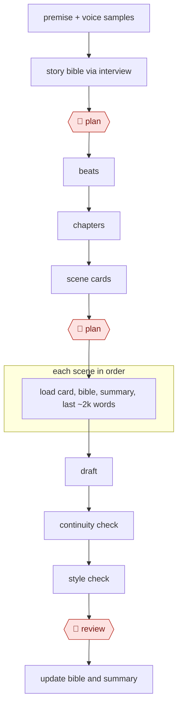

# Bible-driven novel draft

`CRE › WRI › FICTION` · assist · evidence A · **draft: needs a reference example** ([how to add one](../../../../../CONTRIBUTING.md#1-add-an-example-run))

**Shape:** `premise + voice samples → story bible via interview → 🛑 plan → beats → chapters → scene cards → 🛑 plan → each scene in order: load card, bible, summary, last ~2k words → draft → continuity check → style check → 🛑 review → update bible and summary`
**Agent kit:** [run this in Claude Code](variants/claude-code.md)

<!-- shape diagram: generated by scripts/build_diagrams.py from `shape`; don't edit -->

<!-- end shape diagram -->

## Background

A novelist who drafts a long book with an AI model has one main problem: keeping hundreds of pages consistent. Writers handle this with a story bible, a reference file of every character, place, date and world rule, and an outline broken down to single scenes. Checking each new scene against the bible by hand is slow, and a model drafting on its own forgets earlier facts, slides into a generic voice and rewrites decisions the author already made. Here the agent interviews the author to build the bible, proposes the outline, drafts one scene at a time from a small set of files, and runs separate read-only checks for continuity and style. The author still approves the bible, the voice and the outline, and chooses which check notes count, because the book's choices are the author's and it is published under the author's name; the store's disclosure rules also turn on how much of the text the author wrote.

**Terms:**
- **Story bible**: the reference files for a book: characters, places, timeline and the rules of its world.
- **Voice file**: a sample scene in the author's style plus rules drawn from it (point of view, tense, banned phrases), used to steer every draft.
- **Locked canon**: a bible or voice item the author has approved; nothing downstream may change it unless the author does.
- **Beat**: one turn in the story's plot; beats are grouped into chapters and chapters into scenes.
- **Scene card**: a short plan for one scene: point-of-view character, goal, conflict, outcome and what is revealed.
- **POV**: point of view, the character through whose eyes a scene is told.
- **Continuity**: the facts that must stay the same across the book; a **knowledge leak** is a character knowing something before they could have learned it.
- **AI tells, lint**: stock phrases and flat rhythms typical of model prose; a lint script counts them mechanically.
- **Commit**: saving a version of the files in git, the version-control tool the manuscript lives in.
- **KDP**: Amazon Kindle Direct Publishing, the self-publishing store. **AI-generated** text (written by the model, even if edited later) must be disclosed there; **AI-assisted** text (written by the author with AI help) need not.
- **GameLit**: a fiction genre set inside game-like worlds.

## Build it with an agent

**Form:** `project`. One author works on one book in the conversation, but the book runs across many sessions and needs standing project knowledge (the bible and voice file), a rule that locked canon is never edited, and checkers that have not seen the draft being written. [The kit](variants/claude-code.md) writes this build out as files.

**You need:** a git repository with folders for the bible, the voice file, the outline and one file per chapter; samples of the author's own prose, not AI text; a prose-lint script beside the skill; a `CLAUDE.md` giving the folder layout and the files that may be loaded when drafting. The manuscript is the author's property: connect no web tool or MCP server that would upload chapters anywhere the author has not chosen.

| Step | Built as |
|---|---|
| premise + voice samples → story bible via interview | The skill asks one question at a time and writes the answers under `bible/`; it drafts one scene in five voices, and the author's hand-edited pick goes into `voice.md`. |
| 🛑 plan | The skill presents the bible and voice file and stops. Approved items are marked `LOCKED`. |
| beats → chapters → scene cards | The skill writes the beats, a brief per chapter and one card per scene from a template, with a map of where each clue lands. |
| 🛑 plan | The skill presents the outline and stops until the author signs off. |
| each scene in order: load card, bible, summary, last ~2k words → draft | The main conversation, loading only the files `CLAUDE.md` lists for drafting, never the whole manuscript. |
| continuity check → style check | The lint script, then two custom read-only subagents (continuity, style) that write notes files and have no tool to edit prose. |
| 🛑 review | The skill lists every note, numbered, and stops; the author picks which apply, and the agent revises once against that selection. |
| update bible and summary | After the author says accept, the skill commits, appends to the summary and timeline, and proposes character-file changes for approval. |

**Checkpoints:** `plan`: the skill stops twice, after the bible and voice and after the outline. A `PreToolUse` hook blocks edits to `voice.md` and to bible files marked `LOCKED`, so approved canon cannot be rewritten by the agent mid-draft; the author unlocks a file by hand. `review`: the skill stops after the checks with the numbered notes, the checkers cannot edit prose, and a permission rule set to ask before `git commit` keeps a scene out of the manuscript until the author accepts it. The agent has no publishing tool; the author uploads to KDP and records the disclosure.

**Since the sources:** Sources and public runs date from 2023-09 (the KDP disclosure policy) to 2026-09; the two Sudowrite and NovelCrafter pages are undated. McNestrie ran these steps in Claude Code with a bible repository, custom commands and critic agents [[12]](#sources) [[13]](#sources); his post and template repository refused to open in 2026-11, so those details rest on the entry text. Garrett describes treating AI as a production team with locked canon but names no agent that ran the process, and Saoulidis drafted chapter by chapter in an AI code editor, steering each chapter himself. The build keeps per-scene loading because the source gives a reason that still holds, stopping the drafter copying its own earlier output, though McNestrie reports that long books still strain it [[12]](#sources). It leaves out the optional reviewers from other model families and the Ollama context setting, which were part of one author's setup. The `LOCKED` hook is this build's addition; the kit states the rule only in `CLAUDE.md`.

*A design based on this entry's steps and the tool documentation as of 2026-11, not a reported run.*

## Steps

*As reported by the sources.*

1. The agent interviews the author to fill the bible: theme, influences, world, characters, timeline, plus a `parked.md` for ideas with no home yet. In a Claude Code repo this is a `/foundations` command writing Markdown under `bible/` [[12]](#sources) [[13]](#sources). For a sequel, load book 1 one file per chapter and have the model draft the bible of people, places and events from it [[15]](#sources).
2. The author and agent lock the voice: the drafting model writes one scene in five voices, the author picks the nearest miss and edits it by hand, and the edited scene goes into `voice.md`, marked LOCKED, with about ten rules extracted from the edits. Dialogue gets its own session [[12]](#sources).
3. 🛑 **Plan**: the author approves the bible and voice. Agents propose and the author promotes; once an item is approved it is locked canon, and everything downstream must respect it unless the author changes it [[12]](#sources) [[14]](#sources).
4. The agent and author break the story into beats, chapters and scene cards: an author-written brief per chapter [[13]](#sources), or a scene list with the POV character for each scene in its own Markdown file [[15]](#sources). The mystery structure (which clue lands where) is planned up front [[14]](#sources).
5. 🛑 **Plan**: the author signs off the outline. Treat it as a navigation system, not an instruction manual, and update it when written scenes beat the plan [[14]](#sources). Saoulidis found and fixed a key plot point in the scene list at chapter 10, and ran another full check at chapter 20 [[15]](#sources).
6. The agent drafts each scene in order with a narrow context: voice file, theme, the brief and the previous chapter only, never the whole manuscript, so the drafter cannot pattern-match its own earlier output [[12]](#sources).
7. The agent runs checks in fresh contexts that write notes and never edit: a lint script for mechanical AI tells (em-dashes, stock phrases, flat sentence-length variance), then a prose critic, a read-only continuity agent that looks for knowledge leaks, a theme guardian, and a tell-hunter. Optional reviewers from other model families (a local model via Ollama, or another API) catch blind spots the drafter's family shares [[12]](#sources).
8. 🛑 **Review**: the author picks which notes count, and the drafter revises against that selection only, in one pass. Then the author accepts and commits, or reverts and rewrites the brief [[12]](#sources) [[13]](#sources). Garrett revised in eight batches of four chapters [[14]](#sources).
9. On acceptance, the agent updates `timeline.md` and proposes character-file changes for the author to approve [[12]](#sources) [[13]](#sources). At the end, the author audits the whole book as one object for voice drift, objects carried after they were left behind, clues that appear after the deduction that uses them, and narration that calls the book a book [[14]](#sources).

**Output:** An author-accepted manuscript in git (one file per chapter), with the bible, timeline and review notes beside it. Next comes compiling (Scrivener to EPUB in one run [[15]](#sources)) and a KDP upload, with the AI-generated vs AI-assisted disclosure recorded [[11]](#sources).
**Failure modes → guards:** Agents applying each other's feedback until the prose is smooth "consensus mush" → critics never edit, and the author chooses which notes apply [[12]](#sources). Looping a model-scored "quality" metric trains the drafter to please the judge → loop only on floors (lint, continuity, tic budgets); the author sets the ceiling [[12]](#sources). The drafter explains its own theme → the theme guardian and the critics flag it [[12]](#sources). The AI rewrites settled decisions → locked canon [[14]](#sources). Drift from the outline, and whole-book AI edits that silently change a key set piece → periodic on-track checks against the scene list, then a hand edit after the manuscript rests [[15]](#sources). Ollama's default 4k context silently truncates chapters, and fail-silent curl hides failed reviewer calls → set the context explicitly and surface errors [[12]](#sources). Long books outgrow any context window → per-scene loading plus the bible; McNestrie flags this as unsolved past chapter 17 [[12]](#sources).
**Roles reported:**

| Role | Responsibility | Variants |
|---|---|---|
| Bible keeper | Characters, places, timeline, rules | Sudowrite Story Bible, a guided pipeline from braindump → synopsis → outline → scenes [[10]](#sources); NovelCrafter Codex, wiki entries linked into the manuscript with bring-your-own model [[10]](#sources); Markdown vault + Claude Code |
| Outliner | Beats → scene cards (goal, conflict, outcome, POV, information revealed) | Same |
| Drafter | Scene prose | LLM with long context |
| Continuity checker | Fresh context; flags contradictions (eye color, travel time, premature knowledge) | Separate agent |
| Line editor | Style sheet: banned clichés, POV, tense | Critic agent |

**Where the author decides:** 🛑 the author owns the bible and the outline (both **Plan**), where most creative control is exercised. The author also rewrites every chapter (**Review**).
**Tag note:** Amazon KDP requires disclosure of AI-*generated* text, images, and translations, even when heavily edited afterward. Purely AI-*assisted* work doesn't need disclosure [[11]](#sources). Record which applies in each example.

## Public runs

Coverage as of 2026-11-06: **Strong**: a first-hand, detailed run that matches most of the shape. From [Where are the real runs?](../../../../../research/2026-11-real-runs.md); every number was re-checked against its page.

- [Jon McNestrie, *Writing a novel with Claude Code*](https://medium.com/@JonMcNestrie/writing-a-novel-with-claude-code-a-ci-pipeline-for-prose-6f8f30c71bb1) (2026-07-07). A bible repo with a locked voice file; critics write notes and the human picks which apply. "about ten rules extracted from your own edits"; "five in the core team". *First-hand: yes; confidence: high.*
- [Matt Garrett, *How I Used AI To Write KDP GameLit Novel*](https://mattgarrett.com/how-i-used-ai-to-write-kdp-gamelit-novel/) (2026-09-10). Story, world and continuity bibles; approved items locked as canon; batch revision; whole-book continuity audit. "102,737 words, 32 chapters"; "eight revision batches". *First-hand: yes; confidence: high.*
- [George Saoulidis, *How to Write a Sequel Using AI*](https://georgesaoulidis.com/how-to-write-a-sequel-using-ai/) (2025-09-21). Book 1 as context → bible → scene list → chapter by chapter → edits. "Asked for 40 scenes list"; "more than 100k words". *First-hand: yes; confidence: med.*

## Sources

10. Sudowrite, *Story Bible template*. https://sudowrite.com/blog/story-bible-template/ · *Sudowrite vs NovelCrafter (2026)*. https://www.inkfluenceai.com/blog/sudowrite-vs-novelcrafter-2026
11. Authors Guild, *Amazon's new disclosure policy for AI-generated book content* (September 2023). https://authorsguild.org/news/amazons-new-disclosure-policy-for-ai-generated-book-content-is-a-welcome-first-step/
12. Jon McNestrie, *Writing a novel with Claude Code - a CI pipeline for prose*, 2026-07-07. https://medium.com/@JonMcNestrie/writing-a-novel-with-claude-code-a-ci-pipeline-for-prose-6f8f30c71bb1
13. Jon McNestrie, *novel-harness* (template repo). https://github.com/jmcnestrie/novel-harness
14. Matt Garrett, *How I Used AI To Write KDP GameLit Novel*, 2026-09-10. https://mattgarrett.com/how-i-used-ai-to-write-kdp-gamelit-novel/
15. George Saoulidis, *How to Write a Sequel Using AI*, 2025-09-21. https://georgesaoulidis.com/how-to-write-a-sequel-using-ai/
