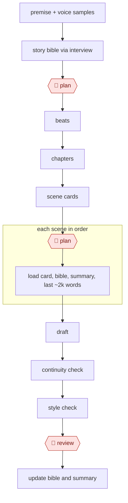

# Bible-driven novel draft

`CRE › WRI › FICTION` · assist · evidence A · **draft: needs a reference example** ([how to add one](../../../../../CONTRIBUTING.md#1-add-an-example-run))

**Shape:** `premise + voice samples → story bible via interview → 🛑 plan → beats → chapters → scene cards → 🛑 plan → each scene in order: load card, bible, summary, last ~2k words → draft → continuity check → style check → 🛑 review → update bible and summary`

<!-- shape diagram: generated by scripts/build_diagrams.py from `shape`; don't edit -->

<!-- end shape diagram -->

| Role | Responsibility | Variants |
|---|---|---|
| Bible keeper | Characters, places, timeline, rules | Sudowrite Story Bible, a guided pipeline from braindump → synopsis → outline → scenes [[10]](#sources); NovelCrafter Codex, wiki entries linked into the manuscript with bring-your-own model [[10]](#sources); Markdown vault + Claude Code |
| Outliner | Beats → scene cards (goal, conflict, outcome, POV, information revealed) | Same |
| Drafter | Scene prose | LLM with long context |
| Continuity checker | Fresh context; flags contradictions (eye color, travel time, premature knowledge) | Separate agent |
| Line editor | Style sheet: banned clichés, POV, tense | Critic agent |

**Checkpoints:** 🛑 the author owns the bible and the outline (both **Plan**), where most creative control is exercised. The author also rewrites every chapter (**Review**).
**Tag note:** Amazon KDP requires disclosure of AI-*generated* text, images, and translations, even when heavily edited afterward. Purely AI-*assisted* work doesn't need disclosure [[11]](#sources). Record which applies in each example.

## Public runs

Coverage as of 2026-11-06: **Strong**: a first-hand, detailed run that matches most of the shape. From [Where are the real runs?](../../../../../research/2026-11-real-runs.md); every number was re-checked against its page.

- [Jon McNestrie, *Writing a novel with Claude Code*](https://medium.com/@JonMcNestrie/writing-a-novel-with-claude-code-a-ci-pipeline-for-prose-6f8f30c71bb1) (2026-07-07). A bible repo with a locked voice file; critics write notes and the human picks which apply. "about ten rules extracted from your own edits"; "five in the core team". *First-hand: yes; confidence: high.*
- [Matt Garrett, *How I Used AI To Write KDP GameLit Novel*](https://mattgarrett.com/how-i-used-ai-to-write-kdp-gamelit-novel/) (2026-09-10). Story, world and continuity bibles; approved items locked as canon; batch revision; whole-book continuity audit. "102,737 words, 32 chapters"; "eight revision batches". *First-hand: yes; confidence: high.*
- [George Saoulidis, *How to Write a Sequel Using AI*](https://georgesaoulidis.com/how-to-write-a-sequel-using-ai/) (2025-09-21). Book 1 as context → bible → scene list → chapter by chapter → edits. "Asked for 40 scenes list"; "more than 100k words". *First-hand: yes; confidence: med.*

## Sources

10. Sudowrite, *Story Bible template*. https://sudowrite.com/blog/story-bible-template/ · *Sudowrite vs NovelCrafter (2026)*. https://www.inkfluenceai.com/blog/sudowrite-vs-novelcrafter-2026
11. Authors Guild, *Amazon's new disclosure policy for AI-generated book content* (September 2023). https://authorsguild.org/news/amazons-new-disclosure-policy-for-ai-generated-book-content-is-a-welcome-first-step/
