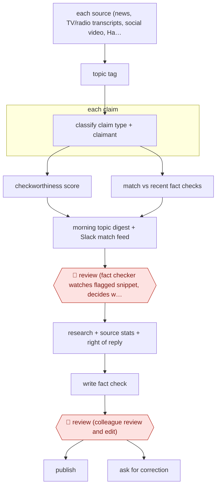

# Claim-monitoring fact-check desk

`CRE › WRI › JOURN` · checkpointed · evidence A · **draft: needs a reference example** ([how to add one](../../../../../CONTRIBUTING.md#1-add-an-example-run))

**Shape:** `each source (news, TV/radio transcripts, social video, Hansard): transcribe → topic tag → each claim: classify claim type + claimant → checkworthiness score | match vs recent fact checks → morning topic digest + Slack match feed → 🛑 review (fact checker watches flagged snippet, decides whether to check) → research + source stats + right of reply → write fact check → 🛑 review (colleague review and edit) → publish | ask for correction`
**Variants:** `full-fact-ai` · `synthid-detector` · `slack`

<!-- shape diagram: generated by scripts/build_diagrams.py from `shape`; don't edit -->

<!-- end shape diagram -->

## Background

A fact-checking charity or newsroom desk publishes articles that test public claims, such as a politician's statistic or a viral health video, against the evidence. The first problem is finding the claims: they appear across newspapers, broadcasts, social media and parliamentary debate, far more than a small team can read or watch. The second is that the same false claim comes back in new places and gets checked again. The agent reads the monitored material every day, labels the claims, scores which are worth a checker's time and links repeats to earlier fact checks. A person still chooses what to check, because that choice decides what the organisation says in public, and a model cannot tell whether a claim is true. People also research, write and review every article, since the published verdict carries the organisation's name.

**Terms:**
- **Claim**: a statement that can be true or false, such as a quoted statistic, as opposed to an opinion.
- **Checkworthiness**: how likely a claim is worth a fact checker's time, for example because it is harmful, widely repeated or checkable.
- **Claim matching**: finding new sentences that make the same claim as one already checked.
- **Hansard**: the official written record of debates in the UK Parliament.
- **PMQs**: Prime Minister's Questions, the weekly live parliamentary session in which MPs question the Prime Minister.
- **Right of reply**: giving the person or organisation behind a claim the chance to respond before publication.
- **Embeddings, entity recognition, part-of-speech tagger**: text-analysis methods that turn a sentence into numbers for comparison, pick out names of people and places, and label each word's grammatical role. Matching needs them so that claims about different people or places are not confused.
- **SynthID**: Google's watermark that some AI-generated images and videos carry, which a detector can read.

## Build it with an agent

**Form:** `service`. Nobody is at a keyboard when monitoring runs: it runs every day on its own, and people see only a morning digest and a feed of matches.

**You need:** feeds or exports of the monitored sources as text (news, parliamentary records, transcripts), with speech-to-text from a separate transcription service for broadcasts and videos; a store outside the conversation holding recent fact checks and past runs' results; a chat connector (MCP server) to post to the team's channel; read access to the published fact checks. The agent needs no tool that writes to the publishing system.

| Step | Built as |
|---|---|
| each source: transcribe → topic tag | A cloud scheduled task or a `claude -p` job reads each new item from the store. Audio and video are transcribed outside the agent first. The agent tags each item with a topic from a fixed list. |
| each claim: classify claim type + claimant → checkworthiness score | A skill holding the claim definition, the claim types and the scoring rubric; the agent labels and scores each claim. Subagents take batches when the volume is large. It is never asked whether a claim is true. |
| match vs recent fact checks | The same run compares each claim with the recent fact checks in the store and records likely matches with the matched check's link. |
| morning topic digest + Slack match feed | The run writes the most checkworthy claims under topic headings and posts them with the matches to the team's channel through the chat connector. |
| 🛑 review (decide whether to check) | See Checkpoints. |
| research + source stats + right of reply → write fact check | Done by the fact checker. In a normal session the checker may ask a skill to gather background pages or find the source of a statistic. |
| 🛑 review (colleague review and edit) → publish / ask for correction | See Checkpoints. |

**Checkpoints:** `review` (first): the run ends after posting the digest and the matches; a fact checker reads the flagged snippet and decides whether to check it, and nothing happens to a claim until a person picks it up. `review` (second): the draft is written by a person and goes to a colleague in the organisation's own publishing system. The agent has no publish tool and no tool to contact a claimant, so a missed stop cannot reach the public or the person being checked.

**Since the sources:** Sources date from 2025-02 to 2026-06. They describe one organisation's own tools, built over many years: trained classifiers, a trained match model and, in 2026, watermark scans. They do not describe an agent assembled from general parts. The build above replaces the trained topic classifier and match model with prompts on a general model, a change the sources do not report. It leaves out the SynthID scans, which need a separate detector, and the search tool over all monitored media. It keeps the sources' rule that the model is never asked whether a claim is true. Transcribing video and radio still needs a speech-to-text service that the agent does not provide. The Nieman Lab article refused to open in 2026-11, so details drawn from it rest on the entry text.

*A design based on this entry's steps and the tool documentation as of 2026-11, not a reported run.*

## Steps

*As reported by the sources.*

1. Monitoring tools continuously ingest daily newspapers, TV, radio, online videos, social media platforms and Hansard. Live events (weekly PMQs, debates) get a real-time transcript. During the 2026 elections the team also monitored more than a thousand candidate-linked Facebook, TikTok, X, YouTube and Instagram accounts, with AI transcripts for videos [[1]](#sources)[[2]](#sources).
2. A classifier trained on 10,000 labelled articles tags each article with one of 17 high-level topics. Models then label each claim with its claim type and claimant, and score it for checkworthiness. The model is never asked whether a claim is true [[1]](#sources).
3. Generative AI ranks snippets in long videos and podcasts (for example health claims or emotive advice), so checkers can go straight to the relevant part [[1]](#sources).
4. Claim matching compares all monitored media with recently checked claims. Sentence embeddings are enhanced with entity recognition and a part-of-speech tagger, plus a trained match model. Matches go into an internal Slack channel [[1]](#sources)[[2]](#sources).
5. Every morning the system shows the most checkworthy claims under topic headings. A search tool filters by speaker, party or source type [[1]](#sources).
6. 🛑 **Review**: a fact checker watches or reads the flagged part to understand the claim, then decides whether to check it formally. Humans decide 'what is worthy of attention' [[1]](#sources)[[2]](#sources).
7. The checker researches background, finds the source of statistical claims and gives right of reply where appropriate. AI is limited to aids such as reverse image search, and checkers write the article themselves [[1]](#sources).
8. 🛑 **Review**: colleagues carefully review and edit the article before publication [[1]](#sources).
9. The desk publishes the fact check. For repeat claims, it contacts the MP or asks the newspaper for a correction. Elections also add SynthID watermark scans of candidates' images and videos [[1]](#sources)[[2]](#sources).

**Output:** Published fact checks and correction requests; a daily claims overview for the editorial team.
**Failure modes → guards:** Claim matching confused different people or places → entity recognition + POS tagger + trained match model [1]. Volume overwhelms a small team → checkworthiness ranking + Slack feed to reduce friction [2]. Treating AI as a truth oracle → the model is never asked whether a claim is true [1].
**How it differs:** Nearest is AWF-0134 (Sampled LLM records analysis): that agent answers fixed questions over a document set for one investigative story, with reporters sampling the answers. Here the deliverable is a stream of fact checks from continuous monitoring, and humans triage each surfaced claim. AWF-0074 rewrites reporter notes into stories, a different input and deliverable.

## Public runs

Coverage as of 2026-11-13: **Strong**: a first-hand, detailed run that matches most of the shape. Collected and re-checked in [Third collection pass](../../../../../research/2026-11-third-pass.md).

- [Full Fact (Nowottny), Full Fact is battling AI-generated elections content](https://www.niemanlab.org/2026/06/full-fact-is-battling-ai-generated-elections-content-with-ai-tools-of-its-own/) (2026-06-25). 2026 UK devolved elections: candidate accounts monitored, claims matched to Slack, watermark scans, human triage. "we scanned 16,514 images or videos attached to candidates' social media posts, and identified 136 that appeared to have watermarks". *First-hand: yes; confidence: high.*
- [Full Fact (Corney), How AI can help fact checkers](https://fullfact.org/blog/2025/feb/how-ai-can-help-fact-checkers/) (2025-02-11). Full pipeline from topic tagging to claim matching; tool used by other fact-checkers. "used by over 40 fact checking organisations working in three languages across 30 countries on a daily basis"; "Over 200 fact check articles have been published about claims found there using our tools". *First-hand: yes; confidence: high.*

## Sources

1. David Corney (Full Fact), How AI can help fact checkers, 2025-02-11. https://fullfact.org/blog/2025/feb/how-ai-can-help-fact-checkers/
2. Steve Nowottny (editor, Full Fact), Full Fact is battling AI-generated elections content with AI tools of its own, Nieman Lab, 2026-06-25. https://www.niemanlab.org/2026/06/full-fact-is-battling-ai-generated-elections-content-with-ai-tools-of-its-own/
