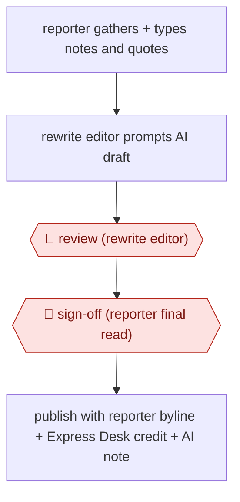

# Reporter-notes rewrite desk

`CRE › WRI › JOURN` · assist · evidence A · **draft: needs a reference example** ([how to add one](../../../../../CONTRIBUTING.md#1-add-an-example-run))

**Shape:** `reporter gathers + types notes and quotes → rewrite editor prompts AI draft → 🛑 review (rewrite editor) → 🛑 sign-off (reporter final read) → publish with reporter byline + Express Desk credit + AI note`
**Variants:** `in-house-chatgpt`

<!-- shape diagram: generated by scripts/build_diagrams.py from `shape`; don't edit -->

<!-- end shape diagram -->

## Background

A news story starts with a reporter gathering facts and quotes, which is not the same as writing the article. Newsrooms have long split the two: in a rewrite desk, an editor takes the reporter's notes, often by phone from the field, and turns them into finished prose. That saves reporters the typing but adds a handover in which facts can change. Here the agent writes the first draft from the typed notes and quotes. A rewrite editor still checks every draft against the notes, because a published error is the newspaper's. The reporter reads it last and decides whether it goes out under their name, because the byline makes them answerable for it.

**Terms:**
- **Rewrite desk, rewrite editor**: the editor who turns a reporter's notes into a draft story, and the desk that does this.
- **Byline**: the line naming the reporter who stands behind a story.
- **Express Desk credit**: the 'Advance Local Express Desk' line printed beside the reporter's name to show that the story began as an AI draft.
- **AI note**: the disclosure at the foot of the story saying AI tools helped and staff reviewed it.

## Build it with an agent

**Form:** `skill`. One editor works on one story at a time in the conversation, so one skill holding the story format and the house rules is enough.

**You need:** the reporter's typed notes and quotes for one story, as text; a skill with the newsroom's story format, style rules and the wording of the AI note; a place to save the draft for the reporter. Notes that identify confidential sources stay out unless the newsroom's own policy allows them to be sent to the tool. Connect no publishing tool.

| Step | Built as |
|---|---|
| reporter gathers + types notes and quotes | A person. The notes are the skill's only input. |
| rewrite editor prompts AI draft | The editor runs the skill on the notes. It writes the draft using only what is in the notes and marks any gap as a question for the reporter instead of filling it. |
| 🛑 review (rewrite editor) | See Checkpoints. |
| 🛑 sign-off (reporter final read) | See Checkpoints. |
| publish with reporter byline + Express Desk credit + AI note | The skill appends the AI note to the draft text. Publishing happens in the content system, outside the agent. |

**Checkpoints:** `review`: the skill ends by listing each quote and number in the draft next to the line of notes it came from, then stops for the rewrite editor to fix or approve. `sign-off`: the agent has no tool that publishes or edits the content system, so only the reporter, after a final read, can release the story under their byline.

**Since the sources:** Sources date from 2026-02 to 2026-03. They report a newsroom using an in-house ChatGPT through the rewrite editor, not an agent with a skill. The build above is a proposal, and the sources do not report how the draft prompts were written. The in-house tool is the source's own; any general agent that follows the skill can take its place. The sources show the human gates as the guard against a failure they report: a story published under a reporter's byline without that reporter's sign-off.

*A design based on this entry's steps and the tool documentation as of 2026-11, not a reported run.*

## Steps

*As reported by the sources.*

1. The reporter does the field reporting, outlines the story and decides what the news and tone are. They type up notes and quotes and send them to the rewrite editor [[1]](#sources).
2. The rewrite editor prompts an in-house ChatGPT version (from parent company Advance Local) to turn the material into a full draft. It is used mostly for short, straightforward suburban stories [[1]](#sources)[[2]](#sources).
3. 🛑 **Review**: the rewrite editor, a person, reviews and fact-checks the draft, then sends it back to the reporter [[1]](#sources)[[2]](#sources).
4. 🛑 **Sign-off**: the reporter does a final review before publication. Quinn told readers 'Reporters get the final say,' as quoted secondhand [[1]](#sources).
5. The desk publishes under the reporter's name with 'Advance Local Express Desk' and a note that the article was produced with AI assistance and reviewed by staff [[1]](#sources).

**Output:** A local news story published on cleveland.com, with an AI-assistance disclosure.
**Failure modes → guards:** A story published under a reporter's byline without that reporter's sign-off (a reported September incident, blamed on miscommunication between editors, led to a byline removal and correction) → make the reporter's approval a hard gate before publishing. Unedited AI errors → the rewrite editor fact-checks every draft.
**How it differs:** None close. AWF-0018 Cluster-brief-draft content is SEO marketing content with no reporter or editor gates.

## Public runs

Coverage as of 2026-11-06: **Partial**: first-hand runs that cover part of the shape or put checkpoints elsewhere. Collected and re-checked in [New workflows for empty categories](../../../../../research/2026-11-new-workflows.md).

- [Boston Globe, Cleveland's largest newspaper is using AI to write some stories](https://www.bostonglobe.com/2026/03/03/business/cleveland-plain-dealer-ai/) (2026-03-03). Express Desk in daily use: reporter notes, AI draft, editor review, reporter final review. "freed up an extra workday for them each week". *First-hand: yes (editor Chris Quinn, quoted from his column); confidence: med.*

## Sources

1. Boston Globe, Cleveland's largest newspaper is using AI to write some stories, 2026-03-03. https://www.bostonglobe.com/2026/03/03/business/cleveland-plain-dealer-ai/
2. Riddhi Setty (CJR), republished by Editor & Publisher, In this Cleveland newsroom, AI is writing (but not reporting) the news, 2026-02-26. https://www.editorandpublisher.com/stories/in-this-cleveland-newsroom-ai-is-writing-but-not-reporting-the-news,260375
