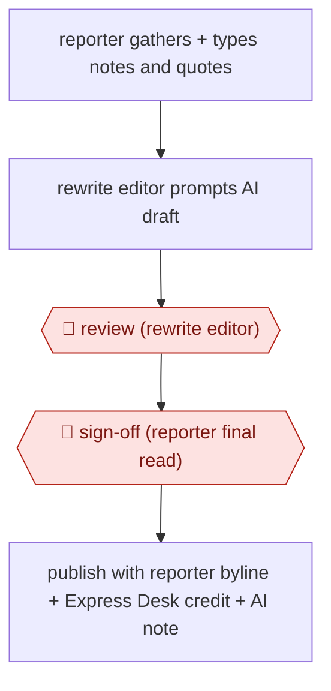

# Reporter-notes rewrite desk

`CRE › WRI › JOURN` · assist · evidence A · **draft: needs a reference example** ([how to add one](../../../../../CONTRIBUTING.md#1-add-an-example-run))

**Shape:** `reporter gathers + types notes and quotes → rewrite editor prompts AI draft → 🛑 review (rewrite editor) → 🛑 sign-off (reporter final read) → publish with reporter byline + Express Desk credit + AI note`
**How it differs:** None close. AWF-0018 Cluster-brief-draft content is SEO marketing content with no reporter or editor gates.
**Variants:** `in-house-chatgpt`

<!-- shape diagram: generated by scripts/build_diagrams.py from `shape`; don't edit -->

<!-- end shape diagram -->

## Steps
1. The reporter does the field reporting, outlines the story and decides what the news and tone are. They type up notes and quotes and send them to the rewrite editor [[1]](#sources).
2. The rewrite editor prompts an in-house ChatGPT version (from parent company Advance Local) to turn the material into a full draft. It is used mostly for short, straightforward suburban stories [[1]](#sources)[[2]](#sources).
3. 🛑 **Review**: the human rewrite editor reviews and fact-checks the draft, then sends it back to the reporter [[1]](#sources)[[2]](#sources).
4. 🛑 **Sign-off**: the reporter does a final review before publication. Quinn told readers 'Reporters get the final say,' as quoted secondhand [[1]](#sources).
5. Publish under the reporter's name with 'Advance Local Express Desk' and a note that the article was produced with AI assistance and reviewed by staff [[1]](#sources).

**Output:** A local news story published on cleveland.com, with an AI-assistance disclosure.
**Failure modes → guards:** A story published under a reporter's byline without that reporter's sign-off (a reported September incident, blamed on miscommunication between editors, led to a byline removal and correction) → make the reporter's approval a hard gate before publishing. Unedited AI errors → the rewrite editor fact-checks every draft.

## Public runs

Coverage as of 2026-11-06: **Partial**: first-hand runs that cover part of the shape or put checkpoints elsewhere. Collected and re-checked in [New workflows for empty categories](../../../../../research/2026-11-new-workflows.md).

- [Boston Globe, Cleveland's largest newspaper is using AI to write some stories](https://www.bostonglobe.com/2026/03/03/business/cleveland-plain-dealer-ai/) (2026-03-03). Express Desk in daily use: reporter notes, AI draft, editor review, reporter final review. "freed up an extra workday for them each week". *First-hand: yes (editor Chris Quinn, quoted from his column); confidence: med.*

## Sources

1. Boston Globe, Cleveland's largest newspaper is using AI to write some stories, 2026-03-03. https://www.bostonglobe.com/2026/03/03/business/cleveland-plain-dealer-ai/
2. Riddhi Setty (CJR), republished by Editor & Publisher, In this Cleveland newsroom, AI is writing (but not reporting) the news, 2026-02-26. https://www.editorandpublisher.com/stories/in-this-cleveland-newsroom-ai-is-writing-but-not-reporting-the-news,260375
