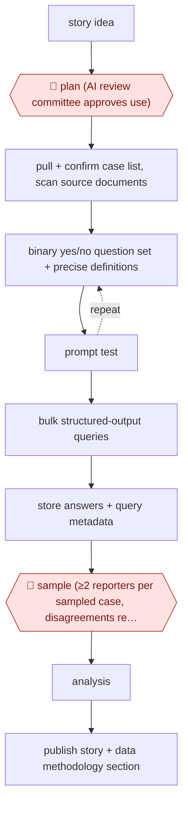

# Sampled LLM records analysis

`CRE › WRI › JOURN` · sampled · evidence A · **draft: needs a reference example** ([how to add one](../../../../../CONTRIBUTING.md#1-add-an-example-run))

**Shape:** `story idea → 🛑 plan (AI review committee approves use) → pull + confirm case list, scan source documents → (binary yes/no question set + precise definitions ⟲ prompt test) → bulk structured-output queries → store answers + query metadata → 🛑 sample (≥2 reporters per sampled case, disagreements resolved against predefined accuracy thresholds) → analysis → publish story + data methodology section`
**How it differs:** AWF-0074 Reporter-notes rewrite desk is assist-mode drafting of a single story from a reporter's notes. This run produces a dataset from hundreds of primary documents, and the checkpoint is a statistical sample with double coding, not a per-draft read. The deliverable, checkpoint and autonomy all differ.
**Variants:** `gpt-4o` · `python-sqlite-r`

<!-- shape diagram: generated by scripts/build_diagrams.py from `shape`; don't edit -->

<!-- end shape diagram -->

## Steps
1. An editor and the data and investigations editors scope a question that needs exact counts and percentages over time across a large body of court filings [[1]](#sources).
2. 🛑 **Plan**: under Bloomberg's generative AI policy, a review committee approves the AI use before work starts [[1]](#sources).
3. Engineers pull the cases from PACER, confirm the case list, and scan the initial complaints so an LLM can read them [[1]](#sources).
4. The lead writer drafts the questions. The team iterates prompts over several weeks, choosing binary yes/no questions over open-ended ones and fixing precise definitions (for example, what counts as a 'redistricting' case) [[1]](#sources).
5. Python scripts run the queries in bulk with structured outputs. SQLite stores the answers and query metadata, and R does the analysis [[1]](#sources).
6. 🛑 **Sample**: reporters independently answer the same questions on a random sample of cases, with at least two reporters per case. Disagreements are reviewed and discussed, and results are checked against predefined accuracy thresholds. About 20 staff took part [[1]](#sources).
7. The story is published with a data methodology section that describes the AI analysis [[1]](#sources).

**Output:** A validated dataset built from primary documents, plus a published investigation and methodology note.
**Failure modes → guards:** Vague or open-ended questions give answers that can't be parsed or are inconsistent → binary questions, precise definitions, structured outputs. Model errors spread across hundreds of documents → double-coded random sample against preset thresholds before any number is published.

## Public runs

Coverage as of 2026-11-06: **Partial**: first-hand runs that cover part of the shape or put checkpoints elsewhere. Collected and re-checked in [Second collection pass](../../../../../research/2026-11-second-pass.md).

- [NPC Journalism Institute, How Bloomberg Law uses AI-driven data analysis](https://www.pressclubinstitute.org/2025/05/22/how-bloomberg-law-uses-ai-driven-data-analysis-to-tackle-big-stories/) (2025-05-22). Voting Rights Act story: GPT-4o coded complaints, reporters double-checked a random sample. "579 federal voting rights complaints". *First-hand: interview; confidence: high.*

## Sources

1. Elliot C. Williams, National Press Club Journalism Institute, 'How Bloomberg Law uses AI-driven data analysis to tackle big stories', 2025-05-22. https://www.pressclubinstitute.org/2025/05/22/how-bloomberg-law-uses-ai-driven-data-analysis-to-tackle-big-stories/
