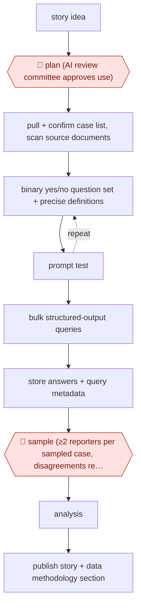

# Sampled LLM records analysis

`CRE › WRI › JOURN` · sampled · evidence A · **draft: needs a reference example** ([how to add one](../../../../../CONTRIBUTING.md#1-add-an-example-run))

**Shape:** `story idea → 🛑 plan (AI review committee approves use) → pull + confirm case list, scan source documents → (binary yes/no question set + precise definitions ⟲ prompt test) → bulk structured-output queries → store answers + query metadata → 🛑 sample (≥2 reporters per sampled case, disagreements resolved against predefined accuracy thresholds) → analysis → publish story + data methodology section`
**Variants:** `gpt-4o` · `python-sqlite-r`

<!-- shape diagram: generated by scripts/build_diagrams.py from `shape`; don't edit -->

<!-- end shape diagram -->

## Background

Some news stories rest on counting: how many lawsuits of a certain kind were filed, and how that share changed over the years. When the facts sit in hundreds of long court filings, reading them all by hand is slow, and keyword searches miss cases worded differently. A language model can answer the same fixed questions about every document and produce a table that can be counted. Models make mistakes, and a figure printed in a story must be right. So the agent answers the questions in bulk, and people decide whether the work may start, and check a random sample of the answers themselves against a preset accuracy threshold before any number is used. The newsroom, not the model, answers for what it publishes.

**Terms:**
- **Complaint**: the first filing in a lawsuit, which sets out what the person suing claims.
- **PACER**: the US federal courts' online system for obtaining case filings.
- **Binary question**: a yes/no question put to the model about each document, as opposed to an open-ended one.
- **Structured outputs**: a model setting that forces each answer into a fixed format, so a script can read it.
- **Double coding**: two people answer the same question about the same document independently, and their disagreements are discussed.
- **Accuracy threshold**: the minimum share of sampled answers that must be right, set before checking, for the results to be used.
- **Redistricting case**: one of the case types in the source story; the team had to spell out what counted, because small changes in wording changed the model's answers.
- **SQLite, R**: a small file-based database, and a programming language for statistics.

## Build it with an agent

**Form:** `skill`. One data journalist runs one analysis in the conversation, and the work is a fixed procedure of defining questions, running a script and preparing a sample.

**You need:** the case documents as text files, with the case list confirmed; a written approval from the newsroom's AI review committee, saved as a file; an API connection to a model that can return structured answers; a small script beside the skill that runs the questions over every document and writes the answers and each query's settings into a SQLite file; the accuracy threshold, written down before sampling. Documents that must not leave the newsroom's systems stay out of the model's reach.

| Step | Built as |
|---|---|
| story idea → 🛑 plan | See Checkpoints. |
| pull + confirm case list, scan source documents | People and engineers. The skill checks that every case on the list has a text file and lists the gaps. |
| binary yes/no question set + precise definitions ⟲ prompt test | The skill drafts the binary questions and definitions with the journalist, runs them on a small set of documents, shows the answers beside the text, and revises until the journalist accepts. |
| bulk structured-output queries | The script runs every question on every document with structured outputs. |
| store answers + query metadata | The same script writes answers, the prompt version and the model name into SQLite. |
| 🛑 sample | See Checkpoints. |
| analysis | The agent runs counts and shares over time from the stored answers, only after the threshold is met. |
| publish story + data methodology section | The skill drafts the methodology section from the stored settings and the sample result. A person writes and publishes the story. |

**Checkpoints:** `plan`: a `PreToolUse` hook blocks the bulk-query script until the approval file exists, so the run cannot start without it. `sample`: the skill draws a random sample, writes a blank answer sheet without the model's answers for each reporter, and stops. Only after two reporters have answered each sampled case does it compare their answers with the model's, list the disagreements for a person to resolve, and report the result against the threshold. It does not begin the analysis below the threshold.

**Since the sources:** The only source dates from 2025-05 and its public run reports a 2025 analysis with GPT-4o. A search in 2026-11 found an IRE article from 2026-08 that also argues for checking model labels against human labels before publishing ([IRE, 2026-08](https://ire.org/2026/08/13/using-llms-in-data-journalism-can-be-trustworthy-if-these-five-elements-are-in-your-methodology/)); Nothing found shows the practice superseded. The model is a variant and may be replaced. Structured outputs and bulk submission are features the sources used by hand, and the build keeps them. The source's team included about 20 staff for validation and two outside advisers; one skill does not replace those people. The build leaves out the PACER pull and the scanning of complaints, which the sources assigned to engineering teams.

*A design based on this entry's steps and the tool documentation as of 2026-11, not a reported run.*

## Steps

*As reported by the sources.*

1. An editor and the data and investigations editors scope a question that needs exact counts and percentages over time across a large body of court filings [[1]](#sources).
2. 🛑 **Plan**: under Bloomberg's generative AI policy, a committee of reviewers approves the AI use before work starts [[1]](#sources).
3. Engineers pull the cases from PACER, confirm the case list, and scan the initial complaints so an LLM can read them [[1]](#sources).
4. The lead writer drafts the questions. The team iterates prompts over several weeks, choosing binary yes/no questions over open-ended ones and fixing precise definitions (for example, what counts as a 'redistricting' case) [[1]](#sources).
5. Python scripts run the queries in bulk with structured outputs, so each answer arrives in a fixed format. SQLite stores the answers and query metadata, and R does the analysis [[1]](#sources).
6. 🛑 **Sample**: reporters independently answer the same questions on a random sample of cases, with at least two reporters per case. Disagreements are reviewed and discussed, and results are checked against predefined accuracy thresholds. About 20 staff took part [[1]](#sources).
7. The story is published with a data methodology section that describes the AI analysis [[1]](#sources).

**Output:** A validated dataset built from primary documents, plus a published investigation and methodology note.
**Failure modes → guards:** Vague or open-ended questions give answers that can't be parsed or are inconsistent → binary questions, precise definitions, structured outputs. Model errors spread across hundreds of documents → double-coded random sample against preset thresholds before any number is published.
**How it differs:** AWF-0074 Reporter-notes rewrite desk is assist-mode drafting of a single story from a reporter's notes. This run produces a dataset from hundreds of primary documents, and the checkpoint is a statistical sample with double coding, not a per-draft read. The deliverable, checkpoint and autonomy all differ.

## Public runs

Coverage as of 2026-11-06: **Partial**: first-hand runs that cover part of the shape or put checkpoints elsewhere. Collected and re-checked in [Second collection pass](../../../../../research/2026-11-second-pass.md).

- [NPC Journalism Institute, How Bloomberg Law uses AI-driven data analysis](https://www.pressclubinstitute.org/2025/05/22/how-bloomberg-law-uses-ai-driven-data-analysis-to-tackle-big-stories/) (2025-05-22). Voting Rights Act story: GPT-4o coded complaints, reporters double-checked a random sample. "579 federal voting rights complaints". *First-hand: interview; confidence: high.*

## Sources

1. Elliot C. Williams, National Press Club Journalism Institute, 'How Bloomberg Law uses AI-driven data analysis to tackle big stories', 2025-05-22. https://www.pressclubinstitute.org/2025/05/22/how-bloomberg-law-uses-ai-driven-data-analysis-to-tackle-big-stories/
