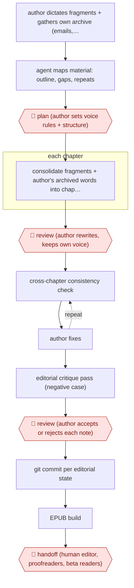

# Dictation-to-memoir manuscript

`CRE › WRI › NONFIC` · assist · evidence A · **draft: needs a reference example** ([how to add one](../../../../../CONTRIBUTING.md#1-add-an-example-run))

**Shape:** `author dictates fragments + gathers own archive (emails, journals, blog posts) → agent maps material: outline, gaps, repeats → 🛑 plan (author sets voice rules + structure) → each chapter: consolidate fragments + author's archived words into chapter file → 🛑 review (author rewrites, keeps own voice) → (cross-chapter consistency check ⟲ author fixes) → editorial critique pass (negative case) → 🛑 review (author accepts or rejects each note) → git commit per editorial state → EPUB build → 🛑 handoff (human editor, proofreaders, beta readers)`
**How it differs:** AWF-0073 Dossier-to-chapter book (closest). 0073 builds chapters from agent web-research dossiers with citations, BibTeX and an unsupported-claims audit. Here the only source is the author's own dictation and archive, there is no research or citation step, the agent's main job is consolidation, consistency and critique, and the final gate is a handoff to a human editor. Different source material, checkpoints and deliverable.
**Variants:** `claude-markdown-git-epub` · `notebooklm-claude`

<!-- shape diagram: generated by scripts/build_diagrams.py from `shape`; don't edit -->

<!-- end shape diagram -->

## Steps
1. The author produces the raw material: fragments dictated on the commute, voice-recorded scenes, plus their own past writing (20+ years of emails, newsletters, blog posts, journals) [[1]](#sources)[[2]](#sources).
2. The agent reads the whole pile and returns an outline, questions the author hadn't asked, gaps, and passages repeated across chapters. 🛑 **Plan**: the author sets voice rules and what the book is and isn't [[2]](#sources).
3. Set up the manuscript like code: one chapter per Markdown file, git for every editorial state, a one-command EPUB build [[1]](#sources).
4. Each chapter: the agent consolidates dictated fragments recorded weeks apart into a coherent chapter, searches the email archive for the author's own contemporaneous words about the event, and reconstructs half-remembered details (trail names, landmarks, distances). 🛑 **Review**: the author rewrites; anything the agent drafted from scratch was rewritten entirely [[1]](#sources)[[2]](#sources).
5. Cross-chapter consistency check ('given chapters 1, 4, and 9, what breaks in this one?'); in the reported run it found half a dozen real errors [[1]](#sources).
6. Editorial critique pass, explicitly asking for the negative case rather than 'a better version'. 🛑 **Review**: the author applied about 60% of notes and rejected 40% [[1]](#sources).
7. Build the EPUB. 🛑 **Handoff**: the manuscript goes to a human editor, proofreaders and beta readers before publication [[1]](#sources)[[2]](#sources).

**Output:** A finished, edited memoir manuscript (Markdown + EPUB) handed to a human editor or published.
**Failure modes → guards:** Asking for 'a better version' sands off the voice → ask what's weak in the existing text; agent praise bias → request the negative case and keep a human editor in the loop; agent-drafted prose not in the author's voice → author rewrites every generated passage.

## Public runs

Coverage as of 2026-11-13: **Strong**: a first-hand, detailed run that matches most of the shape. Collected and re-checked in [Fourth collection pass](../../../../../research/2026-11-fourth-pass.md).

- [Matt Whitt, Writing a Memoir with Claude](https://mattwhitt.com/blog/writing-a-novel-with-claude/) (2026-04-12). Commute dictation consolidated into chapters; consistency checks; author kept ~60% of notes. "28 chapters, 80,000+ words, fully edited". *First-hand: yes; confidence: high.*
- [Steve Bremner, I Wrote a Book With AI](https://stevebremner.com/2026/05/i-wrote-a-book-with-ai-heres-what-actually-happened/) (2026-05-21). Email-archive search + voice transcripts shaped into memoir; goes to human editor. "twenty plus years’ worth of emails". *First-hand: yes; confidence: med.*

## Sources

1. Matt Whitt, Writing a Memoir with Claude: A Workflow Report, 2026-04-12. https://mattwhitt.com/blog/writing-a-novel-with-claude/
2. Steve Bremner, I Wrote a Book With AI. Here's What Actually Happened, 2026-05-21. https://stevebremner.com/2026/05/i-wrote-a-book-with-ai-heres-what-actually-happened/
