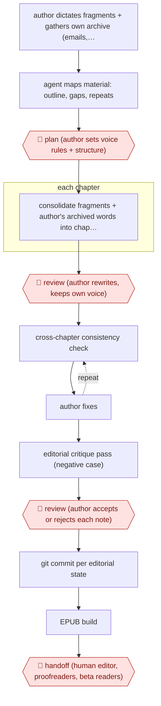

# Dictation-to-memoir manuscript

`CRE › WRI › NONFIC` · assist · evidence A · **draft: needs a reference example** ([how to add one](../../../../../CONTRIBUTING.md#1-add-an-example-run))

**Shape:** `author dictates fragments + gathers own archive (emails, journals, blog posts) → agent maps material: outline, gaps, repeats → 🛑 plan (author sets voice rules + structure) → each chapter: consolidate fragments + author's archived words into chapter file → 🛑 review (author rewrites, keeps own voice) → (cross-chapter consistency check ⟲ author fixes) → editorial critique pass (negative case) → 🛑 review (author accepts or rejects each note) → git commit per editorial state → EPUB build → 🛑 handoff (human editor, proofreaders, beta readers)`
**Variants:** `claude-markdown-git-epub` · `notebooklm-claude`

<!-- shape diagram: generated by scripts/build_diagrams.py from `shape`; don't edit -->

<!-- end shape diagram -->

## Background

A memoir is a book about the author's own life, so the raw material already exists: memories, old emails, journals and blog posts. The hard part is turning scattered pieces into chapters that hang together and still sound like the author. Many authors find it easier to talk than to type, so they record fragments aloud, often weeks apart, and then face a pile that repeats itself and contradicts itself. The agent consolidates the fragments, finds the author's own earlier words about an event, and checks later chapters against earlier ones. The author still decides what the book is, rewrites every passage the agent drafted and judges each criticism, because the story and the voice are the author's, and a memoir is read as the author speaking. A human editor still reads it before release, because the agent tends to praise.

**Terms:**
- **Dictation fragments**: short voice recordings, transcribed to text, each telling a scene or an event.
- **Voice rules**: written instructions for how the book should sound and what it is and is not about.
- **Consistency check**: reading one chapter against the others for contradicting facts, names or dates.
- **Negative case**: asking what is wrong with a text, instead of asking for a better version, because a request for improvement tends to flatten the author's voice and a request for opinion tends to bring praise.
- **Markdown, git, EPUB**: plain text files with light formatting marks; a tool that saves every version of a set of files; the standard e-book file format.
- **Beta readers**: volunteer readers who read the manuscript before publication and say what worked.

## Build it with an agent

**Form:** `skill`. One author works on one book in the conversation, so a skill that holds the voice rules and the chapter procedure is enough.

**You need:** the dictated transcripts as text; the author's own archive (emails, journals, blog posts) as files the agent can search; the manuscript as one Markdown file per chapter in a git repository; a small script that builds the EPUB; a skill with the author's voice rules and the questions for the consistency and critique passes. The archive holds other people's private messages. The author decides which parts the agent may search, and nothing is uploaded elsewhere. Connect no publishing tool.

| Step | Built as |
|---|---|
| author dictates fragments + gathers own archive | The author. The transcripts and archive are the skill's inputs. |
| agent maps material: outline, gaps, repeats | The skill reads the pile and returns an outline, questions for the author, gaps and passages repeated across chapters. |
| 🛑 plan | See Checkpoints. |
| each chapter: consolidate fragments + author's archived words into chapter file | The skill writes a chapter file from the fragments, searches the archive for the author's contemporaneous words about the event, and marks details it could not support as questions. |
| 🛑 review (author rewrites) | See Checkpoints. |
| cross-chapter consistency check ⟲ author fixes | The skill reads the chapter against the others the author names and lists contradictions. The author fixes them. |
| editorial critique pass (negative case) | A built-in subagent that has not seen the drafting reads the manuscript and returns what is weak, structured by section. |
| 🛑 review (accept or reject each note) | See Checkpoints. |
| git commit per editorial state → EPUB build | Git commands after the author's decision; the script builds the EPUB. |
| 🛑 handoff | See Checkpoints. |

**Checkpoints:** `plan`: the skill stops after presenting the outline and the voice rules, and writes nothing into chapter files until the author approves them. `review` (chapters): the skill stops after each chapter file and the author rewrites it; passages the agent drafted from scratch are marked so none stays unrewritten. `review` (notes): the skill lists the critique notes, numbered, and applies only those the author selects. A permission rule set to ask before `git commit` keeps a change out of the history until the author says yes. `handoff`: the skill ends by stating what it could not judge, and the manuscript goes to a human editor, proofreaders and beta readers outside the agent, which has no publishing tool.

**Since the sources:** Sources date from 2026-04 to 2026-05. Both are personal blog accounts of one author each, and both used Claude, with Whitt reporting that it held the whole 80,000-word manuscript in context. The build keeps what they report: one file per chapter, git for each state, a one-command EPUB build, the negative-case request and the author's rewrite. It adds the marked passages, which neither source describes as a mechanism. Neither source mentions a skill, so how the voice rules were stored is the build's choice. Whether a model keeps a whole manuscript in view depends on the model and the book's length, and the build does not rely on it.

*A design based on this entry's steps and the tool documentation as of 2026-11, not a reported run.*

## Steps

*As reported by the sources.*

1. The author produces the raw material: fragments dictated on the commute, voice-recorded scenes, plus their own past writing (20+ years of emails, newsletters, blog posts, journals) [[1]](#sources)[[2]](#sources).
2. The agent reads the whole pile and returns an outline, questions the author hadn't asked, gaps, and passages repeated across chapters. 🛑 **Plan**: the author sets voice rules and what the book is and isn't [[2]](#sources).
3. The author sets up the manuscript like code: one chapter per Markdown file, git for every editorial state, a one-command EPUB build [[1]](#sources).
4. Each chapter: the agent consolidates dictated fragments recorded weeks apart into a coherent chapter, searches the email archive for the author's own contemporaneous words about the event, and reconstructs half-remembered details (trail names, landmarks, distances). 🛑 **Review**: the author rewrites; anything the agent drafted from scratch was rewritten entirely [[1]](#sources)[[2]](#sources).
5. The agent runs a cross-chapter consistency check ('given chapters 1, 4, and 9, what breaks in this one?'); in the reported run it found half a dozen real errors [[1]](#sources).
6. The agent runs an editorial critique pass, the author explicitly asking for the negative case rather than 'a better version'. 🛑 **Review**: the author applied about 60% of notes and rejected 40% [[1]](#sources).
7. A script builds the EPUB. 🛑 **Handoff**: the manuscript goes to a human editor, proofreaders and beta readers before publication [[1]](#sources)[[2]](#sources).

**Output:** A finished, edited memoir manuscript (Markdown + EPUB) handed to a human editor or published.
**Failure modes → guards:** Asking for 'a better version' sands off the voice → ask what's weak in the existing text; agent praise bias → request the negative case and keep a human editor in the loop; agent-drafted prose not in the author's voice → author rewrites every generated passage.

## Public runs

Coverage as of 2026-11-13: **Strong**: a first-hand, detailed run that matches most of the shape. Collected and re-checked in [Fourth collection pass](../../../../../research/2026-11-fourth-pass.md).

- [Matt Whitt, Writing a Memoir with Claude](https://mattwhitt.com/blog/writing-a-novel-with-claude/) (2026-04-12). Commute dictation consolidated into chapters; consistency checks; author kept ~60% of notes. "28 chapters, 80,000+ words, fully edited". *First-hand: yes; confidence: high.*
- [Steve Bremner, I Wrote a Book With AI](https://stevebremner.com/2026/05/i-wrote-a-book-with-ai-heres-what-actually-happened/) (2026-05-21). Email-archive search + voice transcripts shaped into memoir; goes to human editor. "twenty plus years’ worth of emails". *First-hand: yes; confidence: med.*

## Sources

1. Matt Whitt, Writing a Memoir with Claude: A Workflow Report, 2026-04-12. https://mattwhitt.com/blog/writing-a-novel-with-claude/
2. Steve Bremner, I Wrote a Book With AI. Here's What Actually Happened, 2026-05-21. https://stevebremner.com/2026/05/i-wrote-a-book-with-ai-heres-what-actually-happened/
