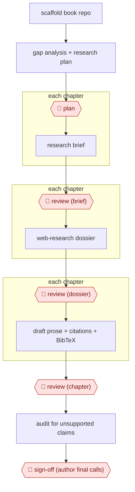

# Dossier-to-chapter book

`CRE › WRI › NONFIC` · assist · evidence A · **draft: needs a reference example** ([how to add one](../../../../../CONTRIBUTING.md#1-add-an-example-run))

**Shape:** `scaffold book repo → gap analysis + research plan → 🛑 plan → each chapter: research brief → 🛑 review (brief) → each chapter: web-research dossier → 🛑 review (dossier) → each chapter: draft prose + citations + BibTeX → 🛑 review (chapter) → audit for unsupported claims → 🛑 sign-off (author final calls)`
**How it differs:** AWF-0030 Issue-tree research produces a strategy answer, not a cited book. AWF-0011 Bible-driven novel draft is fiction with no source or citation gates. AWF-0009 Screening funnel screens literature but writes no long-form chapters.
**Variants:** `claude-code-quarto` · `gemini-cli-research`

<!-- shape diagram: generated by scripts/build_diagrams.py from `shape`; don't edit -->

<!-- end shape diagram -->

## Steps
1. The author sets up the book skeleton (Quarto book structure, initial chapter drafts, framework). One model reviews the repo, finds gaps and drafts a research plan and master prompt. 🛑 **Plan**: the author steers the analysis and revises scope before accepting the master prompt [[1]](#sources).
2. A drafting model writes a research brief for each chapter (17 briefs). 🛑 **Review**: the author reviews each brief and redirects scope where needed [[1]](#sources).
3. A second model with web search (Gemini via CLI) produces a dossier for each chapter: annotated source list, argument spine, section outline and figure sketches. Runs are sequential to avoid rate limits. Citation rules apply in this step: Tier 1 sources need a live URL confirmed in the session, and Tier 2 papers get a placeholder unless the publisher page was retrieved. 🛑 **Review**: the author checks each dossier for scope gaps and source quality, then accepts, rejects or re-runs it [[1]](#sources).
4. The drafting model writes chapter prose from the dossiers, verifies citations, builds diagrams and tables, and adds BibTeX entries. 🛑 **Review**: the author reviews each chapter and directs revisions [[1]](#sources).
5. Cross-model review: Gemini audits finished chapters for unsupported claims and unlinked entities, and Claude triages the flags. 🛑 **Sign-off**: the author makes the final call on each flagged item [[1]](#sources).

**Output:** A Quarto book (chapter files plus a .bib file), ready for publication or a further editorial pass.
**Failure modes → guards:** Hallucinated or unverifiable citations → the live-URL rule for Tier 1, DOI placeholders for anything not retrieved, and a second model's audit. The source admits not every citation was independently verified, so a human citation spot-check before publication is still needed. Scope drift → the author gates each brief and dossier.

## Public runs

Coverage as of 2026-11-06: **Partial**: first-hand runs that cover part of the shape or put checkpoints elsewhere. Collected and re-checked in [New workflows for empty categories](../../../../../research/2026-11-new-workflows.md).

- [Implementing AI in Academic Medicine, Appendix D](https://seandavi.github.io/amc-ai-governance/appendix_workflow.html) (undated). Full book built through brief, dossier, chapter and audit phases, with the author reviewing every phase. 17 complete dossiers, about 30,900 words total; the research phase took about four hours of elapsed time. *First-hand: yes; confidence: med.*

## Sources

1. Implementing AI in Academic Medicine, Appendix D: How This Book Was Written: A Multi-Model AI Authorship Workflow (author not named on the page; undated). https://seandavi.github.io/amc-ai-governance/appendix_workflow.html
