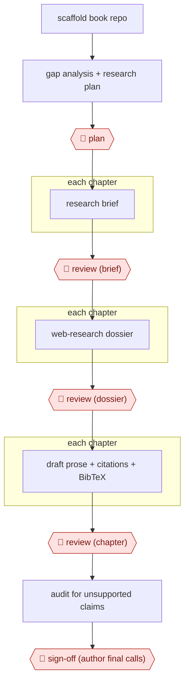

# Dossier-to-chapter book

`CRE › WRI › NONFIC` · assist · evidence A · **draft: needs a reference example** ([how to add one](../../../../../CONTRIBUTING.md#1-add-an-example-run))

**Shape:** `scaffold book repo → gap analysis + research plan → 🛑 plan → each chapter: research brief → 🛑 review (brief) → each chapter: web-research dossier → 🛑 review (dossier) → each chapter: draft prose + citations + BibTeX → 🛑 review (chapter) → audit for unsupported claims → 🛑 sign-off (author final calls)`
**Variants:** `claude-code-quarto` · `gemini-cli-research`

<!-- shape diagram: generated by scripts/build_diagrams.py from `shape`; don't edit -->

<!-- end shape diagram -->

## Background

A nonfiction book that makes factual claims needs every claim traced to a source a reader can check. For a book of a dozen or more chapters, an author must research each chapter, read and sort the sources, write, and keep a bibliography in order. That is slow, and a model asked to find sources can invent convincing ones that do not exist. Here the agent does the first pass: a brief for each chapter, a web-research dossier of annotated sources, a drafted chapter with citations, and a final audit for claims no source supports. The author still approves each stage, because the book's argument and its accuracy are the author's responsibility and a fake citation in print damages the author. The author also makes the last call on every flagged claim.

**Terms:**
- **Research brief**: a short plan for one chapter: the argument, the kinds of sources to look for, figure ideas and open questions.
- **Dossier**: the research result for one chapter: an annotated source list, the line of argument, a section outline and figure sketches.
- **Quarto**: a publishing system that builds a book from Markdown chapter files.
- **BibTeX**: a plain-text format for a bibliography, kept here in a `.bib` file.
- **DOI**: a permanent identifier for a published paper; a made-up one looks real but resolves to nothing.
- **Tier 1 and Tier 2 sources**: this entry's own citation rule: Tier 1 are documents the agent can open during the session, such as official publications, and need a live URL; Tier 2 are journal papers, which get a placeholder unless the publisher's page was opened.
- **Unsupported claim, unlinked entity**: a statement of fact with no source behind it; a person, organisation or document mentioned without a reference.

## Build it with an agent

**Form:** `project`. One author writes one book, but it spans many sessions and chapters, and needs rules that must hold every time (citation discipline), standing project files, and a reviewer that has not seen the chapters being written. [AWF-0011](../../FICTION/bible-driven-novel-draft/) uses the same form for the same reasons.

**You need:** a git repository holding the Quarto book, a `_research/` folder for the master prompt, briefs and dossiers, and `references.bib`; a `CLAUDE.md` stating the folder layout and the citation rules; skills for the brief, the dossier and the chapter; a web search tool; access to a literature database if the field has one, so that the agent can confirm each paper. No connector is needed to publish.

| Step | Built as |
|---|---|
| scaffold book repo | The author, with the Quarto structure and any early drafts. |
| gap analysis + research plan → 🛑 plan | A skill reads the repo, lists the gaps and writes a master prompt covering structure, voice, citation standards and figures. |
| each chapter: research brief → 🛑 review (brief) | A skill writes one brief per chapter into `_research/briefs/`. |
| each chapter: web-research dossier → 🛑 review (dossier) | A research subagent with web search writes one dossier per chapter, following the two-tier citation rule in `CLAUDE.md`. Chapters can run in parallel, or in turn if the search tool rate-limits. |
| each chapter: draft prose + citations + BibTeX → 🛑 review (chapter) | The main conversation writes the chapter from the dossier, checks each Tier 2 placeholder by lookup before it reaches `references.bib`, and runs the Quarto build. |
| audit for unsupported claims → 🛑 sign-off | A custom read-only subagent that has not seen the drafting reads each finished chapter and lists unsupported claims and unlinked entities in a notes file. The main conversation sorts the flags for the author. |

**Checkpoints:** `plan`: the skill stops after presenting the gaps and the master prompt. `review`: the skills stop after each brief, dossier and chapter, and the author accepts, redirects or re-runs it before the next stage begins. A permission rule set to ask before edits to `references.bib` makes the author see each bibliography change. `sign-off`: the audit subagent has no edit tool, so it only produces the list, and the author decides on each flagged item.

**Since the sources:** The only source is undated; it names Claude Opus 4.7 and Sonnet 4.6, which places it in 2026. It used three models: one for planning, one for drafting and one for research and audit. The build uses subagents of one agent tool instead and drops the choice of a separate research model, which was the source's reasoned choice for breadth and cost. It keeps the two-tier citation rule and the placeholder system, which the source adopted after finding fabricated DOIs in early dossiers. The source reports spot-check accuracy estimates and admits that not every citation was independently verified, so a human spot-check of the bibliography is still needed. The source also notes that its research tool, left in autonomous mode, created files it was not asked to; the build limits the research subagent to writing under `_research/`.

*A design based on this entry's steps and the tool documentation as of 2026-11, not a reported run.*

## Steps

*As reported by the sources.*

1. The author sets up the book skeleton (Quarto book structure, initial chapter drafts, framework). One model reviews the repo, finds gaps and drafts a research plan and master prompt. 🛑 **Plan**: the author steers the analysis and revises scope before accepting the master prompt [[1]](#sources).
2. A drafting model writes a research brief for each chapter (17 briefs). 🛑 **Review**: the author reviews each brief and redirects scope where needed [[1]](#sources).
3. A second model with web search (Gemini via CLI) produces a dossier for each chapter: annotated source list, argument spine, section outline and figure sketches. Runs are sequential to avoid rate limits. Citation rules apply in this step: Tier 1 sources need a live URL confirmed in the session, and Tier 2 papers get a placeholder unless the publisher page was retrieved. 🛑 **Review**: the author checks each dossier for scope gaps and source quality, then accepts, rejects or re-runs it [[1]](#sources).
4. The drafting model writes chapter prose from the dossiers, verifies citations, builds diagrams and tables, and adds BibTeX entries. 🛑 **Review**: the author reviews each chapter and directs revisions [[1]](#sources).
5. Cross-model review: Gemini, the second model, audits finished chapters for unsupported claims and unlinked entities, and Claude triages the flags. 🛑 **Sign-off**: the author makes the final call on each flagged item [[1]](#sources).

**Output:** A Quarto book (chapter files plus a .bib file), ready for publication or a further editorial pass.
**Failure modes → guards:** Hallucinated or unverifiable citations → the live-URL rule for Tier 1, DOI placeholders for anything not retrieved, and a second model's audit. The source admits not every citation was independently verified, so a human citation spot-check before publication is still needed. Scope drift → the author gates each brief and dossier.
**How it differs:** AWF-0030 Issue-tree research produces a strategy answer, not a cited book. AWF-0011 Bible-driven novel draft is fiction with no source or citation gates. AWF-0009 Screening funnel screens literature but writes no long-form chapters.

## Public runs

Coverage as of 2026-11-06: **Partial**: first-hand runs that cover part of the shape or put checkpoints elsewhere. Collected and re-checked in [New workflows for empty categories](../../../../../research/2026-11-new-workflows.md).

- [Implementing AI in Academic Medicine, Appendix D](https://seandavi.github.io/amc-ai-governance/appendix_workflow.html) (undated). Full book built through brief, dossier, chapter and audit phases, with the author reviewing every phase. 17 complete dossiers, about 30,900 words total; the research phase took about four hours of elapsed time. *First-hand: yes; confidence: med.*

## Sources

1. Implementing AI in Academic Medicine, Appendix D: How This Book Was Written: A Multi-Model AI Authorship Workflow (author not named on the page; undated). https://seandavi.github.io/amc-ai-governance/appendix_workflow.html
