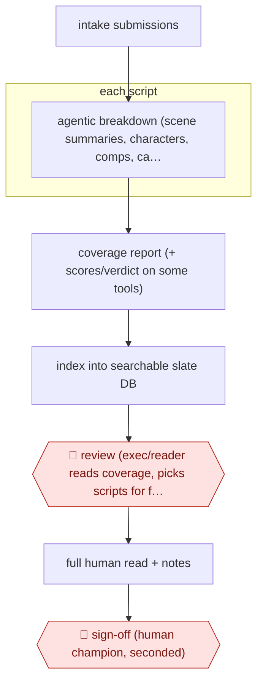

# AI-first script triage

`CRE › WRI › SCREEN` · checkpointed · evidence B · **draft: needs a reference example** ([how to add one](../../../../../CONTRIBUTING.md#1-add-an-example-run))

**Shape:** `intake submissions → each script: agentic breakdown (scene summaries, characters, comps, casting ideas) → coverage report (+ scores/verdict on some tools) → index into searchable slate DB → 🛑 review (exec/reader reads coverage, picks scripts for full read) → full human read + notes → 🛑 sign-off (human champion, seconded)`
**How it differs:** Nearest are AWF-0013 (Beat-to-scene screenplay) and AWF-0014 (Hook-cadence drama script). Both write scripts. This one reads other people's scripts and outputs coverage that feeds a human greenlight or read decision. The deliverable and the checkpoint (triage, not draft review) both differ.
**Variants:** `scriptsense` · `greenlight-coverage` · `screenplayiq`

<!-- shape diagram: generated by scripts/build_diagrams.py from `shape`; don't edit -->

<!-- end shape diagram -->

## Steps
1. Teams upload scripts, either the unread pile or a contest or submission pool [[1]](#sources)[[2]](#sources).
2. A multi-step agentic breakdown splits each script into plot, character and thematic components and produces coverage: scene summaries, character breakdowns, similar titles. Some tools add casting suggestions; others add 1–10 grades and a pass/consider/recommend verdict [[1]](#sources)[[2]](#sources).
3. Uploaded material is indexed so teams can search thousands of scripts by subgenre, setting, theme, character type or storyline against a content mandate [[1]](#sources).
4. 🛑 **Review**: an executive, agent or reader reads the coverage and decides where to focus a full read. ScriptSense deliberately makes no recommendation ('we're not going to make the decision for you') [[2]](#sources).
5. A human reads the full script and writes notes. In the Editors Guild test, AI notes were 'an almost total fail across the board', so notes stay human [[2]](#sources).
6. 🛑 **Sign-off**: at INTERDEPENDENT, a script first read by its in-house AI 'must be then be championed by a human, and seconded by another' before it advances [[3]](#sources).

**Output:** Coverage reports and a searchable slate. Shortlisted scripts go on to full human reads and development decisions.
**Failure modes → guards:** AI coverage is sycophantic and tends to 'recommend' weak scripts → don't trust verdicts; humans read the shortlist [2]. On complex scripts it misattributes action between characters and hallucinates plot points → check synopses against the script before quoting them [2]. Notes need analysis AI lacks → keep notes human [2].

## Public runs

Coverage as of 2026-11-13: **Weak**: only anonymous, vendor-linked or journalist-told accounts. Collected and re-checked in [Third collection pass](../../../../../research/2026-11-third-pass.md).

- [Variety, Hollywood Script Readers Fear They Could be Replaced by AI](https://variety.com/2025/film/news/hollywood-script-readers-replaced-by-ai-test-1236552756/) (2025-10-14). Indie producer uses AI coverage on his stack; WME agents use ScriptSense; Editors Guild test of six platforms. "He found the AI more honest than human feedback — even his own — while it doubled his reading pace.". *First-hand: interview; confidence: med.*
- [Anthropic, Jumpcut customer story](https://www.anthropic.com/customers/jumpcut) (undated). Multi-step script breakdown into coverage, used across studios, agencies and production companies. "35,000+ hours saved in script reading time"; "200+ companies using ScriptSense". *First-hand: vendor; confidence: low.*

## Sources

1. Anthropic customer story, Jumpcut helps Hollywood find the next big script with Claude (vendor). https://www.anthropic.com/customers/jumpcut
2. Gene Maddaus, Hollywood Script Readers Fear They Could be Replaced by AI. They Set Up a Test to See Who Gives Better Feedback, Variety, 2025-10-14. https://variety.com/2025/film/news/hollywood-script-readers-replaced-by-ai-test-1236552756/
3. INTERDEPENDENT Studio 1 call for entries (FilmFreeway rules page). https://filmfreeway.com/interdependent-studio-1
